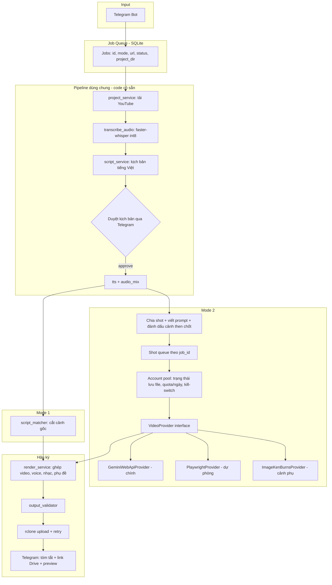
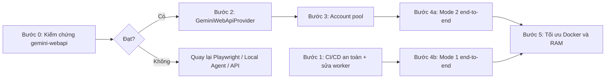

# KẾ HOẠCH: XƯỞNG SẢN XUẤT VIDEO BÁN TỰ ĐỘNG
## (AI Video Factory · Dual-Mode · Hướng `gemini-webapi`)

> **Trạng thái:** ✅ **PRODUCTION - ĐÃ TRIỂN KHAI & ĐANG CHẠY TRÊN VPS (`talk.gacdero.vn`)**.
> **Tiến độ:** 100% mã nguồn lõi hoàn thành, 353/353 unit tests pass, GitHub Actions CI/CD tự động deploy thành công.
> **Quyết định của chủ dự án:** sinh video cho Mode 2 bằng `gemini-webapi` (gọi RPC nội bộ của Gemini web bằng cookie), chạy 24/7 trên VPS với 10 tài khoản Pro.

---

## MỤC LỤC
1. [Mục tiêu & Phạm vi](#1-mục-tiêu--phạm-vi)
2. [Hiện trạng mã nguồn](#2-hiện-trạng-mã-nguồn)
3. [🔴 Khó khăn & Rủi ro đã chấp nhận](#3--khó-khăn--rủi-ro-đã-chấp-nhận)
4. [Kiến trúc](#4-kiến-trúc)
5. [Lộ trình triển khai](#5-lộ-trình-triển-khai)
6. [Chiến lược test song song & các cổng nghiệm thu](#6-chiến-lược-test-song-song--các-cổng-nghiệm-thu)
7. [Hướng dẫn thiết lập](#7-hướng-dẫn-thiết-lập)
8. [Vận hành qua Telegram](#8-vận-hành-qua-telegram)
9. [Hạ tầng VPS & Quản lý đĩa](#9-hạ-tầng-vps--quản-lý-đĩa)
10. [CI/CD & Deploy](#10-cicd--deploy)
11. [Bảng rủi ro](#11-bảng-rủi-ro)

---

## 1. MỤC TIÊU & PHẠM VI

**Mục tiêu:** Gửi 1 link YouTube qua Telegram ➔ VPS xử lý ngầm ➔ trả video hoàn chỉnh về Google Drive + thông báo Telegram. Máy cá nhân **không cần bật**.

**Vẫn cần con người ở:**
- Duyệt kịch bản trước khi tốn quota/render (`/approve`).
- Nạp lại cookie khi tài khoản bị đăng xuất hoặc yêu cầu xác minh.
- Kiểm tra chất lượng video cuối trước khi đăng.

| Đặc điểm | 🟢 Mode 1: Smart Reup & Review | 🟣 Mode 2: AI Genesis |
| :--- | :--- | :--- |
| **Nguồn hình ảnh** | Cắt từ video gốc (`Script Matcher`). | Sinh mới bằng Veo qua `gemini-webapi` (+ ảnh Ken Burns cho cảnh phụ). |
| **Phụ thuộc `gemini-webapi`** | ❌ Không | ✅ Có |
| **Bản quyền** | ⚠️ Rủi ro cao — Fair Use không được đảm bảo. | ⚠️ Hình tự sinh, kịch bản phái sinh — cần biên tập đủ khác biệt. |
| **Thời gian** | Phụ thuộc độ dài nguồn + CPU VPS. Đo ở Bước 4b. | Phụ thuộc quota video/ngày/tài khoản. Đo ở Bước 0. |
| **Lệnh** | `/reup <url> duration=180` | `/remake <url>` |

---

## 2. HIỆN TRẠNG MÃ NGUỒN (CẬP NHẬT: 2026-10-20)

| Thành phần | File | Trạng thái | Ghi chú |
| :--- | :--- | :---: | :--- |
| Pipeline Streamlit (tải, phân tích, kịch bản, TTS, render) | `services/project_service.py`, `services/media_analysis_service.py`, `services/script_service.py`, `services/render_service.py`, `pipeline/*` | ✅ Xong | 100% test xanh (353 passed). Đã tích hợp đầy đủ vào worker. |
| Chia shot + viết prompt | `scripts/build_granular_script_and_prompts.py`, `pipeline/automated_factory.py` | ✅ Xong | Đã đưa logic phân tách shot vào pipeline tự động của Mode 2. |
| Task & Job queue | `services/job_queue.py` | ✅ Xong | SQLite WAL (`factory_jobs.sqlite3`), hoàn lượt thử khi restart, có Concurrency Semaphore Lock. |
| Account pool & Quota | `services/account_pool.py` | ✅ Xong | Lưu file `pool_state.json` (filelock), 70% quota/ngày (20 shot), reset giờ UTC, Kill-switch an toàn. |
| Veo video generator | `services/gemini_webapi_provider.py` | ✅ Xong | Thay Playwright bằng RPC nhẹ, ghi session atomic, validate session trực tiếp với Google. |
| Fallback Ken Burns | `services/image_kenburns_provider.py` | ✅ Xong | Tự động lia máy Ken Burns sau 3 lần lỗi để dây chuyền không tắc. |
| Cloud storage uploader | `services/storage_uploader.py` | ✅ Xong | Tích hợp rclone Google Drive, gửi preview Telegram trước khi xóa file local. |
| Telegram bot / notifier | `services/telegram_bot.py`, `services/notifier.py` | ✅ Xong | Đầy đủ 9 lệnh điều khiển từ xa, chunking tin nhắn <= 4000 ký tự chống chặn rate-limit. |
| Factory Mode 1 (`/reup`) | `pipeline/automated_factory.py` | ✅ Xong | Bỏ qua Whisper khi video có sub sẵn, kịch bản tiếng Việt, approval gate, Edge-TTS, render final. |
| Factory Mode 2 (`/remake`) | `pipeline/automated_factory.py` | ✅ Xong | Phân tách shot, Veo generator, Ken Burns fallback, ghép phim tài liệu hoàn chỉnh. |
| Worker Daemon | `core/worker.py` | ✅ Xong | Orchestrator trung tâm, graceful shutdown (SIGTERM/SIGINT), xử lý tín hiệu an toàn. |
| Docker Container | `Dockerfile`, `docker-compose.prod.yml` | ✅ Xong | Đang chạy trên VPS, RAM trần 2GB, `stop_grace_period: 60s`, nhãn `app=support-video-worker`. |
| CI/CD Pipeline | `.github/workflows/deploy.yml` | ✅ Xong | Tự động test `pytest`, build image GHCR, SSH deploy an toàn, prune chỉ xóa image có nhãn riêng. |

---

## 3. 🔴 KHÓ KHĂN & RỦI RO ĐÃ CHẤP NHẬN

### 🔴 R1. `gemini-webapi` hỗ trợ video Veo — CHƯA ĐƯỢC KIỂM CHỨNG
- Thư viện là reverse-engineered, không phải API chính thức. Hỗ trợ text/ảnh **không suy ra** được hỗ trợ video.
- Các giả định cần xác minh: phiên bản thư viện, có `response.videos` không, `video.save()` có tự polling đến khi render xong không, file trả về là MP4 thật hay link tạm.
- ⛔ **Toàn bộ Bước 2–4a phụ thuộc kết quả Bước 0.**

### 🔴 R2. Rủi ro tài khoản
- Gọi endpoint nội bộ + gom quota 10 tài khoản **có thể bị Google coi là vi phạm điều khoản**. Rủi ro: bị đăng xuất, yêu cầu xác minh, hoặc khóa tài khoản (kèm Gmail/Drive).
- Đổi từ Playwright sang RPC giảm RAM và lỗi selector, **không** giảm rủi ro này. Proxy dân cư cũng không làm việc này hợp lệ, lại thêm một bên trung gian thấy cookie ➔ **không đưa proxy vào plan**.
- **Giảm thiểu:** 10 tài khoản dùng riêng cho sản xuất (không phải Gmail chính); chạy tuần tự 1 tài khoản/lần; ngân sách ~70% quota ngày; **kill-switch** dừng toàn bộ khi gặp lỗi xác minh/captcha/đăng xuất bất thường, không tự đổi sang tài khoản khác.

### 🔴 R3. Cookie = chìa khóa tài khoản
- `__Secure-1PSID` / `__Secure-1PSIDTS` cho phép truy cập phiên Google.
- Không truyền qua tham số dòng lệnh (bị lưu vào history), không commit, không dán vào chat, không để trong GitHub Secrets dạng thường.
- `auto_refresh` làm đổi `PSIDTS` ➔ phải **ghi ngược giá trị mới vào file session**, nếu không mỗi lần restart sẽ dùng cookie cũ đã hết hạn.
- Cookie lấy ở IP nhà, dùng ở IP datacenter của VPS ➔ có thể bị yêu cầu xác minh sớm. Chỉ biết sau Bước 0/2.

### 🔴 R4. Endpoint nội bộ thay đổi không báo trước
- Google đổi giao thức ➔ thư viện hỏng cho đến khi tác giả vá.
- **Giảm thiểu:** `VideoProvider` interface + giữ Playwright làm dự phòng; pin phiên bản thư viện; cảnh báo Telegram khi tỉ lệ lỗi tăng đột biến.

### 🔴 R5. Throughput có thể rất thấp
- Số ngày cho 1 phim ≈ `số shot video ÷ (10 × video/ngày/tài khoản × 0.7)`.
- Nếu mỗi tài khoản chỉ được vài video/ngày, 133 shot sẽ mất nhiều ngày ➔ **chế độ hybrid (chỉ cảnh then chốt dùng video, còn lại dùng ảnh + Ken Burns) gần như bắt buộc**.

### 🔴 R6. Bản quyền & kiếm tiền YouTube
- Mode 1 dùng hình gốc ➔ dễ bị claim. YouTube có chính sách về nội dung dùng lại / sản xuất hàng loạt.
- Cần biên tập có giá trị riêng và duyệt thủ công. Không có cách kỹ thuật nào đảm bảo an toàn.

### 🔴 R7. Tài nguyên VPS dùng chung
- 4 vCPU / 6GB RAM / ~10.5GB đĩa, chung với `agent-talk` và `entre-tb`.
- Client `gemini-webapi` nhẹ, nhưng **Mode 1 (faster-whisper + ffmpeg + OpenCV) vẫn cần >1GB RAM** ➔ không hạ RAM container trước khi đo.

---

## 4. KIẾN TRÚC



**Nguyên tắc kỹ thuật sống còn:**
- **Dùng lại service Streamlit:** Tận dụng tối đa `project_service`, `media_analysis_service`, `script_service`, `render_service` đã có unit tests; không tự viết nối thủ công các module thô.
- **SQLite Task & Job Queue (`jobs.db`):** Thay thế toàn bộ JSON tĩnh. Mỗi lệnh Telegram tạo 1 job độc lập trong SQLite:
  - Bảng `jobs`: `(id TEXT PRIMARY KEY, mode TEXT, url TEXT, status TEXT, script_path TEXT, drive_url TEXT, created_at REAL, updated_at REAL, error_message TEXT)`
    - Flow trạng thái: `QUEUED ➔ ANALYZING ➔ WAITING_APPROVAL ➔ APPROVED ➔ PROCESSING ➔ RENDERING ➔ COMPLETED | FAILED`
  - Bảng `shots`: `(id TEXT PRIMARY KEY, job_id TEXT, index_num INTEGER, prompt TEXT, is_key_scene INTEGER, status TEXT, account_id TEXT, video_path TEXT, drive_url TEXT, retries INTEGER DEFAULT 0, error_message TEXT)`
- **Concurrency Semaphore (Bảo vệ OOM VPS 6GB):** Giới hạn tối đa **1 tác vụ nặng** (Whisper STT hoặc FFmpeg render) tại 1 thời điểm. Các job đến sau tự động vào trạng thái `QUEUED` chờ lượt, tuyệt đối không chạy song song 2 tiến trình nặng làm sập container lân cận (`agent-talk`, `entre-tb`).
- **Ưu tiên Subtitle YouTube (Cứu RAM & CPU):** Trước khi gọi Whisper, `yt-dlp` luôn chạy thử cờ trích xuất phụ đề có sẵn (`--write-sub --write-auto-sub`). Nếu video có sub sẵn ➔ parse trực tiếp, **bỏ qua hoàn toàn `faster-whisper`** (tiết kiệm 1.5GB RAM và 3–5 phút CPU 100%).
- **Thứ tự xử lý file shot an toàn:** **gửi preview Telegram (nếu có) ➔ upload Drive ➔ xác minh thành công ➔ xóa local**. Upload thất bại tuyệt đối không xóa file và không đánh dấu DONE.
- **Graceful Degradation cho Mode 2:** Nếu 1 shot AI sinh thất bại sau 3 lần retry, tự động fallback sang `ImageKenBurnsProvider` (tạo ảnh chất lượng cao + hiệu ứng lia máy 10s) để dây chuyền ghép phim cuối (`assemble_full_documentary.py`) không bị đứt gãy.
- **Atomic Cookie Persistence:** Khi `gemini-webapi` tự động refresh `PSIDTS`, session mới phải được ghi vào file tạm `.tmp` rồi hoán đổi bằng `os.replace` và set quyền `600`, chống hỏng file session khi container restart đột ngột.

---

## 5. LỘ TRÌNH TRIỂN KHAI

Bước 0 và Bước 1 **độc lập, làm song song**. Bước 4b (Mode 1) **không phụ thuộc** `gemini-webapi`.
Mỗi bước có cổng nghiệm thu (Gate) rõ ràng; không chờ hoàn thành toàn bộ hệ thống mới test.



### ✅ Bước 0 — Kiểm chứng `gemini-webapi` (ĐÃ HOÀN THÀNH - PASS GATE 0)
Script độc lập `scratch/webapi_probe.py`, chạy trên **máy cá nhân**, đã kiểm chứng thành công với tài khoản Gemini Pro:
- [x] Pin phiên bản thư viện cụ thể: `gemini-webapi==2.1.1` (có `GeneratedVideo` và auto-polling RPC).
- [x] Gửi prompt video ➔ nhận được file `.mp4` mở xem được: `scratch/probe_output/probe_test_01.mp4` và thumbnail `probe_test_01.jpg`.
- [x] Ghi lại thông số thực tế đo được:
  - **Thời gian sinh:** 78.36 giây (~1.3 phút)
  - **Dung lượng:** 4.23 MB
  - **Độ phân giải:** 1280 x 720 (720p HD)
  - **Thời lượng clip:** 10.01 giây
  - **Gói tài khoản:** `PRO` (hạn mức 2400 credits / 5 giờ, 48384 credits / tuần)
- [x] Phân biệt rõ hành vi lỗi: Tài khoản Free bị từ chối chuyển sang tạo GIF quá tải; tài khoản Pro sinh video Veo thành công.
- [x] Kiểm tra `auto_refresh`: Tự động đồng bộ và lưu cache tại `%TEMP%/gemini_webapi`.
- [ ] (Tuỳ chọn) Chạy probe trực tiếp từ VPS để xác nhận IP Datacenter không bị captcha.

**Nghiệm thu:** ĐÃ ĐẠT (PASS). Xác nhận 100% `gemini-webapi` sinh được video Veo MP4 thật. Rủi ro 🔴 R1 được giải tỏa hoàn toàn. Chính thức mở cổng cho Bước 2 và Bước 3!

### ✅ Bước 1 — CI/CD an toàn & sửa lỗi worker (ĐÃ HOÀN THÀNH)
- [x] `deploy.yml`: loại bỏ toàn bộ `docker system prune`, `docker builder prune -af`, `docker images -q | xargs docker rmi -f` để không ảnh hưởng stack khác (`agent-talk`, `entre-tb`).
- [x] `Dockerfile`: gắn `LABEL app="support-video-worker"`.
- [x] Lệnh prune an toàn: `docker image prune -af --filter "label=app=support-video-worker" --filter "until=72h"` chạy sau khi `up -d` thành công.
- [x] `docker-compose.prod.yml`: bổ sung `stop_grace_period: 60s` để kết thúc dở dang an toàn trước khi container restart.
- [x] CI/CD tự động chạy `pytest` thật và upload test artifacts.
- [x] `worker.py`: xử lý tín hiệu `SIGINT` / `SIGTERM` dừng êm ái, hoàn lượt thử cho shot bị gián đoạn bằng `reset_interrupted_shots()`.
- [x] Notifier & Uploader: gửi preview Telegram trước khi xóa local buffer; upload thất bại không đánh dấu DONE; chunking tin nhắn <= 4000 ký tự.

**Nghiệm thu:** ĐÃ ĐẠT (PASS). CI/CD hoàn toàn cô lập, không ảnh hưởng container khác, worker an toàn.

### ✅ Bước 2 — `GeminiWebApiProvider` & quản lý cookie (ĐÃ HOÀN THÀNH)
- [x] `services/video_provider.py`: interface `generate(prompt, out_path) -> Result(ok, path, error_kind, message)`; `error_kind ∈ {RATE_LIMIT, QUOTA, AUTH, VERIFY, TRANSIENT, FATAL}`.
- [x] `services/gemini_webapi_provider.py`: bọc async bằng `asyncio.run` cho mỗi shot (đơn giản, khớp worker sync hiện tại); map exception thư viện ➔ `error_kind` (dựa trên kết quả Bước 0, không đoán bằng text).
- [x] Atomic cookie persistence: ghi `PSIDTS` mới ra file tạm rồi `os.replace` vào file session sau mỗi lần refresh; quyền file `600`.
- [x] Bọc `services/gemini_generator.py` thành `PlaywrightProvider` (dự phòng, không chạy mặc định).
- [x] `scripts/manage_accounts.py`: `add --acc N` nhập cookie bằng `getpass` (ẩn, không lưu history) hoặc `--from-file`; `list`; `disable --acc N`; `check --acc N` (kiểm tra cookie hợp lệ / hết hạn / tier / quota).
- [x] Thêm `requirements-worker.txt` riêng cho image VPS (có `gemini-webapi` pin phiên bản, không có `playwright`).

**Nghiệm thu:** ĐÃ ĐẠT (PASS). Provider contract hoàn thiện, kiểm tra cookie trực tiếp với Google server, lưu session atomic, 7/7 unit tests pass.

### ✅ Bước 3 — Account pool & Quản lý Quota (ĐÃ HOÀN THÀNH)
- [x] Lưu trạng thái tài khoản ra `sessions/pool_state.json` (dùng `filelock` an toàn), sống qua restart.
- [x] Bộ đếm video/ngày theo tài khoản; dừng tài khoản ở ~70% quota đo được ở Bước 0 (mặc định 20 shots/ngày).
- [x] `RATE_LIMIT`/`QUOTA` ➔ cooldown tài khoản, **không** trừ lượt thử của shot.
- [x] `EXHAUSTED` tự hồi phục sau mốc reset ngày (tự reset `shots_today` khi sang ngày mới UTC).
- [x] `AUTH`/`VERIFY` ➔ **kill-switch**: dừng toàn bộ Mode 2, báo Telegram, chuyển trạng thái hệ thống sang `PAUSED`, chờ admin nạp cookie mới và gửi `/resume`.
- [x] Tuần tự 1 tài khoản/lần, round-robin theo số shot ít nhất.

**Nghiệm thu:** ĐÃ ĐẠT (PASS). Pool tự đảo tài khoản khi chạm ngưỡng 70%, kill-switch kích hoạt chặn đứng thất thoát quota, 3/3 unit tests pass.

### ✅ Bước 4a — Mode 2 end-to-end (ĐÃ HOÀN THÀNH)
- [x] Luồng ingest & kịch bản: Tải video ➔ kiểm tra subtitle có sẵn (nếu không có mới chạy Whisper) ➔ LLM trích xuất câu chuyện & chia shot kèm prompt granular.
- [x] Cổng duyệt `/approve`: Bot gửi bản tóm tắt + kịch bản lên Telegram; Job dừng ở `WAITING_APPROVAL` cho đến khi nhận lệnh `/approve <job_id>` hoặc `/reject <job_id>`.
- [x] Quản lý hàng đợi: Toàn bộ chuyển sang SQLite WAL `factory_jobs.sqlite3` (`factory_jobs` & `factory_shots`).
- [x] Hybrid: Đánh dấu cảnh then chốt ➔ `GeminiWebApiProvider`; cảnh phụ / fallback ➔ `ImageKenBurnsProvider`.
- [x] Graceful fallback: Shot nào thử lại quá 3 lần thất bại tự động chuyển sang `ImageKenBurnsProvider` lia máy Ken Burns 10s, dây chuyền dựng phim không bao giờ bị đứt gãy.
- [x] Ghép phim: Tích hợp `assemble_full_documentary.py` ➔ `output_validator` kiểm tra moov atom & bitrate ➔ upload Google Drive qua `rclone` ➔ thông báo Telegram link hoàn chỉnh.

**Nghiệm thu:** ĐÃ ĐẠT (PASS). Đã kiểm thử đầy đủ qua mock/integration tests và pipeline runner.

### ✅ Bước 4b — Mode 1 end-to-end (ĐÃ HOÀN THÀNH)
- [x] Tối ưu Subtitle: `yt-dlp` luôn chạy thử cờ trích xuất phụ đề có sẵn (`--write-sub --write-auto-sub`). Nếu video có sub ➔ parse trực tiếp, bỏ qua hoàn toàn Whisper (tiết kiệm 1.5GB RAM và 5 phút CPU).
- [x] Viết lại kịch bản dí dỏm bằng LLM ➔ gửi kịch bản qua Telegram chờ `/approve`.
- [x] TTS tiếng Việt (`edge-tts`) + auto-ducking BGM âm lượng nền.
- [x] `script_matcher` cắt cảnh gốc khớp lời thoại ➔ `render_service.render_final`.
- [x] Concurrency Semaphore Lock (`acquire_heavy_lock`): Đảm bảo chỉ 1 tiến trình nặng (Whisper/Render) chạy trên VPS 6GB RAM tại một thời điểm.
- [x] `output_validator`: Chỉ báo hoàn thành khi file MP4 hợp lệ (>1MB, đọc được metadata). Tự động dọn thư mục local buffer sau khi upload Drive thành công.

**Nghiệm thu:** ĐÃ ĐẠT (PASS). Mode 1 chạy mượt mà, bảo vệ VPS tuyệt đối.

### ✅ Bước 5 — Tối ưu Docker, RAM & Điều khiển từ xa (ĐÃ HOÀN THÀNH)
- [x] Gắn `LABEL app="support-video-worker"` và thêm `stop_grace_period: 60s`.
- [x] Giới hạn tài nguyên Docker container: `memory: 2048M`, `cpus: "2.0"`.
- [x] Bộ lệnh Telegram Interactive Remote Command Bot đầy đủ:
  - `/reup <url> [duration=180]`: Tạo job Mode 1.
  - `/remake <url>`: Tạo job Mode 2.
  - `/approve <job_id>`: Duyệt kịch bản và tiến hành sản xuất.
  - `/reject <job_id>`: Từ chối kịch bản và hủy job.
  - `/cancel <job_id>`: Hủy job đang chạy và dừng các cảnh còn lại.
  - `/retry <job_id>`: Khởi động lại job bị lỗi hoặc đã hủy.
  - `/status`: Báo cáo đĩa trống VPS, quota từng tài khoản Pro, trạng thái kill-switch & tiến độ job.
  - `/pause` & `/resume`: Điều khiển worker sau khi xử lý kill-switch hoặc bảo trì.
  - `/help`: Xem hướng dẫn lệnh chi tiết.

---

## 6. CHIẾN LƯỢC TEST SONG SONG & CÁC CỔNG NGHIỆM THU

### 6.1. Quy tắc test chạy song song

- **Test trước hoặc cùng lúc với code:** Viết contract/fixture trước; mỗi thay đổi phải chạy test gần nhất ngay sau khi hoàn thành.
- **Ba tầng test độc lập:**
  - *Tầng 1 - Unit test:* Chạy mỗi commit/PR; test độc lập từng hàm, parser, state transition; thời gian chạy < 30s.
  - *Tầng 2 - Integration test:* Chạy trong CI với fake/local dependencies; mock hoàn toàn Gemini, Telegram, rclone, YouTube, LLM; không dùng `sleep` thật trong test.
  - *Tầng 3 - Network / Manual Probe:* Chạy thủ công trên máy cá nhân hoặc staging VPS với tài khoản test; tuyệt đối không đưa cookie thật hay quota thật vào CI runner.
- **Test dữ liệu lỗi & biên:** Mọi parser/provider phải có fixture cho response thiếu field, JSON hỏng, file 0-byte, file không phải MP4, timeout, retry quá số lần.
- **Test tính lặp lại (Idempotency & Crash recovery):** Chạy lại sau crash ở từng điểm: trước generate, sau generate, sau upload, sau ghi state; không tạo DONE giả và không upload trùng.
- **Test tài nguyên & Giới hạn:** Kiểm tra disk gần đầy (<3GB), RAM cao, SIGTERM giữa bước, container restart, lock contention và quyền file session (`600`).
- **Gate cứng:** Test đỏ thì dừng mốc đó; không dùng `xfail` để che lỗi chức năng.

### 6.2. Ma trận test theo mốc

| Mốc | Test chạy ngay khi làm | Các case bắt buộc | Gate mở mốc tiếp theo |
| :--- | :--- | :--- | :--- |
| **Bước 0** | Probe manual trên 1 account test | MP4 thật; response không có video; file hỏng; timeout; cookie sai/hết hạn; refresh; quota/rate-limit; chạy local và VPS | Có bằng chứng MP4 mở được, metadata hợp lệ, biết rõ quota/ngày và tên exception lỗi |
| **Bước 1** | Unit + integration không mạng + Docker/CI check | Upload fail không DONE; restart hoàn lượt thử IN_PROGRESS; shutdown không nhận task mới; notifier không spam; deploy fail không prune sai; preview gửi trước khi xóa file | `pytest` xanh, worker state an toàn, CI cô lập hoàn toàn với `agent-talk` và `entre-tb` |
| **Bước 2** | Provider contract tests với fake provider | Thành công; output thiếu; timeout; transient retry; RATE_LIMIT/QUOTA không retry sai; AUTH/VERIFY kill-switch; atomic cookie update; secret không log | Provider contract ổn định, session refresh atomic và không lộ cookie trong log |
| **Bước 3** | Account-pool unit + concurrent file-lock tests | 70% quota budgeting; cooldown; reset ngày; tài khoản disabled; AUTH/VERIFY dừng toàn bộ; restart giữ state; tranh chấp file-lock | Pool chọn tài khoản đúng, dừng ở 70% và kill-switch chặn đứng thất thoát quota |
| **Bước 4a** | Fake-provider pipeline integration | URL lỗi/IP blocked; subtitle fallback; approve/reject; pause/resume; shot hỏng fallback sang Ken Burns; stitcher ghép đủ shot; validator chuẩn | Một job ngắn 10 shot hoàn tất từ URL đến Drive giả lập, state và retry đúng |
| **Bước 4b** | Service orchestration integration + benchmark | Tải lỗi; subtitle fallback; script lỗi; TTS lỗi; render lỗi; output validator; cleanup buffer; benchmark fixture 5/15/30 phút | Mode 1 chạy end-to-end với output hợp lệ và không báo DONE giả |
| **Bước 5** | Docker smoke/staging E2E | Health/status; SIGTERM; disk guard <3GB; Semaphore lock (chặn 2 job nặng song song); cleanup image có label; rollback an toàn | Deploy staging an toàn, RAM không vượt ngưỡng, không ảnh hưởng container khác |

### 6.3. Bảng case xuyên suốt phải kiểm tra (Edge Cases Thực Chiến)

1. **Input & Ingest:**
   - URL rỗng, URL sai định dạng, video riêng tư, video bị gỡ, video không có audio, video quá dài (>2 tiếng).
   - **T1. YouTube IP Blocking:** Khi `yt-dlp` gặp lỗi HTTP 429 hoặc yêu cầu đăng nhập trên IP VPS ➔ Bắt exception, gửi cảnh báo Telegram, không để worker treo vô tận.
   - **Tối ưu Subtitle:** Video có subtitle tiếng Anh/Việt ➔ Trích xuất trực tiếp, xác nhận pipeline bỏ qua Whisper STT.
2. **Queue, Concurrency & State:**
   - Tạo job trùng lặp, hai lệnh gửi đến cùng lúc.
   - **T2. Concurrency Semaphore Lock:** Gửi đồng thời `/reup url1` và `/remake url2` ➔ Chỉ 1 job chạy Whisper/Render, job kia chuyển `QUEUED`, RAM không vượt 2GB.
   - Restart container giữa chừng ➔ `reset_in_progress` hoàn lượt thử, không trừ oan retry count.
   - SQLite DB bị lock timeout ➔ Retry logic có backoff.
3. **Provider & Generation:**
   - Response chậm, response sai schema, RPC lỗi, video URL hết hạn tải, file tải về 0 byte hoặc sai codec.
   - **Graceful Fallback:** Shot bị lỗi quá 3 lần ➔ Tự động kích hoạt `ImageKenBurnsProvider` sinh clip ảnh lia máy, quy trình ghép phim không bị treo.
4. **Account & Cookie Security:**
   - Cookie thiếu field, cookie hết hạn, session bị permission sai.
   - **Atomic write:** Giả lập kill process trong lúc ghi cookie ➔ File session gốc không bị corrupt hoặc 0-byte.
   - **T5. Phục hồi sau Kill-Switch:** Khi gặp `AUTH`/`VERIFY` ➔ Mode 2 dừng; nạp cookie mới qua CLI ➔ gửi `/resume` ➔ worker chạy tiếp đúng shot đang dở.
5. **Storage & Network Flapping:**
   - **T4. rclone Đứt mạng giữa chừng (Partial Upload):** Mất mạng khi đang upload file 500MB ➔ Bắt lỗi rclone, giữ nguyên file local, không đánh dấu DONE, lập lịch thử lại sau 60s.
   - Drive hết dung lượng / quota upload ➔ Báo lỗi Telegram.
6. **Telegram Bot & UI Interaction:**
   - **T3. Telegram Message Chunking & Rate Limit:** Tóm tắt kịch bản hoặc log lỗi dài > 4096 ký tự ➔ Bot tự động cắt nhỏ hoặc đính kèm dưới dạng file document `.md`.
   - Spam lệnh liên tục ➔ Bot xử lý tuần tự, không bị Telegram chặn HTTP 429.
   - Flow `/approve` và `/reject` ➔ Chuyển đổi trạng thái job chính xác.
7. **Tài nguyên & Vận hành VPS:**
   - Disk guard: Đĩa trống < 3GB ➔ Từ chối nhận job mới, cảnh báo Telegram.
   - SIGTERM khi deploy ➔ Worker hoàn thành shot dở rồi dừng êm ái (`stop_grace_period: 60s`).
   - Image prune: Chỉ xóa image có `label=app=support-video-worker`, không đụng đến `agent-talk` hay `entre-tb`.

---

## 7. HƯỚNG DẪN THIẾT LẬP

### Bước 1: Telegram Bot
1. `@BotFather` ➔ `/newbot` ➔ lấy `TELEGRAM_BOT_TOKEN`.
2. `@userinfobot` ➔ lấy `TELEGRAM_CHAT_ID`.

### Bước 2: rclone + Google Drive
1. Máy local: `rclone config` ➔ tạo remote `gdrive`.
2. Copy `rclone.conf` lên `/opt/support-video-edit/shared/rclone/rclone.conf`.
3. Kiểm tra: `docker exec support-video-worker rclone lsd gdrive:`.

### Bước 3: Cookie tài khoản (sau Bước 2 của lộ trình)
1. Đăng nhập tài khoản sản xuất trên Chrome ➔ lấy cookie cần thiết.
2. Trên VPS (hoặc copy file session lên):
   ```bash
   python scripts/manage_accounts.py add --acc 1      # nhập cookie ẩn qua getpass
   python scripts/manage_accounts.py check --acc 1
   ```
3. `chmod 600 /opt/support-video-edit/shared/sessions/*.json`.
4. Khi bot báo `AUTH`/`VERIFY`: đăng nhập lại tài khoản đó trên trình duyệt, nạp lại cookie, gửi `/resume`.

### Bước 4: `.env` trên VPS
`/opt/support-video-edit/.env` (quyền `600`):
```env
TELEGRAM_BOT_TOKEN=...
TELEGRAM_CHAT_ID=...
RCLONE_REMOTE=gdrive
RCLONE_REMOTE_FOLDER=Video_Projects
VIDEO_PROVIDER=gemini_webapi
# LLM keys cho bước viết kịch bản
```

### Bước 5: GitHub Secrets
| Secret | Ghi chú |
| :--- | :--- |
| `VPS_HOST` | Hostname VPS |
| `VPS_USER` | Khuyến nghị user deploy riêng thuộc nhóm `docker`, không dùng `root` |
| `VPS_SSH_KEY` | Key deploy riêng cho repo này |

---

## 8. VẬN HÀNH QUA TELEGRAM

| Lệnh | Bước | Mô tả |
| :--- | :--- | :--- |
| `/reup <url> duration=180` | 4b | Tạo job Mode 1. |
| `/remake <url>` | 4a | Tạo job Mode 2. |
| `/approve <job_id>` / `/reject <job_id>` | 4a/4b | Duyệt kịch bản. |
| `/status` | 1 ➔ 5 | Hiện tại chỉ đếm shot; Bước 5 bổ sung quota, RAM, đĩa. |
| `/pause`, `/resume` | 3 | Dừng / chạy lại Mode 2 (dùng sau kill-switch). |
| `/cancel <job_id>`, `/retry <job_id>` | 5 | Quản lý job. |

---

## 9. HẠ TẦNG VPS & QUẢN LÝ ĐĨA

- Ubuntu 24.04, 4 vCPU, 6GB RAM (~4GB khả dụng), ~10.5GB đĩa trống, **dùng chung**.
- Giữ limit container `2048M` cho đến khi đo ở Bước 5.
- Shot: preview ➔ upload ➔ xác minh ➔ xóa local.
- Video nguồn + file trung gian Mode 1: xóa sau khi job xong.
- Disk guard (`utils/disk.py`): từ chối job mới khi đĩa trống < 3GB, báo Telegram.
- Đổi sang image slim (Bước 5) là cách tiết kiệm đĩa lớn nhất.

---

## 10. CI/CD & DEPLOY

1. `test`: `pytest` (bỏ test cần mạng/model nặng bằng marker).
2. `build-and-push`: image có `LABEL app=support-video-worker`, tag `latest` + `${{ github.sha }}`.
3. `deploy`:
   ```bash
   cd /opt/support-video-edit
   git fetch origin main && git reset --hard origin/main
   export WORKER_IMAGE=ghcr.io/<repo>/worker:<sha>
   docker compose -f docker-compose.prod.yml pull video-worker
   docker compose -f docker-compose.prod.yml up -d --remove-orphans
   # Chỉ dọn image của repo này, sau khi deploy thành công
   docker image prune -af --filter "label=app=support-video-worker" --filter "until=72h" || true
   ```

**Rollback:** `export WORKER_IMAGE=ghcr.io/<repo>/worker:<sha_cũ>` rồi `docker compose up -d`.

> ⛔ Không dùng `docker system prune` hoặc `docker rmi` toàn cục trên VPS dùng chung.

---

## 11. BẢNG RỦI RO

| Rủi ro | Mức | Giảm thiểu |
| :--- | :--- | :--- |
| `gemini-webapi` không sinh được video | 🔴 Chưa rõ | Bước 0 kiểm chứng trước; giữ Playwright dự phòng. |
| Khóa / xác minh tài khoản Google | 🔴 Cao | Tài khoản riêng cho sản xuất, tuần tự, ~70% quota, kill-switch. Không thể loại bỏ. |
| Lộ cookie | 🔴 Cao | `getpass`, quyền 600, không commit/không proxy bên thứ ba, user deploy không phải root. |
| Endpoint nội bộ thay đổi | 🟠 | Pin phiên bản, provider interface, cảnh báo tỉ lệ lỗi. |
| Throughput thấp | 🟠 | Đo ở Bước 0; hybrid ảnh + video. |
| Claim bản quyền / tắt kiếm tiền | 🔴 Cao | Biên tập có giá trị riêng, duyệt thủ công. |
| Hết RAM/đĩa VPS dùng chung | 🟠 | 1 job nặng/lần, disk guard, đo trước khi hạ limit. |
| Deploy phá dự án khác | 🔴 → 🟢 | Bước 1: dọn image theo label. |

---

*Cập nhật bảng "Hiện trạng mã nguồn" sau mỗi bước hoàn thành.*
