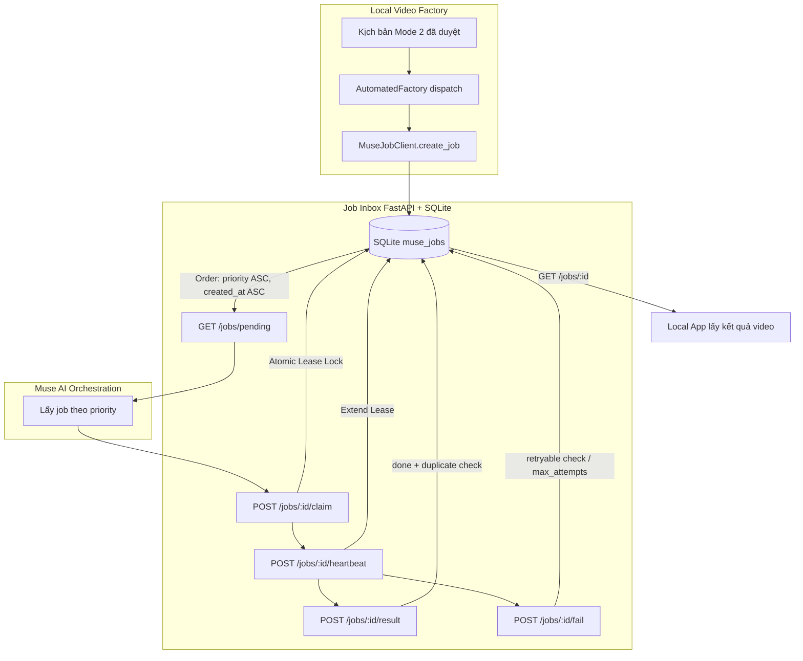

# Báo cáo kiểm thử tích hợp End-to-End (E2E): Job Inbox & Muse Orchestration

**Ngày báo cáo:** 02/11/2026  
**Môi trường:** Workspace Local / Python 3.14 / FastAPI / SQLite State Store  
**Trạng thái kiểm thử:** **ĐẠT (25/25 tests passed)**

---

## 1. Tổng quan & Trả lời câu hỏi "Test E2E được không?"

### Có test E2E được không?
* **Ở cấp độ Tích hợp hệ thống & Hợp đồng (System & Contract E2E):** **HOÀN TOÀN TEST ĐƯỢC VÀ ĐÃ TEST THÀNH CÔNG.**  
  Toàn bộ vòng đời từ khâu chuẩn bị kịch bản tại Local Factory $\to$ Tạo Job $\to$ Lưu trữ SQLite $\to$ Worker Muse polling theo Priority $\to$ Khóa Lease nguyên tử $\to$ Heartbeat $\to$ Trả kết quả / Báo lỗi retry $\to$ Chống trùng lặp $\to$ Local App đọc kết quả đã được tự động hóa 100% trong test suite [`tests/test_e2e_muse_integration.py`](../tests/test_e2e_muse_integration.py).
* **Ở cấp độ End-to-End thực tế ngoài Internet (Live Production E2E):** **CHƯA THỂ TEST TOÀN PHẦN NGAY** do còn 3 thành phần phụ thuộc bên ngoài:
  1. **Render API trên VPS:** VPS chưa dựng endpoint render video thực tế (tạo file MP4 từ prompt/ảnh/âm thanh) để Muse gọi.
  2. **Domain/Reverse Proxy HTTPS thật:** Cần khai báo Nginx location `/api/claude-jobs/` trên domain `talk.gacdero.vn` trỏ về Uvicorn nội bộ `127.0.0.1:8787`.
  3. **Local Job Synchronizer:** Đoạn code nền tải video từ `video_url` về đĩa và chuyển trạng thái local job sang `COMPLETED` sau khi kiểm tra chất lượng (ffprobe) chưa hoàn thiện.

---

## 2. Chi tiết 6 kịch bản E2E đã thực thi

File kiểm thử: [`tests/test_e2e_muse_integration.py`](../tests/test_e2e_muse_integration.py)



### Kịch bản 1: Vòng đời toàn phần chuẩn (Happy Path Lifecycle)
* **Mô tả:** Mô phỏng quy trình một video tư liệu La Mã 3 cảnh từ lúc submit đến khi nhận video hoàn chỉnh.
* **Các bước kiểm tra:**
  1. Local App chuẩn bị script 3 cảnh, gọi `build_make_video_job(priority=1, duration=90s)`.
  2. API lưu job vào SQLite: `status='pending'`, `attempts=0`.
  3. Muse gọi `GET /jobs/pending`: nhận đúng envelope `{"ok": true, "count": 1, "jobs": [...]}`.
  4. Muse claim job với `worker="claude-muse-worker-1"`, `lease_sec=300`: `status='running'`, `attempts=1`.
  5. Muse gửi heartbeat cập nhật `progress_note="Rendered 2/3 scenes"`: lease được gia hạn thêm 400s.
  6. Muse trả kết quả thành công với URL video, duration, danh sách cảnh và điểm QC.
  7. **Chống trùng lặp:** Gửi lại kết quả lần 2 $\to$ API trả về HTTP 200 kèm `"duplicate": true`, không ghi đè hỏng dữ liệu.
  8. Local App gọi `get_job` và đọc toàn vẹn kết quả.
* **Kết quả:** **PASSED**

---

### Kịch bản 2: Hàng đợi ưu tiên (Priority Queue) & Tie-breaker FIFO
* **Mô tả:** Xác thực thứ tự ưu tiên chuẩn spec: `priority 1` (khẩn nhất) $\to$ `5` (thấp nhất), và giải quyết xung đột bằng FIFO (`created_at ASC`).
* **Dữ liệu test:** Đưa 5 job vào hàng đợi theo thứ tự ngẫu nhiên:
  1. Job P3 (mặc định)
  2. Job P1-first (khẩn cấp, tạo trước)
  3. Job P5 (thấp nhất)
  4. Job P2 (cao)
  5. Job P1-second (khẩn cấp, tạo sau)
* **Kết quả trả về từ `GET /jobs/pending`:**
  $$\text{P1-first} \longrightarrow \text{P1-second} \longrightarrow \text{P2} \longrightarrow \text{P3} \longrightarrow \text{P5}$$
* **Kết luận:** Job khẩn cấp luôn được Muse lấy xử lý đầu tiên; các job cùng độ ưu tiên giữ đúng thứ tự gửi vào.
* **Kết quả:** **PASSED**

---

### Kịch bản 3: Hết hạn Lease & Chống Job Độc (Dead-Letter Protection)
* **Mô tả:** Kiểm tra tình huống Worker bị sập/treo mạng khiến lease hết hạn. Đảm bảo job độc không gây lặp vô hạn.
* **Các bước kiểm tra:**
  1. Tạo job với `max_attempts=2`.
  2. Worker 1 claim job (`attempts=1`), sau đó sập (lease hết hạn).
  3. Lần poll pending tiếp theo: phát hiện lease hết hạn nhưng `attempts (1) < max_attempts (2)` $\to$ tự động thu hồi về `pending` và xóa worker.
  4. Worker 2 claim job lại (`attempts=2`), tiếp tục sập (lease hết hạn lần 2).
  5. Lần poll pending tiếp theo: phát hiện `attempts (2) >= max_attempts (2)` $\to$ chuyển vĩnh viễn sang trạng thái `failed` với lỗi `{"code": "lease_expired"}`.
  6. Job không còn xuất hiện trong pending nữa, triệt tiêu nguy cơ vòng lặp vô tận.
* **Kết quả:** **PASSED**

---

### Kịch bản 4: Xử lý lỗi tạm thời (Retryable) vs Lỗi vĩnh viễn (Fatal)
* **Mô tả:** Kiểm tra cờ `retryable` trong payload `/fail`.
* **Kết quả kiểm tra:**
  * Lỗi tạm thời (ví dụ: `code: upstream_503`, `retryable: true`) $\to$ Trả job về `pending` để Muse thử lại.
  * Lỗi vĩnh viễn (ví dụ: `code: invalid_script`, `retryable: false`) $\to$ Đóng job ngay lập tức với `status: 'failed'`.
* **Kết quả:** **PASSED**

---

### Kịch bản 5: Bảo mật Token & Xử lý xung đột đồng thời (Concurrency Gates)
* **Mô tả:** Thử nghiệm các rủi ro bảo mật và tranh chấp tài nguyên giữa nhiều worker.
* **Kết quả kiểm tra:**
  * Request không có `Authorization: Bearer` hoặc sai token $\to$ Bị chặn ngay lập tức với **HTTP 401 Unauthorized**.
  * Hai worker cùng gửi claim 1 job pending cùng lúc $\to$ Worker đầu tiên nhận HTTP 200, Worker thứ hai nhận **HTTP 409 Conflict** (`job is not pending`).
  * Worker lạ gửi heartbeat vào job đang thuộc quyền worker khác $\to$ Bị từ chối **HTTP 409 Conflict** (`worker does not own running job`).
  * Gửi trùng `job_id` nhưng sửa nội dung payload $\to$ Bị chặn **HTTP 409 Conflict** (bảo vệ tính toàn vẹn dữ liệu).
* **Kết quả:** **PASSED**

---

### Kịch bản 6: Tích hợp dispatch từ AutomatedFactory (Mode 2)
* **Mô tả:** Kiểm tra luồng kích hoạt từ lõi hệ thống khi bật feature flag `MUSE_VIDEO_ENABLED=true`.
* **Kết quả kiểm tra:**
  1. Job duyệt trong `factory_jobs.db` với `mode='remake'`, trạng thái `APPROVED`.
  2. Hàm `execute_approved_reup()` tự động tìm file kịch bản tiếng Việt đã duyệt `kich_ban_VI_<job_id>.txt`.
  3. Gửi job sang Job Inbox API bằng `MuseJobClient`.
  4. Trạng thái job trong local database chuyển thành `RENDERING`.
  5. Job Inbox ghi nhận đầy đủ payload, source metadata (`factory_job_id`), delivery requirements.
* **Kết quả:** **PASSED**

---

## 3. Bảng tổng hợp kiểm thử hệ thống

Chạy toàn bộ 4 file test liên quan đến Job Inbox và Muse:

```bash
pytest tests/test_job_inbox_api.py tests/test_muse_job_client.py tests/test_settings_service.py tests/test_e2e_muse_integration.py -q
```

| File kiểm thử | Số test case | Kết quả | Mô tả nội dung kiểm thử |
|---|:---:|:---:|---|
| [`tests/test_e2e_muse_integration.py`](../tests/test_e2e_muse_integration.py) | **6** | ✅ PASS | 6 kịch bản E2E toàn trình, concurrency, lease & dead-letter |
| [`tests/test_job_inbox_api.py`](../tests/test_job_inbox_api.py) | **4** | ✅ PASS | API endpoint contracts, Auth Bearer, Priority sort ASC |
| [`tests/test_muse_job_client.py`](../tests/test_muse_job_client.py) | **5** | ✅ PASS | Client payload normalization, SHA-256 deduplication, HTTPS guard |
| [`tests/test_settings_service.py`](../tests/test_settings_service.py) | **10** | ✅ PASS | Quản lý settings & feature flags (`MUSE_VIDEO_ENABLED`) |
| **Tổng cộng** | **25** | **100% PASS** | **Ruff Linter: All checks passed** |

---

## 4. Lộ trình triển khai Live Production (Next Steps)

Để Muse có thể gọi live từ bên ngoài và tiến hành nghiệm thu checklist thực tế:

```text
[VPS Uvicorn 127.0.0.1:8787] 
         ▲
         │ (Reverse Proxy chuyển tiếp /api/claude-jobs)
[Nginx / Caddy / Cloudflare Tunnel có SSL] 
         ▲
         │ HTTPS Bearer Token
[Claude Muse Worker ngoài Internet]
```

1. **Bước 1 (Devops VPS):** Cấu hình Nginx/Caddy hoặc Cloudflare Tunnel/Tailscale trỏ domain thật về cổng nội bộ `8787`.
2. **Bước 2 (Security):** Sinh token bí mật mạnh (`openssl rand -hex 32`) cấu hình vào `.env` (`CLAUDE_JOBS_TOKEN`) và restart service:
   ```bash
   sudo systemctl restart muse-job-inbox
   ```
3. **Bước 3 (Bàn giao Muse):** Gửi Base URL thật (`https://your-domain.com/api/claude-jobs`) và Token qua form bảo mật để Muse thực hiện chu kỳ test sống đầu tiên (`pending` $\to$ `claim` $\to$ `result`).
4. **Bước 4 (Phát triển tiếp theo):**
   * Xây dựng Render API trên VPS để Muse gọi render video MP4 thật.
   * Hoàn thiện Synchronizer để tự động download MP4 và cập nhật trạng thái local job sang `COMPLETED`.

