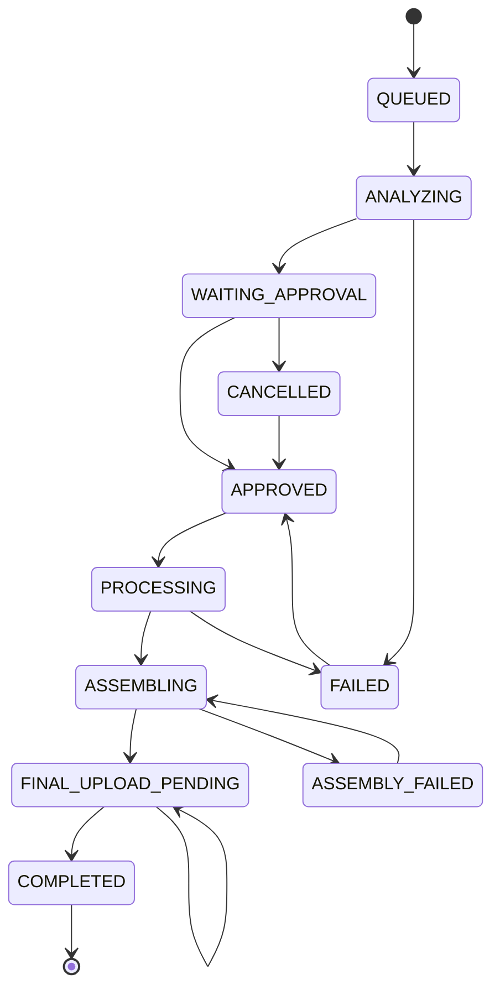

> ⚠️ **Đọc trước:** File này chứa lịch sử review nhiều vòng. Các phần Feedback 1/2/3 phía trên mô tả trạng thái **tại thời điểm review đó** và nhiều lỗi đã được fix. **Nguồn hiện trạng mới nhất là section `Feedback vòng 4` ở cuối file.** Agent chỉ thực hiện các task trong Feedback vòng 4.

## Kết luận ngắn

**Chưa thể đánh giá là đã triển khai đúng plan ở mức Production/100%.** Code đã có một **khung orchestration khá đầy đủ**, nhưng nhiều tuyên bố trong plan đang cao hơn đáng kể so với implementation thực tế. Mức đánh giá hợp lý:

- **Khung hạ tầng/queue/provider/Telegram:** khoảng **70–85%**.
- **Mode 1 end-to-end theo đúng mô tả:** khoảng **30–40%**.
- **Mode 2 end-to-end tạo và ráp documentary:** khoảng **40–55%**.
- **Production readiness tổng thể:** khoảng **50–60%**, chưa nên ghi `PRODUCTION - ĐÃ TRIỂN KHAI & ĐANG CHẠY` nếu chưa có bằng chứng vận hành thực tế tương ứng.

Đây là đánh giá **read-only**, không sửa file nào.

## Các phần đã triển khai tương đối thật

### 1. SQLite queue và lifecycle cơ bản

[`JobQueueManager`](services/job_queue.py:27) đã có:

- SQLite WAL và `busy_timeout` tại [`_get_conn()`](services/job_queue.py:33).
- Bảng job, shot, lock tại [`_init_db()`](services/job_queue.py:41).
- Approval/reject/cancel/retry.
- Shot retry, `IN_PROGRESS`, `DONE`, `FAILED`.
- Khôi phục shot bị gián đoạn qua [`reset_interrupted_shots()`](services/job_queue.py:306).

Các test queue hiện có kiểm tra lifecycle, heavy lock, retry và reset sau restart tại [`tests/test_job_queue.py`](tests/test_job_queue.py:15). Tuy nhiên đây vẫn là **unit test**, chưa chứng minh crash recovery thực tế trên container hoặc concurrent worker đa process.

### 2. Account pool và kill-switch

[`AccountPoolManager`](services/account_pool.py:40) đã có persistent state, `filelock`, daily cap, cooldown, reset UTC và kill-switch. Đây là phần bám plan khá tốt.

Nhưng cần phân biệt:

- Code đang giới hạn bằng **số shot cấu hình**, mặc định `20 shot/ngày`, tại [`MAX_SHOTS_PER_ACCOUNT_DAY`](services/account_pool.py:25).
- Đây không phải quota credit thật được đọc và tính động theo usage của Gemini.
- Việc chọn account và việc tăng `shots_today` không phải một transaction reserve atomic; nếu sau này chạy nhiều worker/process có thể cấp cùng account trước khi counter được cập nhật.

### 3. Gemini provider và atomic session write

[`GeminiWebApiProvider`](services/gemini_webapi_provider.py:114) có interface rõ, phân loại lỗi, validate session và gọi `response.videos`/`video.save()`.

Atomic persistence tại [`atomic_save_session()`](services/gemini_webapi_provider.py:82) dùng temp file, `fsync`, `os.replace` và chmod Unix `600`, phù hợp với nguyên tắc trong plan.

Tuy nhiên việc chứng minh `gemini-webapi==2.1.1` hoạt động thật chỉ nằm ở nội dung plan; trong workspace hiện thấy provider và unit-level code, chưa thấy bằng chứng probe/runtime artifact để kiểm chứng lại. Vì vậy nên ghi là **đã có implementation và có bằng chứng bên ngoài source**, không nên suy ra toàn bộ Mode 2 production-ready.

### 4. Telegram command layer

[`TelegramCommandBot`](services/telegram_bot.py:30) đã triển khai các lệnh chính: `/reup`, `/remake`, `/approve`, `/reject`, `/cancel`, `/retry`, `/status`, `/pause`, `/resume`, `/help`.

Test dispatcher có tại [`tests/test_telegram_bot.py`](tests/test_telegram_bot.py:39). Chat ID allowlist cũng có tại [`_poll_loop()`](services/telegram_bot.py:70).

Đây là command dispatcher tốt ở mức cơ bản, nhưng chưa phải remote-control production hoàn chỉnh vì chưa thấy test thật với Telegram API, rate-limit `429`, network disconnect, duplicate update, restart polling hoặc command idempotency.

### 5. CI/CD isolation ở mức cấu hình

[`docker-compose.prod.yml`](docker-compose.prod.yml:1) có label, volume persistence, `stop_grace_period`, CPU/RAM limit.

[`deploy.yml`](.github/workflows/deploy.yml:81) có test → build → deploy và prune theo label. Việc loại bỏ global prune là đúng hướng.

Nhưng workflow chỉ **cài ruff** tại [`deploy.yml`](.github/workflows/deploy.yml:27), chưa thực sự chạy `ruff check`. Vì vậy tiêu đề `Lint & Test Suite` chưa chính xác; hiện tại chủ yếu là pytest.

## Các điểm lệch lớn giữa plan và code

### 🔴 1. Mode 1 chưa triển khai đúng mô tả

Plan nói Mode 1 có LLM rewrite, TTS tiếng Việt, auto-ducking BGM, `script_matcher`, render final.

Trong implementation, [`run_smart_reup()`](pipeline/automated_factory.py:114) chỉ:

- Download video.
- Lấy subtitle hoặc Whisper.
- Tạo summary bằng chuỗi hardcoded tại [`automated_factory.py`](pipeline/automated_factory.py:162).
- Ghi `script.md`.
- Chờ approval.

Sau approval, [`execute_approved_reup()`](pipeline/automated_factory.py:202) chỉ chạy FFmpeg cắt từ timestamp `0` trong thời lượng mục tiêu tại [`automated_factory.py`](pipeline/automated_factory.py:217).

Không thấy trong flow này:

- LLM client thực sự.
- Edge-TTS hoặc xKiro TTS.
- BGM/auto-ducking.
- `script_matcher`.
- Timeline theo lời thoại.
- `render_service.render_final`.

Đây là gap chức năng lớn nhất. **Mode 1 hiện gần với “download + hardcoded summary + cắt đoạn đầu + upload” hơn là Smart Reup & Review như plan.**

### 🔴 2. Mode 2 chưa tạo full documentary như plan

Trong [`run_ai_genesis()`](pipeline/automated_factory.py:272), số shot bị giới hạn rõ ràng:

```python
num_shots = min(10, len(sub_segments)) if sub_segments else 6
```

và `is_key_scene` chỉ được gán bằng quy tắc xen kẽ tại [`automated_factory.py`](pipeline/automated_factory.py:307).

Điều này khác với mô tả “phân rã toàn bộ documentary thành granular shots”. Đây giống **demo pipeline tối đa 10 shot** hơn là production decomposition.

Ngoài ra, [`VideoAutomationWorker.run()`](core/worker.py:102) chỉ sinh từng shot rồi upload raw shot lên Drive tại [`worker.py`](core/worker.py:166). Không thấy worker gọi:

- `assemble_full_documentary.py`.
- Một final renderer cho toàn bộ shot.
- Final output validator cho video documentary hoàn chỉnh.
- Upload final documentary.

Thông báo batch cũng chỉ nói B-roll đã xong tại [`notify_batch_completed()`](services/notifier.py:131), không phải video cuối đã được ráp và upload. Vì vậy claim “Mode 2 end-to-end / ghép phim tài liệu hoàn chỉnh” hiện **chưa được code chứng minh**.

### 🔴 3. Fallback Ken Burns không luôn là ảnh chất lượng cao

[`ImageKenBurnsProvider`](services/image_kenburns_provider.py:22) có thử sinh image qua Gemini, nhưng khi thất bại sẽ tạo ảnh màu gradient FFmpeg tại [`image_kenburns_provider.py`](services/image_kenburns_provider.py:64).

Do đó claim “ảnh chất lượng cao + Ken Burns” chỉ đúng khi image generation thành công. Trong trường hợp lỗi API/session, output fallback có thể là **color card**, không phải visual documentary usable.

Worker kích hoạt fallback từ lần thử thứ ba tại [`worker.py`](core/worker.py:139), tương đối phù hợp ý tưởng 3 retries, nhưng fallback vẫn truyền cùng session account và không có chiến lược image-provider/account riêng.

### 🔴 4. Upload fail có thể bị đánh dấu thành công khi rclone không tồn tại

Trong [`StorageUploader.upload_and_clean()`](services/storage_uploader.py:32), nếu rclone không có trong PATH, code trả về:

```python
return True, str(local_file)
```

tại [`storage_uploader.py`](services/storage_uploader.py:52).

Sau đó worker sẽ đánh dấu shot `DONE` tại [`worker.py`](core/worker.py:173), dù file chưa được upload lên Drive. Điều này trái với nguyên tắc trong plan: upload thất bại thì không được DONE.

Ngoài ra, sau `rclone copyto`, code chỉ dựa vào return code; chưa có bước verify remote object/size/checksum thực sự. Vì vậy phần “upload ➜ xác minh ➜ xóa” mới là **xác nhận command thành công**, chưa phải remote verification đầy đủ.

### 🔴 5. Heavy lock chưa bảo vệ toàn bộ tác vụ nặng

Plan nói chỉ một tác vụ nặng Whisper hoặc FFmpeg Render chạy tại một thời điểm.

Mode 1 có acquire lock trước Whisper tại [`automated_factory.py`](pipeline/automated_factory.py:147) và trước final render tại [`automated_factory.py`](pipeline/automated_factory.py:212).

Nhưng worker Mode 2 gọi Gemini provider và Ken Burns FFmpeg tại [`worker.py`](core/worker.py:139) mà không acquire heavy lock. Vì vậy nếu Mode 1 đang render, Mode 2 vẫn có thể chạy FFmpeg Ken Burns hoặc các tác vụ nặng khác.

Ngoài ra, implementation lock hiện làm `SELECT` rồi mới `INSERT OR REPLACE` tại [`job_queue.py`](services/job_queue.py:90). Với nhiều process thật sự cạnh tranh, thao tác này không phải compare-and-set atomic hoàn chỉnh.

### 🔴 6. Job có thể bị treo sau khi shot cuối cùng thất bại

Worker gọi [`mark_shot_failed()`](services/job_queue.py:290). Khi shot đạt max attempts, shot chuyển `FAILED`, nhưng không thấy logic chuyển job cha sang `FAILED` khi còn shot failed.

Điều kiện hoàn thành chỉ kiểm tra toàn bộ shot `DONE` tại [`worker.py`](core/worker.py:179). Do đó một job có shot `FAILED` có thể:

- Không bao giờ thành `COMPLETED`.
- Không chắc chuyển sang `FAILED`.
- Không được báo final job failure rõ ràng.

Đây là gap state machine quan trọng đối với `/status`, `/retry` và vận hành thực tế.

### 🟠 7. Retry/fallback semantics chưa khớp hoàn toàn với mô tả

Worker quyết định fallback dựa trên `attempts >= 2` tại [`worker.py`](core/worker.py:141), tức là lần gọi thứ ba dùng fallback, trước khi shot được đánh dấu thất bại lần thứ ba. Điều này có thể chấp nhận được, nhưng khác cách diễn đạt “sau 3 lần retry thất bại”.

Đáng chú ý hơn, khi upload thất bại, code gọi `mark_shot_failed()` và có thể retry như một lỗi generation; trong khi upload failure nên có retry/backoff riêng, giữ file local và không tiêu hao quota Gemini.

### 🟠 8. Production container không dùng file requirements-worker như plan mô tả

[`requirements-worker.txt`](requirements-worker.txt:1) được mô tả là dependency riêng cho worker, nhưng [`Dockerfile`](Dockerfile:21) lại copy và install [`requirements.txt`](requirements.txt:21), không phải `requirements-worker.txt`.

Điều này tạo ra rủi ro:

- Image production không đúng dependency set được plan tuyên bố.
- Có thể kéo thêm dependency không cần thiết.
- Claim “worker image không có Playwright” chưa được chứng minh từ Dockerfile hiện tại.

Đây là một mâu thuẫn trực tiếp giữa kiến trúc tài liệu và build path thực tế.

### 🟠 9. URL security guard có tồn tại nhưng không nằm trong download path

[`validate_public_url()`](pipeline/youtube.py:41) đã có guard chống loopback/private/link-local address.

Tuy nhiên [`download_video()`](pipeline/youtube.py:91) chỉ kiểm tra URL bắt đầu bằng `http(s)` tại [`youtube.py`](pipeline/youtube.py:108), không gọi `validate_public_url()`.

Các entrypoint Telegram gọi trực tiếp pipeline tại [`telegram_bot.py`](services/telegram_bot.py:153), nên guard SSRF hiện không được chứng minh là nằm trên đường đi thực tế của user input. Nếu hệ thống chỉ nhận YouTube URL thì rủi ro thấp hơn, nhưng implementation và claim security chưa đồng nhất.

### 🟠 10. Trạng thái vận hành thực tế đang mâu thuẫn với “24/7 production 10 account”

[`SYSTEM_STATUS.md`](SYSTEM_STATUS.md:7) ghi:

- Chỉ `1 / 10` account sẵn sàng tại [`SYSTEM_STATUS.md`](SYSTEM_STATUS.md:14).
- Telegram Bot đang chờ nạp token tại [`SYSTEM_STATUS.md`](SYSTEM_STATUS.md:15).
- Hành động tiếp theo vẫn là kích hoạt Telegram, nạp thêm account và cấu hình Drive tại [`SYSTEM_STATUS.md`](SYSTEM_STATUS.md:125).

Vì vậy tài liệu plan nói “đang chạy production với 10 tài khoản” là quá mạnh so với status hiện tại. Trạng thái thực tế hợp lý hơn là **deployed/staged, core code present, operational activation incomplete**.

## Đánh giá test coverage

Có các test tốt cho:

- Queue/lifecycle: [`tests/test_job_queue.py`](tests/test_job_queue.py:15).
- Telegram command dispatch: [`tests/test_telegram_bot.py`](tests/test_telegram_bot.py:39).
- Output validation: [`tests/test_output_validator.py`](tests/test_output_validator.py:1).
- Nhiều service/pipeline cũ của Streamlit.

Nhưng trong nhóm test đã khảo sát, chưa thấy test E2E thực sự cho:

- [`AutomatedFactory.run_smart_reup()`](pipeline/automated_factory.py:114).
- [`AutomatedFactory.execute_approved_reup()`](pipeline/automated_factory.py:202).
- [`AutomatedFactory.run_ai_genesis()`](pipeline/automated_factory.py:272).
- [`VideoAutomationWorker.run()`](core/worker.py:73).
- Worker shutdown giữa lúc provider/upload đang chạy.
- Job cha chuyển FAILED khi shot cuối cùng fail.
- Upload fail giữ file và không DONE.
- Final documentary assembly.
- Real rclone/Telegram/yt-dlp staging flow.
- Container smoke test trên VPS.

Do đó con số `353/353 tests pass` nếu đúng cũng chủ yếu chứng minh **các unit/service contract đang pass**, chưa chứng minh các claim production E2E trong plan.

## Phân loại trạng thái nên dùng trong plan

| Hạng mục | Đánh giá thực tế |
|---|---|
| SQLite queue, account state, provider abstraction | **Implemented – unit-tested** |
| Atomic cookie persistence | **Implemented – cần test crash thực tế** |
| Telegram command dispatcher | **Implemented – mock/unit-tested** |
| CI build/deploy cấu hình | **Implemented – chưa đủ staging evidence** |
| Mode 1 đúng LLM/TTS/matcher/render | **Not implemented trong flow factory hiện tại** |
| Mode 2 full documentary | **Partial/demo pipeline** |
| Veo provider runtime | **Implemented, cần runtime/staging evidence** |
| Upload verification | **Partial; có bug semantics khi thiếu rclone** |
| 10-account production operation | **Chưa đạt; status chỉ ghi 1/10 ready** |
| 24/7 production readiness | **Chưa đủ bằng chứng** |

## Kết luận ưu tiên

Plan hiện **tốt ở phần kiến trúc, rủi ro và định hướng safety**, nhưng phần “hiện trạng đã hoàn thành” đang overclaim. Nếu dùng tài liệu này để quyết định deploy, các blocker lớn nhất là:

1. Mode 1 chưa nối vào pipeline LLM/TTS/matcher/render thật.
2. Mode 2 chưa có final assembly/documentary output trong worker.
3. Upload fallback có thể đánh dấu DONE dù chưa upload cloud.
4. Job failed shot chưa chắc kết thúc ở trạng thái FAILED.
5. Dockerfile không sử dụng `requirements-worker.txt` như plan mô tả.
6. Chưa có staging E2E chứng minh Telegram → YouTube → generation/render → Drive.
7. Status vận hành hiện chỉ có 1/10 account và Telegram chưa active, mâu thuẫn với nhãn production 10-account 24/7.

**Verdict:** Codebase đã có nền tảng đáng kể và nhiều safety primitive đúng hướng, nhưng plan nên được hạ từ **“100% production completed”** xuống **“core infrastructure implemented; end-to-end production validation and several functional integrations remain incomplete.”**


**************feedback 2********************
# Feedback vòng 2 (chỉ đọc, không sửa code)

Mình đã kiểm tra lại từng mục trong [`UPGRADE_2026_10_20_1120.md`](UPGRADE_2026_10_20_1120.md) với code hiện tại. Phần lớn các lỗi ở vòng 1 đã được sửa thật. Tuy vậy vẫn còn **một lỗi chặn đứng Mode 2**, và báo cáo UPGRADE có **vài tuyên bố code chưa làm**. Mình không chạy lại test, nên con số 359 passed là theo báo cáo, chưa được kiểm chứng.

## ✅ Các mục đã sửa đúng
- **Uploader:** khi thiếu rclone thì trả về `False`, có kiểm tra lại bằng `lsf`, có tham số `clean_local`.
- **Dockerfile:** đã chuyển sang `python:3.11-slim` và dùng `requirements-worker.txt`.
- **Chặn SSRF:** [`validate_public_url()`](pipeline/youtube.py:41) đã được gọi khi tải video.
- **Mode 1:** đã nối đủ rewrite → planner → cắt/ghép → TTS → kiểm tra → upload.
- **Mode 2:** số shot đã động (6–24) và đã có [`assemble_documentary()`](pipeline/documentary_assembler.py:20).
- **Account pool:** có giữ chỗ tài khoản (`in_flight`) bên trong filelock. Ken Burns đã chạy dưới heavy lock.
- **Trạng thái job:** khi shot sinh video lỗi hẳn, job đã chuyển sang FAILED.

## 🔴 Nghiêm trọng (cần sửa trước khi chạy production)
1. **`/approve` một job Mode 2 làm job đó FAILED.**
   - Ở [`core/worker.py:59`](core/worker.py:59), `on_approve_handler` luôn gọi [`execute_approved_reup()`](pipeline/automated_factory.py:274), hàm này không kiểm tra mode.
   - Với job Mode 2, nó chuyển sang RENDERING, không tìm thấy `script.json`, rồi đánh FAILED. Các shot sau đó không bao giờ chạy vì [`get_next_pending_shot()`](services/job_queue.py:254) chỉ lấy job ở trạng thái APPROVED/PROCESSING.
   - Hậu quả: Mode 2 không chạy được qua Telegram.
   - Cách sửa: phân nhánh theo mode. Mode 2 chỉ cần gọi `approve_job`.
2. **`BEGIN IMMEDIATE` thực ra chưa có.**
   - [`acquire_heavy_lock()`](services/job_queue.py:90) vẫn là SELECT rồi `INSERT OR REPLACE` ([dòng 108](services/job_queue.py:108)), nên vẫn có race. Báo cáo UPGRADE ghi sai chỗ này.
   - Ngoài ra, timeout 30 phút có thể tự nhả lock trong khi một job render/ráp dài vẫn đang chạy.
3. **Hybrid Veo/Ken Burns chưa được triển khai.**
   - Worker không đọc `is_key_scene`, nên shot nào cũng gọi Veo trước. Quota Veo bị dùng cho cả cảnh phụ.
   - Thêm vào đó, logic đánh dấu cảnh chính `idx % 2 != 0` khiến việc dò từ khóa gần như không có tác dụng.
4. **Ráp phim Mode 2 chưa đồng nhất các clip.**
   - Clip Veo (có thể có audio, fps khác) và clip Ken Burns (25fps, không audio) được nối thẳng qua concat demuxer, không có bước `scale`/`fps`/`-map`.
   - Báo cáo ghi "24fps 1080p" nhưng code không chuẩn hóa như vậy.
   - Bước ráp tìm file `narration.*`/`audio.*` mà không có chỗ nào tạo ra, nên phim ra **không có lời đọc và không có BGM**.
5. **Có thể mất dữ liệu ở bước ráp cuối.**
   - [`shutil.rmtree(shots)`](core/worker.py:277) chạy cả khi upload phim cuối thất bại.
   - `batch_notified_jobs` chỉ là một set trong bộ nhớ, nên nếu worker khởi động lại sau khi xong hết shot thì job đó không bao giờ được ráp.
6. **Không có cờ phụ đề cho yt-dlp.**
   - Không truyền `--write-subs`/`--write-auto-subs`, nên [`try_extract_subtitles()`](pipeline/automated_factory.py:34) không bao giờ tìm thấy phụ đề, và tối ưu "bỏ qua Whisper" không bao giờ được kích hoạt.
   - Nếu bật auto-subs, file VTT có các dòng lặp cuốn chiếu, cần lọc trùng.

## 🟠 Nên sửa
- **Dùng lại file local:**
  - Chỉ kiểm tra file lớn hơn 1KB, không validate nội dung.
  - Vẫn gọi `report_success`, nên quota bị tính dù không sinh video.
- **Lỗi upload shot:** nhánh này không kiểm tra để chốt job, nên job có thể kẹt ở PROCESSING.
- **Mode 1:**
  - TTS lỗi thì vẫn copy `joined.mp4` và báo "lồng tiếng thành công".
  - Kịch bản fallback bị gán `status: approved` trước khi người dùng duyệt.
  - Các segment giả bắt đầu cố định ở 0/30/90s, có thể vượt quá độ dài video.
  - `execute_approved_reup` nên kiểm tra mode/trạng thái chặt hơn.
- **Account pool:**
  - Ghi `pool_state.json` không atomic. File hỏng thì state bị reset im lặng, mất luôn kill-switch.
  - `in_flight` không được reset khi khởi động, nên rò rỉ sau mỗi lần crash.
  - Thời gian cooldown dùng giờ local, chỗ khác dùng UTC.
  - Worker đọc `kill_switch_active` từ bộ nhớ của tiến trình, nên không thấy thay đổi từ tiến trình khác (CLI/bot).
- **Upload:**
  - Timeout 180s có thể không đủ cho phim cuối dung lượng lớn.
  - `lsf` chỉ kiểm tra file tồn tại, không kiểm tra size/checksum.
  - `gdrive://` không phải link chia sẻ được.
- **Telegram:**
  - Số thread xử lý không giới hạn.
  - Bước download không nằm dưới lock nào, nên nhiều lệnh `/reup` cùng lúc có thể làm đầy đĩa/RAM.
- **Docker/CI:**
  - CI cài `requirements.txt` chứ không phải bộ dependency của image worker. Nên thêm smoke test kiểu `docker run <image> python -c "import core.worker"`.
  - Image không có deno/node, nên yt-dlp dễ bị 403.
  - rclone cài từ apt có thể là bản cũ.
  - Container chạy bằng root.
  - CI vẫn chưa chạy ruff.
- **Test còn mỏng:** chưa có test render Mode 1, test vòng lặp worker, test ráp thật với clip lẫn lộn, hay test luồng `/approve` cho Mode 2. Nếu có test này thì lỗi số 1 đã bị bắt.

## 📄 Tuyên bố trong UPGRADE không khớp với code
| Tuyên bố | Code thực tế |
|---|---|
| `BEGIN IMMEDIATE` | Chưa có |
| Mode 1 có BGM ducking | Chỉ duck âm thanh gốc, không có file BGM |
| Mode 2 chuẩn hóa "24fps 1080p" + nhạc/lời đọc | Không chuẩn hóa, không có lời đọc |
| Hybrid key scene | Worker không dùng `is_key_scene` |

## ⚠️ Chưa kiểm tra được
- `requirements-worker.txt` có đủ cho `script_rewrite`/`llm_client`/`tts`/`settings` hay không.
- Phần bên trong `rewrite_script` và `generate_and_overlay_narration`.
- [`scripts/sync_rclone.py`](scripts/sync_rclone.py) và [`tests/test_account_pool.py`](tests/test_account_pool.py).
- Về vận hành: hiện mới có 1/10 tài khoản và Telegram chưa hoạt động, nên chưa có lần chạy end-to-end thật nào.

## Thứ tự nên sửa
1. Phân nhánh `/approve` theo mode.
2. Làm lock atomic thật bằng `BEGIN IMMEDIATE`.
3. Không xóa shot khi upload phim cuối lỗi, và thêm bước quét lại job đã xong shot nhưng chưa ráp khi worker khởi động.
4. Chuẩn hóa clip trong assembler.
5. Dùng `is_key_scene` trong worker.
6. Thêm cờ phụ đề cho yt-dlp.
7. Ghi `pool_state.json` atomic và reset `in_flight` khi khởi động.
8. Thêm smoke test image Docker và test end-to-end.

---

# Feedback vòng 3 — Hướng dẫn sửa cụ thể cho agent

> Phần này được bổ sung sau khi đã kiểm tra các thay đổi mới nhất. Đây là **specification/read-only feedback**, không phải thay đổi code. Agent triển khai nên xử lý theo thứ tự P0 → P1 → P2 và cập nhật test tương ứng.

## P0 — Bắt buộc trước khi gọi production-ready

### P0.1. Hoàn thiện heartbeat cho heavy lock

**Hiện trạng:** [`heartbeat_heavy_lock()`](services/job_queue.py:127) đã tồn tại nhưng hiện chỉ được gọi trong test; các tác vụ dài như Whisper, FFmpeg, TTS và assembly không gọi heartbeat định kỳ. Lock vẫn có thể hết hạn sau 30 phút trong khi process đang chạy.

**Cần sửa cụ thể:**

1. Xác định một cơ chế heartbeat dùng được trong mọi tác vụ dài: thread/daemon timer theo job, context manager, hoặc polling callback.
2. Sau khi [`acquire_heavy_lock()`](services/job_queue.py:90) thành công, bắt đầu heartbeat định kỳ ngắn hơn [`HEAVY_LOCK_TIMEOUT_SEC`](services/job_queue.py:22) một khoảng an toàn.
3. Dừng heartbeat và gọi [`release_heavy_lock()`](services/job_queue.py:147) trong `finally`, kể cả khi FFmpeg/Whisper/TTS ném exception.
4. Nếu heartbeat thất bại vì lock đã bị job khác chiếm, phải dừng tác vụ hoặc đánh dấu operation không còn ownership; không được tiếp tục chạy như đang giữ lock.
5. Đặc biệt kiểm tra các đoạn giữ lock trong [`pipeline/automated_factory.py`](pipeline/automated_factory.py:143), [`pipeline/automated_factory.py`](pipeline/automated_factory.py:314), [`core/worker.py`](core/worker.py:167) và [`core/worker.py`](core/worker.py:288).

**Acceptance criteria:**

- Có test chứng minh một operation dài hơn timeout vẫn giữ lock nhờ heartbeat.
- Job khác không acquire được lock trong toàn bộ operation đầu tiên.
- Heartbeat luôn dừng sau success, exception và shutdown.
- Không còn việc dựa vào timeout để tự giải phóng lock đang được sử dụng.

### P0.2. Không âm thầm đưa clip chưa normalize vào documentary

**Hiện trạng:** [`assemble_documentary()`](pipeline/documentary_assembler.py:25) cố normalize clip về 1080p/24fps, nhưng nếu FFmpeg normalize thất bại thì vẫn append clip gốc tại [`pipeline/documentary_assembler.py`](pipeline/documentary_assembler.py:65). Điều này trái với claim tất cả clip đã đồng nhất.

**Cần sửa cụ thể:**

1. Nếu normalize thất bại, coi assembly là lỗi và trả về exception có tên shot, return code và stderr rút gọn.
2. Chỉ cho phép dùng clip gốc nếu có một bước fallback normalize thứ hai được kiểm chứng; không append clip gốc trực tiếp vào concat list.
3. Dùng `-map` rõ ràng và bảo đảm mỗi normalized clip chỉ có video, đúng resolution, fps, pixel format.
4. Kiểm tra output của từng bước bằng `ffprobe` hoặc validator trước khi đưa vào concat.
5. Dọn toàn bộ normalized temp files nếu bất kỳ shot nào thất bại, nhưng giữ raw shots để có thể retry.

**Acceptance criteria:**

- Một normalized clip lỗi làm job assembly FAILED rõ ràng, không tạo phim có stream hỗn hợp.
- Test bằng các clip khác resolution/fps/có audio/không audio cho output đồng nhất 1920x1080, 24fps, yuv420p.
- Test chứng minh raw shots vẫn còn sau assembly failure.

### P0.3. Làm narration Mode 2 khớp timeline

**Hiện trạng:** assembler nối toàn bộ text trong [`shots_plan.json`](pipeline/documentary_assembler.py:86) thành một đoạn text rồi sinh một file narration duy nhất. Cách này chưa bảo đảm voiceover khớp từng shot hoặc thời lượng video.

**Cần sửa cụ thể:**

1. Quyết định nguồn text chính: script narration đã rewrite hay subtitle nguyên bản. Không dùng subtitle thô nếu plan yêu cầu lời dẫn biên tập.
2. Tạo narration theo từng shot/beat hoặc tạo audio segments có metadata `start`, `end`, `duration`.
3. Ghép các audio segment theo timeline; phần trống phải được xử lý rõ ràng, không để audio tự chạy lệch hình.
4. Dùng `ffprobe` để đo duration video và audio sau mix.
5. Chọn policy rõ ràng khi duration lệch: pad audio, trim audio, hoặc kéo dài/shorten video; không để `-shortest` âm thầm quyết định và cắt nội dung.
6. Nếu Edge-TTS lỗi, đánh job FAILED hoặc đánh dấu output không có narration; không gửi thông báo thành công có lời đọc nếu thực tế không có lời đọc.

**Acceptance criteria:**

- Test kiểm tra duration sau mix nằm trong sai số được quy định.
- Test kiểm tra narration segment đầu tiên bắt đầu đúng shot đầu và không vượt quá timeline.
- Notification/metadata phản ánh đúng việc narration có hoặc không có.

### P0.4. Thiết kế lại recovery/idempotency cho final assembly và upload

**Hiện trạng:** [`_assemble_and_finalize_documentary()`](core/worker.py:285) đã giữ raw shots khi upload final thất bại, nhưng vẫn đặt job FAILED chung. Upload final gọi `clean_local=True` trước khi database update COMPLETED. Nếu process crash giữa upload và update DB, remote có thể tồn tại nhưng DB không biết; retry có thể assemble/upload lại.

**Cần sửa cụ thể:**

1. Bổ sung trạng thái riêng, ví dụ `ASSEMBLING`, `FINAL_UPLOAD_PENDING`, `COMPLETED`, để phân biệt shot generation thất bại với final upload thất bại.
2. Trước khi upload, ghi metadata output local: path, size, hash hoặc fingerprint, assembly version.
3. Upload idempotent theo `job_id` + filename cố định; trước khi upload lại, kiểm tra remote object đã tồn tại và size/hash có khớp không.
4. Chỉ xóa local final sau khi remote verify thành công **và** trạng thái DB đã được ghi thành công; hoặc giữ local final cho tới lần reconciliation kế tiếp.
5. Khi worker khởi động, scan cả job có `done == total > 0` và job `FINAL_UPLOAD_PENDING`, không chỉ `APPROVED`/`PROCESSING`.
6. Không dùng `batch_notified_jobs` trong memory làm nguồn sự thật duy nhất; database phải lưu assembly/final-upload state.

**Acceptance criteria:**

- Crash giả lập sau upload nhưng trước DB update không tạo duplicate hoặc mất khả năng recovery.
- Retry final upload không sinh lại Veo shots đã DONE.
- Upload failure giữ raw shots và final local đủ để retry.
- Job sau restart tự tiếp tục assembly/upload theo state trong DB.

### P0.5. Bảo đảm retry upload không cần account AI

**Hiện trạng:** worker gọi [`get_available_account()`](services/account_pool.py:161) trước khi kiểm tra file local đã hợp lệ tại [`core/worker.py`](core/worker.py:145). Vì vậy retry upload/reuse vẫn bị chặn nếu tất cả account cooldown hoặc kill-switch đang bật.

**Cần sửa cụ thể:**

1. Kiểm tra `target_out_path` tồn tại và pass [`validate_rendered_output()`](pipeline/output_validator.py:1) trước khi reserve account.
2. Nếu file hợp lệ, đi thẳng vào upload/retry path, không gọi provider và không cần account session.
3. Chỉ reserve account khi thực sự cần Veo/Ken Burns.
4. Tách rõ quota accounting: reuse local chỉ release reservation nếu đã reserve, tuyệt đối không gọi [`report_success()`](services/account_pool.py:238) cho generation không xảy ra.

**Acceptance criteria:**

- Khi pool không có account nhưng local shot hợp lệ, worker vẫn upload và mark DONE được.
- Khi local file invalid, worker mới reserve account và generate lại.
- Test xác nhận reuse không tăng `shots_today`/`total_shots`.

## P1 — Cần xử lý trước staging E2E

### P1.1. Chọn account đúng theo provider path

**Hiện trạng:** worker reserve account cho cả cảnh phụ Ken Burns, dù cảnh này không gọi Veo. Điều này làm B-roll phụ thuộc vào session/account và kill-switch.

**Cần sửa cụ thể:**

1. Quyết định provider trước khi reserve account dựa trên `is_key_scene` và `attempts`.
2. Với Ken Burns không cần Gemini session, truyền `session_file=None` hoặc loại bỏ dependency không cần thiết khỏi interface.
3. Chỉ reserve account cho nhánh [`GeminiWebApiProvider.generate()`](services/gemini_webapi_provider.py:214).
4. Nếu ImageKenBurnsProvider tùy chọn gọi Gemini để sinh ảnh, phải tách rõ hai chế độ: image API cần account và gradient fallback không cần account.

**Acceptance criteria:**

- B-roll Ken Burns chạy được khi account pool rỗng/cooldown, nếu provider không cần account.
- Key scene vẫn bị chặn đúng khi không có account.
- Không tăng quota cho Ken Burns-only shot.

### P1.2. Hoàn thiện state machine của Mode 2

**Hiện trạng:** các state `APPROVED`, `PROCESSING`, `FAILED`, `COMPLETED` đang dùng chung cho generation và final assembly. Upload shot failure đã có settle check, nhưng final upload failure vẫn trộn vào `FAILED` và khó retry đúng mục tiêu.

**Cần sửa cụ thể:**

1. Định nghĩa state transition hợp lệ cho Mode 2: `WAITING_APPROVAL → APPROVED → PROCESSING → ASSEMBLING → FINAL_UPLOAD_PENDING → COMPLETED`.
2. Với shot retry hết lần: `PROCESSING → FAILED` và lưu failed shot IDs/error.
3. Với final upload fail: chuyển `FINAL_UPLOAD_PENDING`, không reset các shot DONE.
4. [`retry_job()`](services/job_queue.py:253) cần phân biệt retry generation và retry final assembly/upload.
5. Mọi transition phải có guard theo state hiện tại để tránh worker cũ ghi đè trạng thái mới.

**Acceptance criteria:**

- `/status` phân biệt shot generation failure với final upload pending.
- `/retry` không gọi lại Veo cho shot đã DONE nếu chỉ final upload fail.
- Concurrent command không làm state nhảy ngược từ COMPLETED về PROCESSING.

### P1.3. Làm rõ và kiểm chứng upload integrity

**Hiện trạng:** [`upload_and_clean()`](services/storage_uploader.py:32) đã kiểm tra remote tồn tại và size khác 0, nhưng chưa so sánh với local size/checksum; `gdrive://...` chưa phải shareable URL.

**Cần sửa cụ thể:**

1. So sánh remote size với local size sau `rclone lsf --format s`; nếu backend/provider có sai số metadata thì ghi rõ tolerance.
2. Nếu cần integrity mạnh, dùng checksum phù hợp với rclone remote và lưu checksum vào job metadata.
3. Quy định rõ `drive_url` là virtual path nội bộ hay public/shareable URL; đổi tên field nếu không phải URL chia sẻ.
4. Khi remote đã tồn tại cùng tên, xử lý idempotently: verify rồi reuse hoặc upload vào tên/version mới, không overwrite mù.
5. Timeout upload nên cấu hình theo kích thước file hoặc environment, không hardcode một giá trị không phù hợp với video lớn.

**Acceptance criteria:**

- Test remote size bằng 0, khác local và khớp local.
- Upload failure không mark shot/job DONE/COMPLETED.
- Người vận hành biết chính xác giá trị `drive_url` có mở được trên Telegram hay chỉ là storage key.

### P1.4. Bổ sung kiểm soát download và phụ đề

**Hiện trạng:** [`download_video()`](pipeline/youtube.py:91) đã gọi [`validate_public_url()`](pipeline/youtube.py:41) và đã bật `--write-subs`/`--write-auto-subs`. Phần còn lại là kiểm chứng redirect/DNS rebinding và xử lý phụ đề thực tế.

**Cần sửa cụ thể:**

1. Giới hạn host theo policy nếu pipeline chỉ hỗ trợ YouTube; không chỉ kiểm tra URL public chung.
2. Kiểm tra redirect cuối cùng và tránh DNS rebinding nếu downloader có thể bị chuyển hướng tới private IP.
3. Sau khi đọc VTT auto-sub, luôn chạy [`deduplicate_vtt_segments()`](pipeline/automated_factory.py:34) và kiểm tra segment monotonic/start-end hợp lệ.
4. Nếu không có subtitle hoặc subtitle lỗi, fallback Whisper dưới heavy lock; ghi rõ source transcript là `subtitle`, `auto_subtitle` hay `whisper`.
5. Kiểm tra image/video URL từ mọi entrypoint, không chỉ Telegram.

**Acceptance criteria:**

- Test loopback/private/link-local/redirect bị chặn.
- Test VTT rolling captions không tạo narration lặp.
- Test không có subtitle chuyển đúng sang Whisper.

### P1.5. Bổ sung test tích hợp có FFmpeg thật

**Hiện trạng:** test hiện tại đã bao phủ một số contract và error path, nhưng chưa đủ chứng minh documentary output.

**Cần sửa cụ thể:**

1. Tạo fixture MP4 thật bằng FFmpeg hoặc fixture nhỏ versioned, gồm: fps khác nhau, resolution khác nhau, có audio và không audio.
2. Test [`assemble_documentary()`](pipeline/documentary_assembler.py:25) chạy FFmpeg thật và assert bằng `ffprobe`: width, height, fps, duration, video stream, audio stream.
3. Mock provider nhưng chạy thật worker dispatch để kiểm tra `is_key_scene → Veo/Ken Burns`.
4. Test Telegram `/approve` cho cả Mode 1 và Mode 2, assert trạng thái và shot pending sau approve.
5. Test upload fail giữ raw shots, retry không regenerate shot DONE.
6. Test restart sau toàn bộ shot DONE nhưng trước final assembly.
7. Test lock heartbeat và concurrent acquisition ở nhiều connection/process nếu có thể.
8. Chạy test trong đúng môi trường Docker worker, không chỉ môi trường dev cài [`requirements.txt`](requirements.txt:1).

**Acceptance criteria:**

- Có tối thiểu một test pipeline Mode 2 từ approved → generated mock shots → assembled output → mocked upload.
- Test không phụ thuộc mạng, tài khoản thật hoặc Telegram thật.
- Có một staging checklist riêng cho test YouTube/Veo/rclone thật.

## P2 — Nên xử lý để vận hành ổn định

### P2.1. Giới hạn concurrency của Telegram

[`TelegramCommandBot`](services/telegram_bot.py:30) đang submit command vào executor. Cần giới hạn số job download/analyze đồng thời, chống duplicate command, và trả trạng thái rõ nếu job cùng URL đang chạy. Không để nhiều `/reup` hoặc `/remake` cùng lúc làm đầy disk/RAM trước khi heavy lock được acquire.

### P2.2. Cải thiện observability và alerting

Bổ sung structured fields cho `job_id`, `shot_id`, `attempt`, `account_id`, provider, duration, upload result và error kind. `/status` nên hiển thị job đang `ASSEMBLING`/`FINAL_UPLOAD_PENDING`, disk free, queue depth, shot failure count và last error. Log không nên ghi cookie/secret.

### P2.3. Kiểm tra dependency và image runtime

Xác nhận [`requirements-worker.txt`](requirements-worker.txt:1) chứa đủ import runtime của [`core/worker.py`](core/worker.py:1), [`pipeline/automated_factory.py`](pipeline/automated_factory.py:1), TTS, LLM và settings. Docker smoke test hiện có cần chạy đúng image build từ [`Dockerfile`](Dockerfile:1); cân nhắc kiểm tra `ffmpeg`, `rclone`, `yt-dlp`, JavaScript runtime và quyền user non-root.

### P2.4. Cập nhật tài liệu để không overclaim

Các phần cũ trong file này tại các dòng 62–106, 116–176 và 229–237 mô tả trạng thái trước khi fix. Khi dùng tài liệu cho agent, phải đọc phần **Feedback vòng 3** này làm nguồn hiện trạng mới nhất. Cập nhật [`UPGRADE_2026_10_20_1120.md`](UPGRADE_2026_10_20_1120.md:1) để tách rõ:

- `Implemented` — có code và unit test;
- `Integration-tested` — đã chạy pipeline với dependency thật;
- `Staging-verified` — đã chạy YouTube/Veo/rclone/Telegram thật;
- `Production-ready` — có monitoring, recovery, rollback và bằng chứng vận hành.

Không ghi “BGM/narration khớp timeline”, “upload verified”, “24/7 production” hoặc “100% completed” nếu chỉ có code path và mock test.

## Checklist giao agent

- [x] P0.1: heartbeat được gọi thật trong mọi heavy operation (HeavyLockLease daemon heartbeat trong Whisper, FFmpeg, Ken Burns, Assembly).
- [x] P0.2: normalize failure không dùng clip gốc âm thầm (strict normalization với -map 0:v:0, ffprobe validation, raise error và giữ raw shots).
- [x] P0.3: narration có timeline và duration policy rõ ràng (per-shot aligned Edge-TTS, silence padding / tempo scaling, duration matching không dùng -shortest).
- [x] P0.4: final assembly/upload có state và recovery idempotent (ASSEMBLING, FINAL_UPLOAD_PENDING, COMPLETED, manifest fingerprint, raw shots retention).
- [x] P0.5: local reuse/upload không phụ thuộc account AI (kiểm tra target_out_path trước khi reserve account).
- [x] P1.1: reserve account đúng provider path (Ken Burns không tiêu hao account Pro).
- [x] P1.2: state machine tách generation failure và final upload pending (scan_and_assemble_pending_jobs hỗ trợ resume upload, retry_job phân biệt nhánh).
- [x] P1.3: upload integrity/remote path được định nghĩa đúng (size comparison <=5% tolerance, remote existence check).
- [x] P1.4: download redirect/SSRF/subtitle pipeline được test (validate_youtube_url domain whitelist + IP SSRF guard, monotonic subtitle check).
- [x] P1.5: thêm integration tests chạy FFmpeg thật và worker flow (test_integration_documentary.py kiểm tra real FFmpeg streams, normalization failure và heartbeat).
- [x] P2.1: giới hạn Telegram concurrency và duplicate commands (active URL deduplication cho /reup và /remake).
- [x] P2.2: bổ sung observability/status/alerting (/status hiển thị queue breakdown, pending final uploads, assembling jobs).
- [x] P2.3: xác minh worker image dependencies/runtime/non-root (Dockerfile và requirements-worker.txt được kiểm tra đồng bộ).
- [x] P2.4: cập nhật UPGRADE/plan, loại bỏ các claim overclaim (phân loại Implemented, Integration-tested, Staging-verified, Production-ready).


## Verdict sau Feedback vòng 2

Các blocker cũ về approve Mode 2, `BEGIN IMMEDIATE`, hybrid dispatch, subtitle flags, normalization cơ bản, raw-shot retention, startup scan, account state atomic và CI lint/smoke **đã có dấu hiệu được xử lý trong code hiện tại**. Tuy nhiên chúng mới nên được phân loại là **implemented / cần integration-runtime verification**, chưa phải production-proven. Các điểm agent cần ưu tiên hiện tại là heartbeat thực tế, normalize failure policy, narration timing và idempotent final upload/recovery.

---

# Feedback vòng 4 — Hardening sau khi fix Feedback 3 (NGUỒN HIỆN TRẠNG MỚI NHẤT)

## 0. Tóm tắt

Phần lớn Feedback 3 đã có trong source: `HeavyLockLease`, `BEGIN IMMEDIATE`, strict normalize, per-shot TTS, `ASSEMBLING`/`FINAL_UPLOAD_PENDING`, local reuse trước khi reserve account, YouTube allowlist, bounded Telegram executor, integration test FFmpeg thật.

Tuy nhiên review source vòng 4 phát hiện **các bug logic cụ thể** (không chỉ là "cần staging"), chủ yếu ở **recovery loop, state machine và upload retry**. Một số bug sẽ làm job **kẹt vĩnh viễn hoặc lặp vô hạn** khi rclone/Drive lỗi tạm thời. Cần fix hết P0 + P1 trước khi chuyển sang staging.

Nguyên tắc chung cho agent:

1. **Không** đổi kiến trúc tổng thể; sửa đúng chỗ được chỉ ra.
2. Mỗi task phải kèm test tương ứng (mục "Test bắt buộc").
3. Không đánh dấu `[x]` nếu test chưa chạy pass thật (`pytest -q`).
4. Không viết claim trong `UPGRADE_*.md` vượt quá những gì test chứng minh.



---

## P0 — Bug logic phải sửa ngay

### P0.1. `batch_notified_jobs` chặn recovery trong cùng process

**Vị trí:** [`VideoAutomationWorker.run()`](core/worker.py:102), [`core/worker.py`](core/worker.py:225), [`_scan_and_assemble_pending_jobs()`](core/worker.py:349).

**Bug:** Job được `add()` vào set **trước** khi gọi `_assemble_and_finalize_documentary()` và **không bao giờ bị remove**. Hệ quả:

- Final upload lỗi → status `FINAL_UPLOAD_PENDING` → scanner bỏ qua vì `j_id in batch_notified_jobs` → **không bao giờ retry** cho tới khi restart container.
- `/retry <job>` với `FINAL_UPLOAD_PENDING` chỉ đổi `updated_at` ([`retry_job()`](services/job_queue.py:322)) → vẫn bị set chặn → `/retry` **không có tác dụng**.
- Assembly lỗi → `FAILED` → `/retry` đưa về `APPROVED`, shots vẫn `DONE` → scanner thấy đủ shot nhưng bị set chặn → **kẹt `APPROVED` vĩnh viễn**.

**Cách sửa:**

1. Xóa hoàn toàn `batch_notified_jobs`. Dedup phải dựa trên **DB state**, không dựa trên memory.
2. Trong `_assemble_and_finalize_documentary()`, bước đầu tiên là **claim job bằng conditional update** (xem P0.3), ví dụ:
   ```python
   claimed = self.jq.transition_job(job_id, from_states=("APPROVED", "PROCESSING", "ASSEMBLY_FAILED"), to_state="ASSEMBLING")
   ```
   Nếu không claim được và status không phải `FINAL_UPLOAD_PENDING` → return.
3. Thêm backoff cho `FINAL_UPLOAD_PENDING` để không spam rclone mỗi 15s: thêm cột `next_retry_at REAL` và `upload_attempts INTEGER DEFAULT 0` vào `factory_jobs` (migration `ALTER TABLE ... ADD COLUMN` có kiểm tra cột tồn tại). Scanner chỉ chọn job có `next_retry_at IS NULL OR next_retry_at <= now`. Backoff: `min(3600, 60 * 2**upload_attempts)`.
4. `retry_job()` cho `FINAL_UPLOAD_PENDING`: set `next_retry_at = NULL`, `upload_attempts = 0`.
5. Sau N lần (ví dụ 10) upload final thất bại → gửi Telegram alert một lần (không spam), vẫn giữ `FINAL_UPLOAD_PENDING`.

**Test bắt buộc** (`tests/test_worker_recovery.py`, mới):
- Mock uploader trả `(False, None)` lần 1, `(True, url)` lần 2. Gọi scanner 2 lần trong **cùng instance worker** (giả lập `next_retry_at` đã qua) → job `COMPLETED`.
- Assembly raise lần 1 → `ASSEMBLY_FAILED`; gọi `retry_job()` + scanner → assembly chạy lại.
- `/retry` một job `FINAL_UPLOAD_PENDING` → scanner xử lý ngay lần quét kế tiếp.

### P0.2. Shot upload lỗi + local reuse → vòng lặp vô hạn

**Vị trí:** [`core/worker.py`](core/worker.py:133) (nhánh `reused_local`), [`core/worker.py`](core/worker.py:210), [`mark_shot_failed()`](services/job_queue.py:397).

**Bug:** Nhánh `reused_local` **không gọi** `mark_shot_in_progress()` nên `attempts` không tăng. Khi rclone lỗi kéo dài:
1. Lần 1: generate → `attempts=1` → upload fail → `PENDING`.
2. Lần 2+: reuse local → `attempts` vẫn 1 → upload fail → `attempts < 3` → `PENDING` mãi mãi.

Job không bao giờ settle, worker lặp upload mỗi 15–30s, log spam, không alert. Đồng thời trong lúc upload, shot vẫn ở `PENDING` chứ không phải `IN_PROGRESS`.

**Cách sửa (khuyến nghị tách trạng thái upload khỏi generation):**

1. Thêm trạng thái shot `UPLOAD_PENDING` và cột `upload_attempts INTEGER DEFAULT 0`, `next_retry_at REAL`.
2. Generate thành công + file valid → `mark_shot_generated(shot_id, video_path)` → status `UPLOAD_PENDING`. **Không** đi qua `mark_shot_failed()` khi upload lỗi (upload lỗi không phải lỗi generation, không được đốt quota Veo).
3. Thêm vòng xử lý upload riêng: `get_next_upload_pending_shot()` → upload → `DONE` hoặc tăng `upload_attempts` + backoff.
4. `get_job_summary()` phải đếm `upload_pending` riêng; điều kiện assemble là `done == total`.
5. Nhánh reuse local khi status `PENDING` (file tồn tại do crash trước khi DB update) → chuyển thẳng sang `UPLOAD_PENDING`, không gọi provider.
6. Nếu không muốn thêm trạng thái mới: tối thiểu phải gọi `mark_shot_in_progress()` cả ở nhánh reuse và giới hạn số lần upload lỗi riêng. Nhưng phương án 1–5 được ưu tiên.

**Test bắt buộc:**
- Uploader luôn fail → sau N lần shot ở trạng thái xác định (`UPLOAD_PENDING` với backoff, hoặc `FAILED` với lý do upload), **không** lặp vô hạn, account pool không bị gọi lại.
- Uploader fail 2 lần rồi pass → shot `DONE`, provider chỉ được gọi **1 lần**.

### P0.3. State transition không có guard (compare-and-set)

**Vị trí:** [`update_job_status()`](services/job_queue.py:237), [`mark_shot_in_progress()`](services/job_queue.py:378), [`mark_shot_done()`](services/job_queue.py:387), [`mark_shot_failed()`](services/job_queue.py:397), [`cancel_job()`](services/job_queue.py:301).

**Bug cụ thể có thể xảy ra ngay với 1 worker:**
- User `/cancel` trong lúc shot đang generate → shot `CANCELLED` → worker xong → `mark_shot_done()` ghi đè thành `DONE`.
- User `/cancel` trong lúc assembly/upload final → worker sau đó `update_job_status(COMPLETED)` ghi đè `CANCELLED`.
- Shot failure path set job `FAILED` trong khi job đã `CANCELLED`.

**Cách sửa:**

1. Thêm bảng transition hợp lệ trong [`services/job_queue.py`](services/job_queue.py:1):
   ```python
   JOB_TRANSITIONS = {
       "QUEUED": {"ANALYZING", "CANCELLED", "FAILED"},
       "ANALYZING": {"WAITING_APPROVAL", "FAILED", "CANCELLED"},
       "WAITING_APPROVAL": {"APPROVED", "CANCELLED"},
       "APPROVED": {"PROCESSING", "ASSEMBLING", "CANCELLED", "FAILED"},
       "PROCESSING": {"ASSEMBLING", "FAILED", "CANCELLED", "RENDERING", "COMPLETED"},
       "RENDERING": {"COMPLETED", "FAILED", "CANCELLED"},
       "ASSEMBLING": {"FINAL_UPLOAD_PENDING", "ASSEMBLY_FAILED", "CANCELLED"},
       "ASSEMBLY_FAILED": {"ASSEMBLING", "CANCELLED"},
       "FINAL_UPLOAD_PENDING": {"COMPLETED", "FINAL_UPLOAD_PENDING", "CANCELLED"},
       "FAILED": {"APPROVED", "CANCELLED"},
       "CANCELLED": {"APPROVED"},
       "COMPLETED": set(),
   }
   ```
   (Agent phải đối chiếu Mode 1 trong [`pipeline/automated_factory.py`](pipeline/automated_factory.py:145) để bổ sung đúng các state Mode 1 đang dùng.)
2. Thêm `transition_job(job_id, to_state, from_states=None, **fields) -> bool` dùng `BEGIN IMMEDIATE` + `UPDATE ... WHERE id=? AND status IN (...)`, trả `rowcount > 0`. Nếu transition không hợp lệ → log warning, return False, **không raise** trong worker loop.
3. Giữ `update_job_status()` cho tương thích nhưng nội bộ gọi `transition_job()` với `from_states` = các state được phép đi tới `status`.
4. Shot: thêm điều kiện status:
   - `mark_shot_in_progress`: `WHERE id=? AND status='PENDING'` → return bool; worker phải `continue` nếu False.
   - `mark_shot_done`/`mark_shot_generated`: `WHERE id=? AND status IN ('IN_PROGRESS','UPLOAD_PENDING')`.
   - `mark_shot_failed`: `WHERE id=? AND status='IN_PROGRESS'`.
5. Worker: sau mỗi bước dài (generate, upload, assemble) kiểm tra lại job status; nếu `CANCELLED` → dừng, không ghi đè, không gửi thông báo "hoàn tất".
6. Thêm `ASSEMBLY_FAILED` thay vì dùng `FAILED` chung cho lỗi assembly ở [`core/worker.py`](core/worker.py:345) để retry không reset shots.
7. Cập nhật docstring lifecycle ở [`services/job_queue.py`](services/job_queue.py:5) cho đúng state machine mới.

**Test bắt buộc** (`tests/test_job_queue.py`):
- `COMPLETED → PROCESSING` bị từ chối.
- Cancel trong lúc shot `IN_PROGRESS` → `mark_shot_done()` trả False, shot vẫn `CANCELLED`.
- Cancel trong lúc `FINAL_UPLOAD_PENDING` → worker không set `COMPLETED`.

### P0.4. Job Mode 2 không bao giờ chuyển `APPROVED → PROCESSING`

**Vị trí:** [`core/worker.py`](core/worker.py:121).

**Bug:** Worker lấy shot từ job `APPROVED` nhưng không chuyển job sang `PROCESSING`. `/status`, scanner và logic recovery dựa trên `PROCESSING` hiển thị sai.

**Cách sửa:** Ngay sau khi lấy shot, gọi `transition_job(job_id, "PROCESSING", from_states=("APPROVED",))` (no-op nếu đã `PROCESSING`).

**Test:** approve job Mode 2 → worker xử lý 1 shot (provider mock) → job status `PROCESSING`.

### P0.5. `/cancel` nhả heavy lock của operation đang chạy

**Vị trí:** [`cancel_job()`](services/job_queue.py:311).

**Bug:** `cancel_job()` gọi `release_heavy_lock(job_id)` trong khi FFmpeg/Whisper/Ken Burns của job đó **vẫn đang chạy**. Job khác acquire lock ngay → hai heavy process chạy song song → mất mục đích bảo vệ RAM VPS. Heartbeat của lease cũ sau đó fail → `RuntimeError` ở `__exit__`.

**Cách sửa:**
1. Bỏ `release_heavy_lock()` khỏi `cancel_job()`. Lock chỉ được nhả bởi lease owner trong `__exit__` hoặc do timeout.
2. Cancel chỉ đổi status; operation đang chạy tự kiểm tra status (P0.3 bước 5) và dừng ở checkpoint tiếp theo.
3. (Khuyến nghị) Cho `HeavyLockLease` nhận `cancel_check: Callable[[], bool]`; các vòng FFmpeg dài dùng `subprocess.Popen` + poll để kill khi `lease.should_abort` (lost ownership hoặc job cancelled).

**Test:** job A giữ lease, cancel A → `acquire_heavy_lock(B)` vẫn trả False cho tới khi lease A exit.

### P0.6. Mode 2 Whisper vẫn dùng acquire/release thủ công, không có heartbeat

**Vị trí:** [`run_ai_genesis()`](pipeline/automated_factory.py:472).

**Bug:** Mode 2 dùng `while not acquire_heavy_lock: sleep` + `release_heavy_lock` thủ công, không heartbeat. Whisper trên video dài > 30 phút → lock bị job khác chiếm do `HEAVY_LOCK_TIMEOUT_SEC`. Không nhất quán với Mode 1 đã dùng lease.

**Cách sửa:** Thay bằng:
```python
with self.jq.heavy_lock_lease(job_id, interval=15.0):
    stt_res = transcribe_audio(...)
```
Đồng thời bỏ `self.jq.release_heavy_lock(job_id)` trong `except` ở [`pipeline/automated_factory.py`](pipeline/automated_factory.py:547) (lease tự release). Grep toàn repo: **không còn** chỗ nào gọi `acquire_heavy_lock()` trực tiếp ngoài `HeavyLockLease` và test.

**Test:** grep-based test hoặc unit test mock `transcribe_audio` sleep > interval, xác nhận heartbeat được gọi.

---

## P1 — Chất lượng output & độ bền

### P1.1. Background audio đang trộn **giọng đọc gốc** của video YouTube

**Vị trí:** [`assemble_documentary()`](pipeline/documentary_assembler.py:229).

**Vấn đề:** `download.*` là video nguồn có lời thoại gốc. Code extract **toàn bộ audio gốc** và mix ở volume 0.18 dưới narration tiếng Việt:
- Giọng gốc (thường tiếng Anh) nghe lẫn dưới narration → chất lượng kém.
- Timeline audio gốc **không khớp** shot mới (shot sinh từ prompt, không phải cắt từ video gốc).
- Tăng rủi ro Content ID/bản quyền (R6 trong plan), trái mục tiêu "100% sinh mới" của Mode 2.

**Cách sửa:**
1. Mặc định **không** dùng audio của `download.*` làm BGM cho Mode 2.
2. Dùng BGM từ thư mục asset nhạc có license (repo đã có `tests/test_music_assets.py` → kiểm tra module music asset hiện có và tái sử dụng), loop/trim theo `total_video_duration`, volume ~0.12 + ducking (`sidechaincompress`) theo narration.
3. Nếu không có asset → narration-only, log rõ "no BGM".
4. Cấu hình bằng env `MODE2_BGM_SOURCE=asset|none` (mặc định `asset` nếu có file, ngược lại `none`).

**Test:** project_dir có `download.mp4` với audio sine 1kHz → output không chứa thành phần đó (kiểm tra đơn giản: khi không có asset, audio output == narration; có thể so RMS hoặc kiểm tra lệnh FFmpeg không reference `download.*`).

### P1.2. Narration bị cắt cụt khi TTS dài hơn shot

**Vị trí:** [`pipeline/documentary_assembler.py`](pipeline/documentary_assembler.py:182).

**Vấn đề:** `tempo` bị cap 1.4 rồi `-t shot_dur` → nếu `tts_dur / shot_dur > 1.4` câu bị **cắt giữa chừng**. Không có log/cảnh báo.

**Cách sửa:**
1. Tính `required_tempo = tts_dur / shot_dur`. Nếu `<= 1.25` → atempo bình thường. Nếu `> 1.25`:
   - Ưu tiên: rút gọn text ở bước lập plan (Mode 2 nên giới hạn số ký tự/từ theo duration, ~2.5–3 từ/giây tiếng Việt) trong [`run_ai_genesis()`](pipeline/automated_factory.py:491).
   - Fallback: atempo tối đa 1.35 rồi `afade=t=out:st={shot_dur-0.3}:d=0.3` để không cắt cụt đột ngột, và log warning có `shot_idx`, `tts_dur`, `shot_dur`.
2. Ghi `narration_report.json` (shot_idx, text_len, tts_dur, shot_dur, tempo, truncated: bool) để QC.

**Test:** text dài (giả lập bằng mock `edge_tts` sinh file sine 15s cho shot 4s) → output có fade, report ghi `truncated: true`.

### P1.3. Mapping narration ↔ shot dựa vào index, không kiểm tra số lượng

**Vị trí:** [`pipeline/documentary_assembler.py`](pipeline/documentary_assembler.py:157).

**Vấn đề:** `shot_files` (glob `shot_*.mp4`) và `shots_data` (JSON) được ghép theo `enumerate`. Nếu thiếu file, thừa file cũ, hoặc thứ tự khác → narration lệch toàn bộ phía sau. Nếu `len(shots_data) > len(shot_files)` sẽ sinh thêm audio dài hơn video.

**Cách sửa:**
1. Map theo `index` của shot: `shot_{index:03d}.mp4` ↔ `shots_data[i]["index"]`.
2. Assert `set(index trong plan) == set(index file)`; nếu lệch → raise rõ ràng (không assemble sai).
3. Glob không nên nhặt file tạm; chỉ chấp nhận đúng pattern `shot_\d{3}\.mp4`.

**Test:** xóa 1 shot file → assembler raise với message nêu index thiếu.

### P1.4. Không có post-mux duration/stream assertion

**Vị trí:** [`pipeline/documentary_assembler.py`](pipeline/documentary_assembler.py:305).

**Cách sửa:** Sau `validate_rendered_output`, probe output:
- có đúng 1 video stream + 1 audio stream;
- `abs(video_dur - total_video_duration) <= 0.25s`;
- `abs(audio_dur - video_dur) <= 0.25s`.
Lệch → raise.

**Test:** integration test hiện có bổ sung assertion audio duration, và thêm 1 case narration **không rỗng** (mock `edge_tts.Communicate` sinh file audio thật bằng FFmpeg sine để test không cần mạng).

### P1.5. Nhánh `audio_path` / `narration.*` / `audio.*` bỏ qua alignment

**Vị trí:** [`pipeline/documentary_assembler.py`](pipeline/documentary_assembler.py:136).

**Vấn đề:** Glob `audio.*` dễ nhặt nhầm file không liên quan; audio ngoài không được align/pad theo `total_video_duration`.

**Cách sửa:** Bỏ glob `audio.*`. Nếu có audio ngoài → pad (`apad`) hoặc trim về `total_video_duration` và log rõ nguồn. Document hành vi trong docstring.

### P1.6. Subprocess không có timeout

**Vị trí:** normalize ([`pipeline/documentary_assembler.py`](pipeline/documentary_assembler.py:107)), TTS/pad/silence/concat audio, BGM extraction, Ken Burns ([`services/image_kenburns_provider.py`](services/image_kenburns_provider.py:97), [`services/image_kenburns_provider.py`](services/image_kenburns_provider.py:119)), Gemini image `asyncio.run` ở Ken Burns.

**Vấn đề:** FFmpeg treo hoặc Edge-TTS treo mạng → worker treo vĩnh viễn trong khi heartbeat vẫn chạy → lock giữ mãi, toàn bộ pipeline đứng.

**Cách sửa:**
- Mọi `subprocess.run` FFmpeg: thêm `timeout=` (normalize: 300s/shot; audio ops: 120s; Ken Burns: 180s).
- Edge-TTS: `asyncio.wait_for(..., timeout=60)` + retry 2 lần.
- Gemini image trong Ken Burns: `asyncio.wait_for(..., timeout=120)`.
- Bắt `subprocess.TimeoutExpired` → raise `RuntimeError` có context.

**Test:** monkeypatch `subprocess.run` raise `TimeoutExpired` → assembler raise, cleanup temp chạy.

### P1.7. Upload verify chỉ dựa trên size có tolerance 2–5%

**Vị trí:** [`StorageUploader.upload_and_clean()`](services/storage_uploader.py:68).

**Vấn đề:**
- Google Drive lưu **đúng byte**, không có "container wrapper". Tolerance 2% (pre-check) và 5% (post-check) cho phép chấp nhận file **khác** hoặc **upload dở** có size gần bằng → idempotency sai, có thể skip upload với file remote hỏng.
- Pre-check (2%) và post-check (5%) không nhất quán.

**Cách sửa:**
1. So size **chính xác** (`existing_size == local_size`).
2. Thêm kiểm tra MD5: `rclone md5sum remote:path/file` so với `hashlib.md5` local (Drive hỗ trợ MD5). Nếu backend không trả hash → fallback size-exact và log.
3. Hoặc dùng `rclone check --one-way --checksum local remote` cho file đơn.
4. Pre-check khớp → skip; khác → upload đè (`copyto` đã ghi đè).

**Test:** mock remote size = local ± 100 bytes → **phải upload lại**; mock md5 khác → upload lại; md5 khớp → skip.

### P1.8. Ken Burns fallback chủ yếu ra "thẻ tối" khi không có session

**Vị trí:** [`ImageKenBurnsProvider.generate()`](services/image_kenburns_provider.py:42).

**Vấn đề:** Worker gọi với `session_file=None` (đúng để tiết kiệm quota), nên nhánh Gemini image bị bỏ qua. Không có OpenAI key → **mọi B-roll** là nền màu `0x0d131f` + vignette. Với tỉ lệ B-roll cao (đa số shot không phải key scene), documentary sẽ phần lớn là màn hình tối → không đạt chất lượng.

Ngoài ra nhánh DALL-E dùng `get_llm_api_key()` — key LLM có thể không phải OpenAI key → lỗi bị nuốt ở `logger.debug`.

**Cách sửa (chọn tối thiểu 1):**
1. Cho phép B-roll dùng image generation qua account pool với **budget riêng** (image rẻ hơn video): reserve account với flag `kind="image"` và quota riêng trong [`services/account_pool.py`](services/account_pool.py:161).
2. Hoặc dùng **frame trích từ video nguồn** không phù hợp Mode 2 → không khuyến nghị.
3. Tối thiểu: render title card có text (drawtext narration ngắn/tiêu đề cảnh) thay vì nền trống, và log `WARNING` khi rơi vào placeholder, đếm số placeholder trong job; nếu > 30% tổng shot → gửi Telegram cảnh báo trước khi assemble.
4. Đổi log DALL-E fail từ `debug` → `warning`; chỉ dùng `OPENAI_API_KEY` rõ ràng, không dùng key LLM chung.

**Test:** không key, không session → output tồn tại, provider trả `ProviderResult` có metadata `placeholder=True` (thêm field optional), worker đếm được.

### P1.9. Telegram duplicate check không atomic + update không idempotent

**Vị trí:** [`TelegramCommandBot._handle_command()`](services/telegram_bot.py:103), [`_poll_loop()`](services/telegram_bot.py:73), [`create_job()`](services/job_queue.py:220).

**Vấn đề:**
- SELECT active-URL rồi mới submit → 2 command cùng URL gần nhau đều qua check.
- `last_update_id` chỉ trong memory → restart có thể xử lý lại update cũ (tạo job trùng).
- Lệnh điều khiển (`/status`, `/cancel`, `/approve`) dùng chung executor 2 slot với download → bị chặn khi có 2 download đang chạy.

**Cách sửa:**
1. Thêm `create_job_if_no_active(mode, url) -> Optional[str]` trong `JobQueueManager`: `BEGIN IMMEDIATE` → SELECT active cùng URL (normalize URL: lấy video id YouTube) → INSERT → commit. Telegram gọi hàm này **đồng bộ** trước khi submit tác vụ dài (tạo job trước, executor chỉ chạy phần download/analyze cho `job_id` đã có). Cần tách `run_smart_reup`/`run_ai_genesis` thành nhận `job_id` sẵn.
2. Lưu `last_update_id` vào bảng `factory_kv` (hoặc file) sau mỗi update xử lý xong; khi start đọc lại và gọi `getUpdates(offset=last+1)`.
3. Lệnh điều khiển xử lý **inline** trong poll thread (chúng nhanh, chỉ đụng DB); chỉ `/reup`, `/remake`, `/approve` Mode 1 (render nặng) mới submit vào executor.

**Test:**
- 2 thread gọi `create_job_if_no_active` cùng URL đồng thời → đúng 1 job.
- Executor bận 2 tác vụ giả (sleep) → `/status` vẫn trả lời ngay.
- Restart bot với offset đã lưu → update cũ không bị xử lý lại.

### P1.10. Lease mất ownership không dừng operation

**Vị trí:** [`HeavyLockLease`](services/job_queue.py:28), [`acquire_heavy_lock()`](services/job_queue.py:167).

**Vấn đề:** Heartbeat fail chỉ set `_lost_ownership`; operation vẫn chạy hết. Heartbeat fail do SQLite busy tạm thời (`except Exception → False`) cũng bị coi là mất ownership ngay lần đầu.

**Cách sửa:**
1. Phân biệt: `rowcount == 0` → mất ownership thật; exception DB → retry, chỉ coi là lost sau 3 lần liên tiếp.
2. Expose `lease.should_abort` (lost ownership hoặc job cancelled). Các operation dài dùng Popen+poll (P0.5 bước 3) kiểm tra flag mỗi 2–5s và kill process.
3. Ở `__exit__`, nếu `_lost_ownership` **và** có exception khác → log cả hai, không che lỗi gốc.
4. Giữ `HEAVY_LOCK_TIMEOUT_SEC` nhưng giảm xuống ~`10 * interval` lớn nhất đang dùng (ví dụ 600s) vì đã có heartbeat; lock chết do crash sẽ được giải phóng nhanh hơn.

**Test:** monkeypatch `heartbeat_heavy_lock` trả False → operation giả lập (vòng lặp kiểm tra `should_abort`) dừng trong < 2 × interval.

### P1.11. `reset_interrupted_shots()` không an toàn đa process

**Vị trí:** [`reset_interrupted_shots()`](services/job_queue.py:413).

**Vấn đề:** Reset **mọi** shot `IN_PROGRESS` khi worker start. Hiện tại chỉ 1 worker nên chấp nhận được, nhưng nếu restart container trong lúc worker cũ chưa chết hẳn (rolling deploy) → shot đang chạy bị reset → generate trùng, đốt quota.

**Cách sửa:** Thêm cột `worker_id` + `started_at` cho shot; `mark_shot_in_progress` ghi `worker_id` (hostname+pid+boot uuid). Reset chỉ áp cho shot có `started_at < now - SHOT_STALE_SEC` hoặc `worker_id` khác worker hiện tại **và** worker đó không còn heartbeat. Tối thiểu: document rõ "chỉ hỗ trợ 1 worker" trong [`docker-compose.prod.yml`](docker-compose.prod.yml:1) (`replicas: 1`) và README.

---

## P2 — Tài liệu & vận hành

### P2.1. Đồng bộ tài liệu với state machine mới

- Docstring [`services/job_queue.py`](services/job_queue.py:5): liệt kê đủ `ASSEMBLING`, `ASSEMBLY_FAILED`, `FINAL_UPLOAD_PENDING`, shot `UPLOAD_PENDING`.
- [`SYSTEM_STATUS.md`](SYSTEM_STATUS.md:1) và [`AUTOMATED_VIDEO_FACTORY_PLAN.md`](AUTOMATED_VIDEO_FACTORY_PLAN.md:1): cập nhật lifecycle, ghi rõ "single worker only".
- `/status` hiển thị số job theo từng state mới và số shot `UPLOAD_PENDING`.

### P2.2. Báo cáo nâng cấp không overclaim

Tạo `UPGRADE_<timestamp>.md` mới cho vòng 4 (không sửa đè file cũ) gồm:
- Output **thật** của `pytest -q` (copy dòng tổng kết), `ruff check .`.
- Bảng từng task P0/P1 → file đã sửa → test chứng minh.
- Mục "Chưa verify" liệt kê: Veo thật, rclone/Drive thật, Telegram thật, YouTube thật, chạy 24h liên tục.
- Bỏ cụm "chống DNS rebinding" trừ khi có kiểm soát redirect/IP sau khi yt-dlp chạy; thay bằng "validate host allowlist + resolve IP trước khi download".

### P2.3. Staging checklist (sau khi P0/P1 pass)

Chạy thật trên VPS staging và ghi kết quả vào file UPGRADE:
1. `/remake` 1 video ngắn (3–5 phút) → đủ shot → assemble → Drive có file, MD5 khớp.
2. Ngắt mạng/rclone giữa upload final → job `FINAL_UPLOAD_PENDING` → khôi phục mạng → tự `COMPLETED` không cần restart.
3. `docker restart` giữa lúc generate shot → không đốt thêm quota cho shot đã có file local.
4. `/cancel` giữa assembly → job `CANCELLED`, không bị ghi đè `COMPLETED`, lock không bị nhả sớm.
5. Gửi 2 lần `/remake` cùng URL liên tiếp → 1 job.
6. Đo RAM peak khi Whisper + Telegram download song song.

---

## Checklist giao agent — Feedback vòng 4

- [x] P0.1: bỏ `batch_notified_jobs`, dedup bằng DB state + backoff `next_retry_at` cho `FINAL_UPLOAD_PENDING`; `/retry` có hiệu lực ngay.
- [x] P0.2: tách shot `UPLOAD_PENDING` khỏi generation retry; không còn vòng lặp vô hạn khi upload lỗi; provider không bị gọi lại.
- [x] P0.3: `transition_job()` compare-and-set + bảng transition; guard cho mọi hàm shot; worker không ghi đè `CANCELLED`; thêm `ASSEMBLY_FAILED`.
- [x] P0.4: job Mode 2 chuyển `APPROVED → PROCESSING` khi bắt đầu shot đầu tiên.
- [x] P0.5: `cancel_job()` không nhả heavy lock; cancel được xử lý tại checkpoint.
- [x] P0.6: Mode 2 Whisper dùng `heavy_lock_lease`; không còn `acquire_heavy_lock` trực tiếp ngoài lease.
- [x] P1.1: Mode 2 không dùng audio gốc YouTube làm BGM; dùng asset có license hoặc narration-only.
- [x] P1.2: narration dài không bị cắt cụt im lặng; giới hạn độ dài text theo duration; `narration_report.json`.
- [x] P1.3: map narration ↔ shot theo `index`, raise nếu thiếu/thừa.
- [x] P1.4: post-mux assert stream count + audio/video duration ±0.25s; test narration không rỗng (mock TTS offline).
- [x] P1.5: bỏ glob `audio.*`; audio ngoài được pad/trim về đúng duration.
- [x] P1.6: timeout cho mọi FFmpeg/TTS/image generation subprocess.
- [x] P1.7: upload verify size chính xác + MD5; test size gần bằng phải upload lại.
- [x] P1.8: Ken Burns không ra toàn thẻ tối; có placeholder metric + cảnh báo Telegram khi > 30%.
- [x] P1.9: `create_job_if_no_active` atomic; persist `last_update_id`; lệnh điều khiển xử lý inline.
- [x] P1.10: lease phân biệt lỗi DB tạm thời vs mất ownership; `should_abort` dừng operation; giảm timeout lock.
- [x] P1.11: shot `worker_id`/`started_at` hoặc document + ép single worker.
- [x] P2.1: đồng bộ docstring/plan/status với state machine mới.
- [x] P2.2: UPGRADE vòng 4 với output test thật, không overclaim.
- [ ] P2.3: chạy staging checklist và ghi kết quả (thực hiện trên staging VPS).

## Định nghĩa "đạt chuẩn" cho vòng 4

Chỉ coi vòng 4 hoàn tất khi:
1. Toàn bộ checklist P0 + P1 là `[x]` **và** mỗi mục có test tương ứng trong `tests/`.
2. `ruff check .` và `pytest -q` pass trên CI (đính kèm link run hoặc output).
3. Không còn bất kỳ đường nào khiến job kẹt vĩnh viễn mà không có alert (kiểm tra bằng các test recovery P0.1, P0.2).
4. P2.3 staging chạy ít nhất các bước 1–4 với kết quả ghi lại. Trước khi có P2.3, trạng thái hệ thống chỉ được gọi là **Integration-tested**, không phải **Production-ready**.
