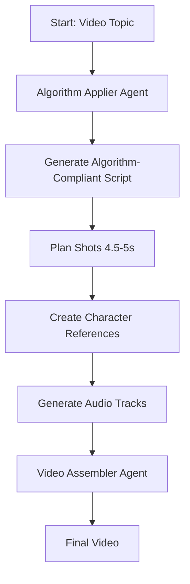

# Agent Deployment Plan for Video Production Pipeline

## Overview
This document outlines the plan for deploying agents to execute the video production pipeline tasks, specifically for implementing the UNIVERSAL_VIDEO_ALGORITHM requirements.

---

## Current State Analysis

### Existing Agent Capabilities (from conversation history)
The user's agent has successfully:
- Downloaded YouTube video `npoPedEq3hs`
- Extracted metadata, transcript, shots, keyframes
- Performed visual analysis, story analysis, audio analysis
- Generated independent critique and triangulation
- Produced complete evidence pack in [`analysis/npoPedEq3hs/`](analysis/npoPedEq3hs/)

### Existing Script Infrastructure
| Script | Purpose | Status |
|---|---|---|
| [`scripts/download_youtube.py`](scripts/download_youtube.py) | YouTube video download | ✅ Available |
| [`scripts/generate_clean_transcript.py`](scripts/generate_clean_transcript.py) | Transcript generation | ✅ Available |
| [`scripts/build_granular_script_and_prompts.py`](scripts/build_granular_script_and_prompts.py) | Script segmentation (10-15s) | ⚠️ Needs update |
| [`scripts/build_full_microsoft_audio.py`](scripts/build_full_microsoft_audio.py) | Audio synthesis | ✅ Available |
| [`scripts/assemble_full_documentary.py`](scripts/assemble_full_documentary.py) | Video assembly | ✅ Available |

---

## Agent Task Breakdown

### Phase 1: Evidence Collection Agent

#### Agent Responsibilities
1. **Video Download & Metadata Extraction**
   - Use [`pipeline/youtube.py`](pipeline/youtube.py)
   - Download video from YouTube URL
   - Extract metadata (title, duration, views, likes)
   - Save to `analysis/{video_id}/00_metadata.json`

2. **Transcript Generation**
   - Use [`pipeline/transcribe.py`](pipeline/transcribe.py)
   - Generate transcript with timestamps
   - Save to `analysis/{video_id}/01_transcript.json`

3. **Shot Detection**
   - Use [`pipeline/shot_analysis.py`](pipeline/shot_analysis.py)
   - Detect scene cuts and shot boundaries
   - Save to `analysis/{video_id}/03_shots.json`

4. **Keyframe Extraction**
   - Use [`pipeline/keyframes.py`](pipeline/keyframes.py)
   - Extract keyframes at shot boundaries
   - Save to `analysis/{video_id}/04_keyframes/`

#### Implementation Status
- **✅ COMPLETE** - Agent already performs all these tasks
- Evidence pack for npoPedEq3hs is complete

---

### Phase 2: Analysis Agent

#### Agent Responsibilities
1. **Audio Metrics Analysis**
   - Use [`pipeline/audio_analysis.py`](pipeline/audio_analysis.py)
   - Measure loudness, speech ratio, WPM, pauses
   - Save to `analysis/{video_id}/05_audio_metrics.json`

2. **Visual Analysis**
   - Use [`pipeline/vlm_captioning.py`](pipeline/vlm_captioning.py)
   - Analyze color palette, composition, edge density
   - Save to `analysis/{video_id}/09_visual_analysis.json`

3. **Story Analysis**
   - Use [`pipeline/content_analysis.py`](pipeline/content_analysis.py)
   - Identify hook, beats, open loops, metaphors, humor
   - Save to `analysis/{video_id}/10_story_analysis.json`

4. **Audio Deep Analysis**
   - Analyze BGM mood shifts, SFX events
   - Save to `analysis/{video_id}/11_audio_analysis.json`

5. **Independent Critique**
   - Cross-validate findings
   - Identify what actually drives retention
   - Save to `analysis/{video_id}/12_independent_critique.json`

6. **Triangulation**
   - Create confidence matrix
   - Save to `analysis/{video_id}/13_triangulation.md`

#### Implementation Status
- **✅ COMPLETE** - Agent already performs all these tasks
- All analysis files exist for npoPedEq3hs

---

### Phase 3: Algorithm Application Agent (NEW - Needs Implementation)

#### Agent Responsibilities

This is the **NEW** agent that needs to be created to apply the UNIVERSAL_VIDEO_ALGORITHM.

1. **Script Generation with Algorithm Constraints**
   ```python
   # Input: Video topic
   # Output: Script with:
   # - Hook paradox (≤30s)
   # - 4-5 open loops (lồng nhau)
   # - Short sentences (50% ≤6 words)
   # - Metaphors (1 per 3-5 minutes)
   # - Humor lines (4+)
   # - Callback to hook in ending
   ```

2. **Shot Planning with 4.5-5s Duration**
   ```python
   # Input: Script
   # Output: Shot plan with:
   # - Mean duration: 4.5-5s
   # - Max words per shot: 6
   # - Total shots: calculated from script length
   ```

3. **Character Consistency Management**
   ```python
   # Input: Script scenes
   # Output: Character reference images
   # - Generate reference image for each character
   # - Store in assets/characters/{character_id}/reference.png
   # - Use reference for all subsequent shots
   ```

4. **Audio Track Generation**
   ```python
   # Input: Script + shot plan
   # Output: Audio tracks with:
   # - Multi-track BGM (8+ tracks for different moods)
   # - SFX events mapped to video events
   # - BGM ducking (-18 to -22 dB under voice)
   # - SFX density: 8-10 per minute
   ```

---

## Agent Deployment Architecture

### Agent 1: Video Analyzer (EXISTS)
```
Input: YouTube URL
Output: Complete evidence pack
Status: ✅ Operational
```

### Agent 2: Algorithm Applier (NEW)
```
Input: Video topic or script
Output: Production-ready assets (script, shots, audio, visuals)
Status: ❌ Needs Implementation
```

### Agent 3: Video Assembler (EXISTS)
```
Input: Assets from Agent 2
Output: Final video
Status: ✅ Operational (needs algorithm compatibility)
```

---

## Implementation Plan for Algorithm Applier Agent

### Step 1: Create Agent Script
**File**: [`scripts/apply_video_algorithm.py`](scripts/apply_video_algorithm.py)

```python
"""
Agent to apply UNIVERSAL_VIDEO_ALGORITHM to generate production-ready assets.
"""
import json
from pathlib import Path
from typing import Dict, List, Optional

from pipeline.llm_client import generate_with_retry
from services.script_auditor import ScriptAuditor

class VideoAlgorithmAgent:
    def __init__(self, video_id: str, output_dir: Path):
        self.video_id = video_id
        self.output_dir = output_dir
        self.evidence_dir = output_dir / "analysis" / video_id
        
    def generate_algorithm_script(self, topic: str) -> Dict:
        """Generate script following UNIVERSAL_VIDEO_ALGORITHM."""
        # Use LLM to generate script with algorithm constraints
        # Return: hook, open_loops, scenes, metaphors, humor_points
        pass
    
    def plan_shots(self, script: Dict) -> List[Dict]:
        """Plan shots with 4.5-5s duration and ≤6 words."""
        # Segment script into shots
        # Ensure each shot has ≤6 words
        # Target duration: 4.5-5s
        pass
    
    def generate_character_references(self, scenes: List[Dict]) -> Dict:
        """Generate and store character reference images."""
        # Detect characters in scenes
        # Generate reference images
        # Store in assets/characters/
        pass
    
    def generate_audio_tracks(self, shot_plan: List[Dict]) -> Dict:
        """Generate multi-track BGM and SFX."""
        # Create BGM tracks per beat/mood
        # Map SFX to events
        # Generate audio files
        pass
```

### Step 2: Update Script Auditor for Algorithm Compliance
**File**: [`services/script_auditor.py`](services/script_auditor.py:27-31)

```python
# Change from:
MIN_WORDS_PER_SHOT = 6
RECOMMENDED_WORDS_PER_SHOT = (14, 25)
MAX_WORDS_PER_SHOT = 28
DEFAULT_TARGET_SHOTS = 24

# To:
# Algorithm mode constants
MIN_WORDS_PER_SHOT_ALGORITHM = 4
RECOMMENDED_WORDS_PER_SHOT_ALGORITHM = (4, 6)
MAX_WORDS_PER_SHOT_ALGORITHM = 6
TARGET_SHOT_DURATION_ALGORITHM = 4.5  # seconds

# Legacy mode constants (for backward compatibility)
MIN_WORDS_PER_SHOT = 6
RECOMMENDED_WORDS_PER_SHOT = (14, 25)
MAX_WORDS_PER_SHOT = 28
DEFAULT_TARGET_SHOTS = 24
```

### Step 3: Create Character Manager
**File**: [`pipeline/character_manager.py`](pipeline/character_manager.py)

```python
"""
Character consistency management for video production.
"""
from pathlib import Path
from typing import Dict, Optional
import uuid

class CharacterManager:
    CHARACTER_DIR = Path("assets/characters")
    
    def __init__(self):
        self CHARACTER_DIR.mkdir(parents=True, exist_ok=True)
        self.characters: Dict[str, Dict] = {}
    
    def create_character(self, name: str, description: str) -> str:
        """Create a new character with reference image."""
        char_id = str(uuid.uuid4())
        char_dir = self.CHARACTER_DIR / char_id
        char_dir.mkdir(parents=True, exist_ok=True)
        
        # Generate reference image (placeholder - actual implementation needed)
        ref_image = char_dir / "reference.png"
        
        self.characters[char_id] = {
            "id": char_id,
            "name": name,
            "description": description,
            "reference_image": str(ref_image),
            "shots": []
        }
        
        return char_id
    
    def get_reference_image(self, char_id: str) -> Optional[Path]:
        """Get reference image path for a character."""
        if char_id in self.characters:
            return Path(self.characters[char_id]["reference_image"])
        return None
```

### Step 4: Create BGM Manager
**File**: [`pipeline/bgm_manager.py`](pipeline/bgm_manager.py)

```python
"""
Multi-track BGM management with mood shifts.
"""
from pathlib import Path
from typing import Dict, List
from dataclasses import dataclass

@dataclass
class BGMTrack:
    path: Path
    mood: str
    start_time: float
    end_time: float
    volume: float  # -18 to -22 dB under voice

class BGMManager:
    BGM_DIR = Path("assets/music/bgm")
    
    def __init__(self):
        self.BGM_DIR.mkdir(parents=True, exist_ok=True)
        self.tracks: List[BGMTrack] = []
    
    def add_track(self, track: BGMTrack):
        """Add a BGM track with mood and timing."""
        self.tracks.append(track)
    
    def get_mood_shift_schedule(self) -> List[Dict]:
        """Get mood shift schedule for mixing."""
        schedule = []
        for track in sorted(self.tracks, key=lambda t: t.start_time):
            schedule.append({
                "start": track.start_time,
                "end": track.end_time,
                "mood": track.mood,
                "volume": track.volume
            })
        return schedule
```

### Step 5: Create SFX Manager
**File**: [`pipeline/sfx_manager.py`](pipeline/sfx_manager.py)

```python
"""
SFX event management for video production.
"""
from pathlib import Path
from typing import Dict, List
from dataclasses import dataclass

@dataclass
class SFXEvent:
    sfx_type: str  # e.g., "ka_ching", "muffled_boom", "cartoon_whoosh"
    timestamp: float
    duration: float = 0.5
    volume: float = -15.0  # dB

class SFXManager:
    SFX_DIR = Path("assets/music/sfx")
    
    # Event triggers from algorithm
    EVENT_TRIGGERS = {
        "money": "ka_ching",
        "explosion": "muffled_boom",
        "transition": "cartoon_whoosh",
        "text_appear": "crayon_scribble",
        "icon_pop": "subtle_pop_plop",
        "dramatic_pause": "dramatic_silence"
    }
    
    def __init__(self):
        self.SFX_DIR.mkdir(parents=True, exist_ok=True)
        self.events: List[SFXEvent] = []
    
    def add_event(self, event_type: str, timestamp: float):
        """Add SFX event at specific timestamp."""
        sfx_type = self.EVENT_TRIGGERS.get(event_type, "default")
        self.events.append(SFXEvent(
            sfx_type=sfx_type,
            timestamp=timestamp
        ))
    
    def get_events_per_minute(self) -> float:
        """Calculate SFX density."""
        if not self.events:
            return 0.0
        last_time = max(e.timestamp for e in self.events)
        return len(self.events) / (last_time / 60)
```

---

## Agent Workflow



---

## Deployment Steps

### Step 1: Create New Agent Script
```bash
# Create the algorithm applier agent
cp scripts/build_granular_script_and_prompts.py scripts/apply_video_algorithm.py
# Then modify apply_video_algorithm.py with algorithm logic
```

### Step 2: Update Existing Scripts
```bash
# Update script_auditor.py constants
# Add algorithm mode support
```

### Step 3: Create New Pipeline Modules
```bash
# Create character_manager.py
touch pipeline/character_manager.py

# Create bgm_manager.py
touch pipeline/bgm_manager.py

# Create sfx_manager.py
touch pipeline/sfx_manager.py
```

### Step 4: Update Documentary Assembler
```bash
# Update documentary_assembler.py to use new audio system
# Integrate BGM and SFX managers
```

---

## Testing Strategy

### Test 1: Algorithm Script Generation
```python
# Test that generated scripts meet algorithm criteria
agent = VideoAlgorithmAgent("test", Path("temp"))
script = agent.generate_algorithm_script("History of Nvidia")

assert len(script["open_loops"]) >= 4
assert script["hook_duration"] <= 30
assert script["short_sentence_pct"] >= 50
```

### Test 2: Shot Planning
```python
# Test that shots meet duration and word count requirements
shots = agent.plan_shots(script)

for shot in shots:
    assert shot["word_count"] <= 6
    assert 4.0 <= shot["duration"] <= 6.0
```

### Test 3: Character Consistency
```python
# Test that character references are created and used
char_manager = CharacterManager()
char_id = char_manager.create_character("Elon Musk", "CEO of Tesla")
ref_image = char_manager.get_reference_image(char_id)

assert ref_image.exists()
```

### Test 4: Audio Generation
```python
# Test that audio meets algorithm specifications
bgm_manager = BGMManager()
# Add tracks for different moods

sfx_manager = SFXManager()
# Add SFX events

assert sfx_manager.get_events_per_minute() >= 8
```

---

## Success Criteria

| Metric | Target | Measurement |
|---|---|---|
| Script passes algorithm audit | 100% | Script auditor validation |
| Mean shot duration | 4.5-5s | Shot analysis |
| Max words per shot | ≤6 | Script analysis |
| Character consistency | 100% | Visual inspection |
| BGM tracks per video | ≥8 | Audio analysis |
| SFX density | 8-10/min | Audio analysis |
| BGM ducking | -18 to -22 dB | Audio metrics |

---

## Risk Mitigation

### Risk 1: LLM Script Generation Quality
**Mitigation**: 
- Use structured prompts with algorithm constraints
- Implement validation checks
- Allow manual override for creative control

### Risk 2: Character Reference Image Generation
**Mitigation**:
- Use stable diffusion with reference image support
- Implement face matching validation
- Cache reference images for reuse

### Risk 3: Audio Complexity
**Mitigation**:
- Start with 2-3 BGM tracks, scale up
- Use pre-mixed BGM tracks initially
- Implement gradual SFX introduction

---

## Timeline

| Phase | Duration | Deliverables |
|---|---|---|
| Phase 1: Algorithm Script Generation | 3 days | apply_video_algorithm.py, updated script_auditor.py |
| Phase 2: Character Management | 2 days | character_manager.py, integration tests |
| Phase 3: Audio System | 3 days | bgm_manager.py, sfx_manager.py, audio integration |
| Phase 4: Testing & Validation | 2 days | Test suite, validation scripts |
| **Total** | **10 days** | Full algorithm deployment |

---

## Next Steps

1. **Immediate**: Create [`scripts/apply_video_algorithm.py`](scripts/apply_video_algorithm.py)
2. **Priority**: Update [`services/script_auditor.py`](services/script_auditor.py:27-31) constants
3. **Parallel**: Create pipeline managers (character, BGM, SFX)
4. **Final**: Integrate and test end-to-end workflow

---

## References

- Algorithm specification: [`skills/video_production/UNIVERSAL_VIDEO_ALGORITHM.md`](skills/video_production/UNIVERSAL_VIDEO_ALGORITHM.md)
- Bottleneck fix plan: [`plans/bottleneck_fix_plan.md`](plans/bottleneck_fix_plan.md)
- Evidence pack: [`analysis/npoPedEq3hs/`](analysis/npoPedEq3hs/)
