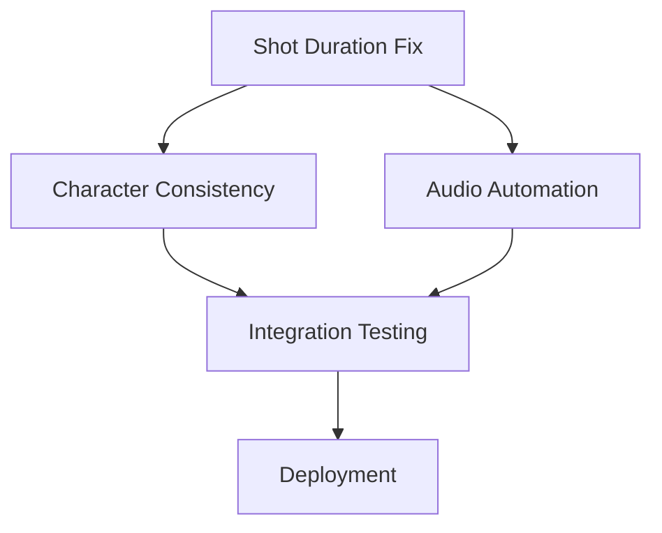

# Pipeline Bottleneck Fix Plan

## Overview
This document outlines the implementation plan to address the 3 critical bottlenecks preventing deployment of the UNIVERSAL_VIDEO_ALGORITHM.

---

## 📋 Bottleneck Validation

### ✅ Confirmed Bottlenecks

| # | Bottleneck | Current State | Required State | Severity | Files Affected |
|---|---|---|---|---|---|
| 1 | Shot Duration | 10s shots ([`script_auditor.py:27-31`](services/script_auditor.py:27-31)) | 4.5-5s shots with ≤6 words | **CRITICAL** | `script_auditor.py`, `script_timeline_planner.py` |
| 2 | Character Consistency | No reference image mechanism | Consistent character appearance across shots | **HIGH** | Image generation pipeline |
| 3 | Audio Automation | Single BGM track ([`documentary_assembler.py:361-395`](pipeline/documentary_assembler.py:361-395)) | Multi-track BGM with mood shifts + SFX event mapping | **HIGH** | `audio_mix.py`, `audio_track_builder.py`, `documentary_assembler.py` |

---

## 🎯 Implementation Plan

### Phase 1: Shot Duration Adjustment (Priority: CRITICAL)

#### Goal
Reduce shot duration from 10s to 4.5-5s with ≤6 words per shot to match algorithm requirements.

#### Current State
- [`script_auditor.py:27-31`](services/script_auditor.py:27-31): `MIN_WORDS_PER_SHOT = 6`, `MAX_WORDS_PER_SHOT = 28`
- Target: 10-second Veo shots
- Evidence: Video npoPedEq3hs has mean 5.0s, median 4.47s ([`03_shots.json`](analysis/npoPedEq3hs/03_shots.json:5-6))

#### Required Changes

1. **Update Shot Duration Constants**
   - File: [`script_auditor.py`](services/script_auditor.py:27-31)
   - Change `MIN_WORDS_PER_SHOT` from 6 to **4**
   - Change `RECOMMENDED_WORDS_PER_SHOT` from (14, 25) to **(4, 6)**
   - Change `MAX_WORDS_PER_SHOT` from 28 to **6**
   - Update comment from "10-second Veo shots" to "4.5-5s algorithm shots"

2. **Update Timeline Planner**
   - File: [`script_timeline_planner.py`](pipeline/script_timeline_planner.py)
   - Adjust shot segmentation logic to target 4.5-5s duration
   - Ensure word count per shot ≤6

3. **Update Script Auditor Logic**
   - File: [`script_auditor.py`](services/script_auditor.py)
   - Modify `audit_script()` to enforce ≤6 words per shot
   - Add validation for shot duration range (4.0-6.0s)

#### Acceptance Criteria
- [ ] All new scripts generate shots with mean duration 4.5-5s
- [ ] All shots have ≤6 words
- [ ] Existing 10s shot compatibility maintained via configuration flag

---

### Phase 2: Character Consistency (Priority: HIGH)

#### Goal
Ensure consistent character appearance across all shots using reference images.

#### Current State
- No character reference mechanism exists
- Each image generation call produces independent character interpretations

#### Required Changes

1. **Create Character Reference System**
   - New file: [`pipeline/character_manager.py`](pipeline/character_manager.py)
   - Store reference images per character
   - Provide reference image path to image generation calls

2. **Integrate with Image Generation**
   - File: Image generation pipeline (TBD - need to locate)
   - Add `reference_image` parameter to generation calls
   - Use face matching to validate consistency

3. **Update VLM Captioning**
   - File: [`pipeline/vlm_captioning.py`](pipeline/vlm_captioning.py)
   - Add character detection to keyframe analysis
   - Track character appearance across shots

4. **Create Character Database**
   - New directory: `assets/characters/`
   - Store reference images: `assets/characters/{character_id}/reference.png`
   - Store character profiles: `assets/characters/{character_id}/profile.json`

#### Acceptance Criteria
- [ ] Character reference images stored and retrievable
- [ ] Image generation uses reference images for consistency
- [ ] Character appearance validated across shots

---

### Phase 3: Audio Automation (Priority: HIGH)

#### Goal
Support multi-track BGM with dynamic mood shifts and SFX event mapping.

#### Current State
- [`documentary_assembler.py:361-395`](pipeline/documentary_assembler.py:361-395): Single BGM track mixing
- No SFX support
- No mood shift automation

#### Required Changes

1. **Create BGM Track Manager**
   - New file: [`pipeline/bgm_manager.py`](pipeline/bgm_manager.py)
   - Support multiple BGM tracks per video section
   - Implement mood shift scheduling based on beats

2. **Create SFX Event System**
   - New file: [`pipeline/sfx_manager.py`](pipeline/sfx_manager.py)
   - Map SFX to video events (e.g., "ka_ching" for money, "muffled_boom" for explosions)
   - Event triggers from [`11_audio_analysis.json:76-83`](analysis/npoPedEq3hs/11_audio_analysis.json:76-83)

3. **Update Audio Mix Pipeline**
   - File: [`pipeline/audio_mix.py`](pipeline/audio_mix.py)
   - Support multi-track BGM mixing with volume ducking
   - Add SFX layer mixing
   - Implement dynamic mood shift transitions

4. **Update Documentary Assembler**
   - File: [`pipeline/documentary_assembler.py`](pipeline/documentary_assembler.py:361-395)
   - Replace single BGM logic with multi-track support
   - Integrate SFX event triggers

5. **Create Audio Configuration Schema**
   - New file: [`core/audio_schemas.py`](core/audio_schemas.py)
   - Define BGM track structure with mood shifts
   - Define SFX event mapping structure

#### Acceptance Criteria
- [ ] Multi-track BGM with mood shifts per beat
- [ ] SFX events triggered at correct timestamps
- [ ] BGM ducking under voiceover (-18 to -22 dB)
- [ ] SFX density: 8-10 per minute

---

## 📊 Dependency Graph

---

## 🎯 Execution Order

1. **Phase 1: Shot Duration** (Week 1)
   - Highest priority - blocks all other work
   - Quick win with immediate impact

2. **Phase 2: Character Consistency** (Week 2)
   - Depends on Phase 1 completion
   - Requires new infrastructure

3. **Phase 3: Audio Automation** (Week 3)
   - Depends on Phase 1 completion
   - Most complex, highest effort

---

## 📝 File Modifications Summary

### Files to Modify
| File | Lines | Change Type | Phase |
|---|---|---|---|
| [`services/script_auditor.py`](services/script_auditor.py) | 27-31 | Constants update | 1 |
| [`pipeline/script_timeline_planner.py`](pipeline/script_timeline_planner.py) | TBD | Logic update | 1 |
| [`pipeline/documentary_assembler.py`](pipeline/documentary_assembler.py) | 361-395 | Logic replacement | 3 |
| [`pipeline/audio_mix.py`](pipeline/audio_mix.py) | TBD | Enhancement | 3 |
| [`pipeline/vlm_captioning.py`](pipeline/vlm_captioning.py) | TBD | Enhancement | 2 |

### Files to Create
| File | Phase |
|---|---|
| [`pipeline/character_manager.py`](pipeline/character_manager.py) | 2 |
| [`pipeline/bgm_manager.py`](pipeline/bgm_manager.py) | 3 |
| [`pipeline/sfx_manager.py`](pipeline/sfx_manager.py) | 3 |
| [`core/audio_schemas.py`](core/audio_schemas.py) | 3 |

### Directories to Create
| Directory | Phase |
|---|---|
| `assets/characters/` | 2 |

---

## ✅ Validation Checklist

- [ ] Shot duration constants updated and tested
- [ ] Script auditor enforces ≤6 words per shot
- [ ] Character reference system implemented
- [ ] Image generation uses character references
- [ ] Multi-track BGM system implemented
- [ ] SFX event system implemented
- [ ] Audio mixing supports all new features
- [ ] All acceptance criteria met for each phase

---

## 📊 Success Metrics

| Metric | Current | Target | Measurement |
|---|---|---|---|
| Mean shot duration | 10s | 4.5-5s | From shot analysis |
| Words per shot (max) | 28 | 6 | From script audit |
| Character consistency | N/A | 100% | Visual inspection |
| BGM tracks per video | 1 | 8+ (per beat) | From audio analysis |
| SFX density | 0 | 8-10/min | From audio analysis |

---

## 🔗 References

- Algorithm requirements: [`skills/video_production/UNIVERSAL_VIDEO_ALGORITHM.md`](skills/video_production/UNIVERSAL_VIDEO_ALGORITHM.md)
- Evidence pack: [`analysis/npoPedEq3hs/`](analysis/npoPedEq3hs/)
- Audio analysis: [`analysis/npoPedEq3hs/11_audio_analysis.json`](analysis/npoPedEq3hs/11_audio_analysis.json)
- Shot analysis: [`analysis/npoPedEq3hs/03_shots.json`](analysis/npoPedEq3hs/03_shots.json)
