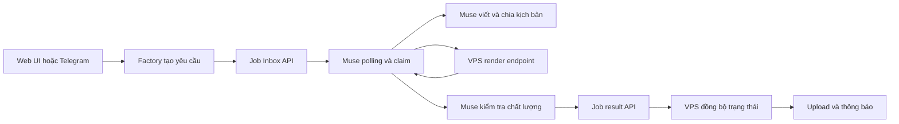

# Kế hoạch chuyển toàn bộ sinh video sang Muse qua API Job Inbox

- **Trạng thái:** Chờ duyệt, chưa sửa code
- **Ngày:** 2026-11-02
- **Phạm vi:** Chuyển luồng sinh video AI từ Gemini/Veo hiện tại sang Muse xử lý end-to-end bằng `make_video`
- **Tài liệu giao thức:** [`muse_job_inbox_spec.md`](../muse_job_inbox_spec.md)
- **Kịch bản mẫu phân tích:** [`kich_ban_VI_remake_1792673726_b537ce.txt`](../kich_ban_VI_remake_1792673726_b537ce.txt)

## 1. Mục tiêu và quyết định đã chốt

### Mục tiêu

1. VPS không còn trực tiếp gọi Gemini/Veo để sinh các video shot.
2. VPS tạo một job `make_video` và đưa vào API Job Inbox.
3. Muse chủ động polling, claim, viết/chia cảnh, gọi hệ thống render của VPS theo giao thức đã thống nhất, chờ render, QC và trả kết quả.
4. VPS nhận `video_url`, script, scenes và QC; cập nhật trạng thái để người dùng theo dõi.
5. Giữ nguyên các phần hậu kỳ phù hợp của hệ thống hiện tại: lưu trữ, kiểm tra output, audio/TTS/BGM, subtitle, upload và thông báo nếu không xung đột với ownership mới của Muse.

### Phạm vi giai đoạn này

- Chọn **API Job Inbox**, không dùng phương án thư mục inbox/outbox.
- Bật allowlist `make_video` cho Muse sau khi hoàn thành kiểm thử bảo mật và vòng test nhỏ.
- Chưa sửa code trong Architect mode.
- Không xóa ngay mã Gemini; trước hết cô lập và tắt bằng feature flag/config để có rollback.
- Không đưa token, cookie Gemini hoặc secret nào vào payload job.

## 2. Phân tích hiện trạng

### 2.1. Luồng Gemini hiện tại

- [`core/worker.py`](../core/worker.py) khởi tạo `GeminiWebApiProvider` làm provider chính và dùng `ImageKenBurnsProvider` làm fallback.
- Luồng xử lý shot quyết định `needs_veo`, lấy account từ `AccountPoolManager`, chọn session file, tạo seed image rồi gọi `primary_provider.generate(...)`.
- Khi Veo lỗi quota/auth/rate-limit, worker đang có logic retry, cooldown, kill-switch và fallback sang Ken Burns.
- [`services/video_provider.py`](../services/video_provider.py) đang định nghĩa abstraction cho provider đồng bộ, trong đó contract hiện tại trả về file video cục bộ.
- [`services/gemini_webapi_provider.py`](../services/gemini_webapi_provider.py) và [`services/gemini_generator.py`](../services/gemini_generator.py) phụ trách giao tiếp Gemini/Veo trực tiếp.
- [`pipeline/automated_factory.py`](../pipeline/automated_factory.py) mô tả Mode 2 là Full AI Genesis bằng Gemini Pro và có các nhánh tạo hình/shot liên quan.
- [`services/account_pool.py`](../services/account_pool.py) hiện phục vụ session Gemini, keep-alive, kiểm tra tier/quota và kill-switch.
- [`services/telegram_bot.py`](../services/telegram_bot.py) hiện có các lệnh/trạng thái liên quan đến Veo, account và Gemini image.

### 2.2. Ranh giới cần thay đổi

**Chuyển sang Muse:**

- Viết hoặc hoàn thiện kịch bản.
- Chia cảnh.
- Tạo `image_prompt`, `video_prompt`, `negative_prompt`.
- Gọi render video theo flow `make_video`.
- Theo dõi render dài bằng heartbeat.
- QC video và trả kết quả.

**VPS tiếp tục sở hữu:**

- Tạo job và lưu trạng thái Job Inbox.
- Bảo mật API và token.
- Poll/đồng bộ trạng thái job.
- Xác thực schema và idempotency.
- Lưu script/scenes/result metadata.
- Nhận và xác minh `video_url`.
- Hậu kỳ cục bộ nếu Muse trả clip/raw asset theo thiết kế được duyệt.
- Upload, delivery, Telegram notification, audit log và recovery.

**Cần quyết định lại, không được mặc định:**

- Muse render trực tiếp vào endpoint nào của VPS hay trả file/link từ môi trường Muse.
- Muse trả video final đã có narration/audio hay chỉ trả visual render.
- TTS/BGM/subtitle thuộc Muse hay vẫn thuộc pipeline VPS.
- `video_url` có cần signed URL, expiry và quyền truy cập riêng hay không.

## 3. Kiến trúc mục tiêu



### Trạng thái nguồn sự thật

- Job Inbox là nguồn sự thật cho trạng thái công việc Muse: `pending`, `running`, `done`, `failed`, `cancelled`.
- `JobQueueManager`/factory job hiện tại là nguồn sự thật cho trạng thái delivery/hậu kỳ của VPS.
- Cần một khóa liên kết bất biến giữa `factory_job_id` và `muse_job_id`; khuyến nghị dùng cùng một ID có namespace rõ ràng, ví dụ `video-<factory_id>`.
- Không để worker local tiếp tục coi job là hoàn tất chỉ vì đã gửi thành công vào inbox.

## 4. Thiết kế payload `make_video`

Payload tối thiểu đề xuất:

```json
{
  "story": "Toàn văn ý tưởng hoặc kịch bản đã chuẩn hóa",
  "script_source": "existing_script_file",
  "script": "Toàn văn kịch bản tiếng Việt nếu đã có",
  "target_duration_sec": 718,
  "language": "vi",
  "visual_style": "cinematic documentary, realistic, coherent characters",
  "aspect_ratio": "16:9",
  "voice": "vi-VN-NamMinhNeural",
  "music_mood": "subtle documentary, tense when needed",
  "source_metadata": {
    "factory_job_id": "remake_1792673726_b537ce",
    "title": "Once You Understand MONEY, You'll Stop Saving it [PART #2]",
    "script_file": "kich_ban_VI_remake_1792673726_b537ce.txt",
    "scene_count_hint": 112
  },
  "delivery_requirements": {
    "return_script": true,
    "return_scenes": true,
    "return_qc": true,
    "video_format": "mp4",
    "minimum_resolution": "1920x1080"
  }
}
```

### Quy tắc payload

- Nếu đã có kịch bản được duyệt, ưu tiên truyền `script` đầy đủ; `story` chỉ làm context.
- Không truyền đường dẫn local kiểu `C:\...` mà Muse không truy cập được.
- `script_file` chỉ là metadata truy vết, không phải nguồn đọc bắt buộc của Muse.
- Không nhồi toàn bộ dữ liệu raw transcript, cookie, API key, session file hoặc thông tin tài khoản.
- Job phải có `priority`, `max_attempts`, `source` và `note` ở cấp job.
- Với job dài khoảng 12 phút/112 cảnh, đặt `max_attempts` thấp nhưng đủ để retry lỗi mạng; không retry mù lỗi nội dung hoặc QC fail.

## 5. Phân tích kịch bản mẫu và cách đưa lên Muse

Kịch bản [`kich_ban_VI_remake_1792673726_b537ce.txt`](../kich_ban_VI_remake_1792673726_b537ce.txt) hiện có:

- 112 cảnh.
- Thời lượng dự kiến khoảng 718 giây.
- 2.782 từ.
- Lời dẫn tiếng Việt.
- Mỗi cảnh có khoảng thời gian, narration, tình huống, AI prompt và thông tin nhân vật.
- Phong cách prompt đang thiên về cinematic documentary, 4K, 35mm, ánh sáng/mood và bố cục rõ ràng.

### Cách chuẩn hóa trước khi tạo job

1. Đọc toàn văn, không cắt theo giới hạn 80 dòng đầu.
2. Parse mỗi block `[CẢNH NNN]` thành record chuẩn.
3. Kiểm tra tổng thời lượng các cảnh, khoảng trống thời gian, cảnh trùng và scene number.
4. Tách rõ `narration` khỏi `visual_description` và prompt.
5. Làm sạch trường `Nhân vật`; loại bỏ token nhiễu như từ dừng hoặc giới từ bị nhận nhầm.
6. Gắn `scene_count_hint=112`, `target_duration_sec=718` nhưng để Muse có quyền điều chỉnh hợp lý theo narration.
7. Truyền toàn văn script đã chuẩn hóa vào `payload.script`.
8. Yêu cầu Muse giữ ý nghĩa factual của script; không tự thay đổi số liệu, nhân vật hoặc luận điểm nếu không có phê duyệt.
9. Yêu cầu output scenes có `scene_no`, `duration_sec`, `narration`, `image_prompt`, `video_prompt`, `negative_prompt`.
10. Sau khi Muse trả result, đối chiếu số cảnh, tổng thời lượng, narration coverage và continuity trước khi đưa sang delivery.

### Job thử nghiệm đầu tiên

Không dùng ngay job 112 cảnh để nghiệm thu integration. Tạo một job test nhỏ từ 3–5 cảnh đầu, giữ cùng format và style. Sau khi vòng đời `pending → running → done` và output contract đạt, mới gửi bản đầy đủ 112 cảnh.

## 6. Kế hoạch thay đổi hệ thống, chưa thực hiện

### Phase A — Contract và cấu hình

- Tạo module client/server-side cho Job Inbox API theo endpoint trong [`muse_job_inbox_spec.md`](../muse_job_inbox_spec.md).
- Bổ sung cấu hình base URL, token từ environment/secret store.
- Thêm timeout, retry backoff, request ID và log không chứa token/payload nhạy cảm.
- Thêm feature flag `MUSE_VIDEO_ENABLED` hoặc cấu hình tương đương.
- Mặc định an toàn: chưa bật production cho tới khi smoke test đạt.

### Phase B — Tạo và theo dõi job

- Tạo adapter nhận yêu cầu từ factory/UI và tạo `make_video` job idempotent.
- Lưu mapping local job ↔ Muse job.
- Poll `GET /jobs/:id` hoặc endpoint danh sách phù hợp để đồng bộ trạng thái.
- Xử lý `401`, `404`, `409`, `422`, timeout và lỗi mạng phân biệt rõ.
- Không tăng attempt của video job khi chỉ là lỗi kết nối API.
- Khi local process restart, đọc mapping và resume việc đồng bộ thay vì tạo job mới.

### Phase C — Thay thế dispatch Gemini

- Tách nhánh `needs_veo` hiện tại khỏi đường chạy production.
- Thay thao tác lấy account/session và gọi `primary_provider.generate` bằng thao tác submit/track Muse job.
- Không xóa provider Gemini trong phase đầu; giữ code cho rollback và test legacy.
- Ngăn fallback Ken Burns tự động được hiểu là video generation thành công khi Muse job chưa hoàn tất.
- Cập nhật state machine local để có trạng thái chờ Muse, ví dụ `MUSE_PENDING`, `MUSE_RUNNING`, `MUSE_DONE`, `MUSE_FAILED` hoặc mapping tương đương.

### Phase D — Nhận output và delivery

- Validate `result.outputs.video_url` bằng media probe/download HEAD policy đã thống nhất.
- Validate duration, codec, resolution, audio track và file size.
- Lưu script/scenes/QC vào project artifact có version.
- Nếu output chỉ là visual video, chạy phần audio/TTS/subtitle/BGM còn thuộc VPS sau khi duyệt ranh giới.
- Chỉ upload/notify khi validation đạt.
- Nếu QC fail, không đánh dấu delivery thành công; lưu issue và áp dụng retry/manual approval theo policy.

### Phase E — UI, Telegram và vận hành

- Thay thông báo “đang dùng Veo/Gemini” bằng “đã gửi Muse / Muse đang xử lý / Muse hoàn tất”.
- Bổ sung lệnh hoặc màn hình xem `muse_job_id`, status, attempts, progress note và last error.
- Giữ các lệnh account Gemini chỉ cho legacy/ảnh nếu còn dùng; không để người vận hành hiểu nhầm đó là video path chính.
- Bổ sung nút/hành động cancel theo endpoint cancel.
- Không expose token hoặc payload script đầy đủ trong Telegram log nếu có nội dung nhạy cảm.

## 7. Bảo mật và độ tin cậy

- Public API bắt buộc HTTPS; nếu dùng Tailscale thì bind vào tailnet và không public port.
- Token tối thiểu 32 ký tự, chỉ lưu trong secret/environment; không commit, không log.
- Xác thực mọi request Muse bằng Bearer token.
- Claim phải atomic; lease mặc định 900 giây.
- Muse heartbeat tối đa mỗi 5 phút cho job dài; VPS có reaper lease hết hạn.
- Kết quả lặp lại phải idempotent; nếu job đã `done`, cùng result trả duplicate mà không làm hỏng artifact.
- Tạo job phải idempotent theo `job_id`; retry request sau timeout không được tạo video job thứ hai.
- Giới hạn payload và kích thước script; cân nhắc lưu artifact script riêng nếu JSON quá lớn.
- Signed URL hoặc access-controlled URL cho video output; xác định expiry đủ cho bước download/validation.
- Audit log gồm timestamp, endpoint, job ID, status code, latency; không log Authorization.

## 8. Kiểm thử và nghiệm thu

### Unit tests

- Schema validation cho `make_video`.
- Job ID deterministic và idempotency.
- Mapping local/Muse job.
- Xử lý retry/backoff theo từng mã HTTP.
- State transition khi restart.
- Dedupe result và cancel.
- Parse/normalize kịch bản 112 cảnh.

### Integration tests với API test

1. Request không token → `401`.
2. Tạo job test nhỏ → `201`, `pending`, `duplicate=false`.
3. Tạo lại cùng ID → `200`, `duplicate=true`.
4. Pending list trả đúng thứ tự.
5. Claim → `running`, attempts tăng 1.
6. Claim lại khi lease còn hiệu lực → `409`.
7. Heartbeat gia hạn lease.
8. Fail retryable → pending nếu còn lượt.
9. Fail non-retryable → failed.
10. Result → done.
11. Gửi result lặp lại → duplicate, không ghi đè sai.
12. Lease hết hạn → job quay về pending.

### End-to-end acceptance

- Job 3–5 cảnh hoàn tất qua Muse, có script/scenes/video URL/QC.
- Job đầy đủ 112 cảnh hoàn tất hoặc dừng rõ ràng ở trạng thái có thể resume.
- Không có request video trực tiếp tới Gemini/Veo trong production path khi feature flag Muse bật.
- Video final vượt qua output validator và delivery hiện tại.
- Restart worker giữa lúc Muse đang chạy không tạo job trùng.
- Cancel job dừng xử lý và không upload output bị hủy.
- Lỗi Muse/API không làm mất script hoặc tạo artifact giả.

## 9. Rollout và rollback

### Rollout theo cổng kiểm soát

1. Deploy contract/client nhưng giữ feature flag tắt.
2. Chạy API security test và unit/integration test.
3. Gửi job 3–5 cảnh bằng Muse.
4. Gửi job 112 cảnh nhưng chỉ cho phép manual approval trước delivery.
5. Bật Muse làm đường chính cho các job mới.
6. Theo dõi tỷ lệ done/failed, latency, QC score, output validator và duplicate job.
7. Sau khi ổn định mới tắt hẳn các lệnh điều phối video Gemini khỏi UI vận hành.

### Rollback

- Tắt feature flag Muse ở tầng submit job.
- Không xóa dữ liệu Job Inbox; giữ mapping để điều tra.
- Chỉ rollback job mới chưa bắt đầu; không tự động chạy song song Muse và Gemini cho cùng một job.
- Legacy Gemini chỉ được khôi phục bằng thao tác vận hành rõ ràng và phải tạo generation attempt/version riêng để tránh ghi đè artifact.

## 10. Các điểm cần Joseph duyệt trước khi Code mode

1. Muse trả **video final đã có voice/music/subtitle** hay chỉ trả visual video để VPS hậu kỳ?
2. Muse gọi render endpoint nào của VPS; endpoint đó đã tồn tại hay cần thiết kế mới?
3. `video_url` là URL public, signed URL hay URL nội bộ qua Tailscale?
4. Cho phép Muse tự động chạy `make_video` không cần approval hay chỉ approval trước delivery?
5. `target_duration_sec` cho kịch bản 718 giây có được phép Muse điều chỉnh theo narration không?
6. Kịch bản mẫu cần giữ nguyên tiếng Việt và factual claim tuyệt đối, hay cho phép Muse biên tập lại?
7. Polling 5 phút theo spec có chấp nhận được không, hay cần webhook/chu kỳ ngắn hơn?
8. Có bật `qc_video` thành job riêng sau `make_video`, hay QC nằm trong cùng flow Muse?
9. Khi Muse fail sau hết retry, thông báo chính thức đi qua Telegram, UI, hay cả hai?
10. Có cho phép giữ Gemini làm emergency rollback hay muốn loại bỏ hoàn toàn sau migration?

## 11. Kết luận

Đề xuất triển khai theo hướng **Muse sở hữu toàn bộ orchestration sinh video**, còn VPS sở hữu **job control, render integration endpoint, artifact validation, delivery và vận hành**. Không nên bắt đầu bằng việc xóa Gemini; cần thay đường dispatch bằng adapter Job Inbox, kiểm thử job nhỏ, xác minh ownership của audio/render/output, rồi mới tắt production path Gemini. Kịch bản 112 cảnh hiện tại phù hợp làm input `make_video` sau bước chuẩn hóa và nên được chạy sau một integration test 3–5 cảnh.
