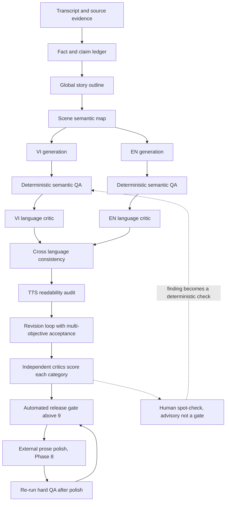

# Kế hoạch nâng chất lượng Script VI/EN lên trên 9/10
# Plan to Raise VI/EN Script Quality Above 9/10

**Trạng thái / Status:** Planning only — chưa sửa code / no code changes
**Đã review và cắt phạm vi / Reviewed and re-scoped: 2026-10-26**

**Phạm vi / Scope:**
- Nâng chất lượng nội dung, cấu trúc, độ tự nhiên và độ mượt TTS cho cả tiếng Việt và tiếng Anh.
- Tập trung vào pipeline ScriptFactory, semantic slicing, rewrite, judge, revision và TTS QA.
- Không triển khai code, không thay đổi prompt, không chạy migration, không deploy trong giai đoạn lập kế hoạch này.

### Cắt phạm vi sau review / Scope cuts from the 2026-10-26 review

Bản gốc của file này là chương trình nhiều tuần (7 phase, 3 lớp chấm, golden set 5 transcript,
human blind review nằm trong release gate). Chẩn đoán đúng nhưng quá liều so với những gì
đang chặn video thật. Plan giờ chia ba tầng, và tầng 1 phải làm trước khi bàn tầng khác:

| Tầng / Tier | Nội dung / Content | Khi nào / When |
|---|---|---|
| **Tier 1 — Slice 0** | Luật revision chấp nhận, 2 gate deterministic (lặp n-gram, xung đột số liệu), chunk sau nhận "beat đã kể" | Ngay, 1 file + 1 test file |
| **Tier 2** | Phase 2 context package, Phase 3 prompt VI/EN tách biệt, Phase 4 naturalness evaluator, Phase 8 external polish | Sau khi Slice 0 đo được trên 1 run thật |
| **Tier 3 (hoãn)** | Phase 0 golden set đủ 5 transcript, Phase 1 ledger `source_span` đầy đủ, Phase 6 audio QA mọi scene, lớp human review trong Part B7/B8 | Sau Gate 4 của video đang chạy |

Lý do hoãn: lỗi thật của bản gần nhất (`remake_1792951825_986f70`) là lặp từ khoá
("tương lai" ×16, "thất bại" ×11), trùng beat xuyên chunk (cảnh 2/25, 4/29–38), một cặp số
mâu thuẫn (8% vs 16%) và revision bị revert dù đã xoá được lặp. Bản đó **không** có lỗi bịa
fact — nên `source_span` ledger, subsystem đắt nhất trong plan, không phải blocker của đêm nay.

---

## 1. Mục tiêu chất lượng bắt buộc / Mandatory Quality Targets

### Hiệu chuẩn thang điểm / Score calibration (điều kiện tiên quyết / precondition)

Mục tiêu ">9.0 mọi tiêu chí" hiện **chưa được hiệu chuẩn**, nên nó chưa phải một gate:

- Judge hiện tại trong pipeline chấm trên thang 7 hạng mục và **đỉnh quan sát được là 7.9/8.0**;
  rubric đó không tách riêng repetition, nên nó không thể là thứ đo mức ">9 tự nhiên".
- Vì vậy phải chọn một trong hai, và chốt trước khi viết gate:
  - **(A) neo lại thang**: target >9.0 chỉ áp dụng cho các critic mới ở Phase 4/6/7, còn judge cũ
    chỉ dùng để so hạng (ranking), không dùng để pass/fail; hoặc
  - **(B) target tương đối**: giữ judge cũ, nhưng yêu cầu cải thiện ≥+1.5 điểm so với baseline
    **và** 0 lỗi hard-QA, thay vì đòi >9.0 tuyệt đối.
- Khuyến nghị của bản review này: **(A)**. Judge cũ 7-item không đủ độ phân giải cho mức 9,
  và nới rubric để điểm đẹp lên là tự lừa.

Mỗi ngôn ngữ phải đạt **trên 9.0/10** ở từng tiêu chí chính, do critic riêng của tiêu chí đó chấm. Không dùng điểm trung bình để che một tiêu chí dưới chuẩn.

| Tiêu chí / Criterion | Điểm hiện tại / Current | Mục tiêu / Target | Điều kiện pass cứng / Hard pass condition |
|---|---:|---:|---|
| Nội dung / Content | 7.5 | >9.0 | Không có fact sai, contradiction, claim không có nguồn hoặc chi tiết bị bịa |
| Cấu trúc video / Video structure | 8.0 | >9.0 | Hook, chronology, acts, open loops, transitions, payoff và callback đều đạt |
| Tự nhiên ngôn ngữ / Language naturalness | 5.5 | >9.0 | Không có câu dịch máy/gượng, collocation sai, chủ-vị mơ hồ hoặc metaphor lệch |
| Mượt khi đọc TTS / TTS smoothness | 5.5–6.0 | >9.0 | Không có câu hụt hơi, nhịp dồn, pause sai, số/tên riêng khó đọc hoặc tốc độ bất ổn |
| VI tổng / VI overall | — | >9.0 | Tất cả tiêu chí VI đều >9.0 |
| EN tổng / EN overall | — | >9.0 | Tất cả tiêu chí EN đều >9.0 |

### Quy tắc không được nới / Non-negotiable rules

1. Một lỗi factual nghiêm trọng làm **fail toàn bộ bản** dù điểm trung bình cao.
2. Một câu TTS gây hiểu sai nghĩa, đọc sai số hoặc sai tên riêng làm **fail language/audio gate**.
3. Không chấp nhận bản đạt cấu trúc nhưng tự nhiên dưới 9.
4. Không chấp nhận bản VI tốt nhưng EN là bản dịch word-by-word.
5. Không chấp nhận việc thêm filler chỉ để đạt word count hoặc duration.
6. Mỗi bản phải lưu được evidence và report để audit lại.
7. Không stage nào (repair, revision, polish, kể cả agent ngoài ở Phase 8) được đổi số liệu, năm,
   đơn vị hoặc tên riêng. Chỉ được đổi **cách nói**.
8. Naturalness không được định nghĩa là "câu dài hơn". Nó xung đột trực tiếp với S07
   (≥35% câu ngắn; bản mới nhất 21.7% → đỏ). Xem Phase 4 để biết cách hoà giải.

---

## 2. Phạm vi code cần đánh giá / Code Areas to Review

Chỉ khi chuyển sang implementation mới được sửa các khu vực sau. Số dòng là ảnh chụp tại ngày
review và phải được verify lại trước khi sửa.

**Slice 0 chỉ chạm vào 3 điểm:** `_revise_script()` (luật acceptance), `script_auditor` (thêm
repetition n-gram + number conflict), `_rewrite_chunk()` (thêm `beats_already_told`). Không đổi
word band, không đổi duration band, không đụng Phase 6/7.

- [`services/script_factory.py`](../services/script_factory.py:1)
  - Prompt generation
  - [`ScriptFactory.run()`](../services/script_factory.py:258)
  - [`_rewrite_chunk()`](../services/script_factory.py:1128)
  - [`_build_outline()`](../services/script_factory.py:1271)
  - [`_global_edit_issues()`](../services/script_factory.py:1360)
  - [`_revise_script()`](../services/script_factory.py:1419)
  - [`_judge()`](../services/script_factory.py:1550)
  - [`_naturalness_report()`](../services/script_factory.py:1627)
  - [`_mechanical_metrics()`](../services/script_factory.py:1647)
- [`services/script_auditor.py`](../services/script_auditor.py:278)
  - Semantic slicing
  - Scene parsing
  - Language-specific audit
  - Claim and continuity audit
- [`services/algorithm_qa.py`](../services/algorithm_qa.py:1)
  - Quality thresholds
  - Duration and pacing boundaries
- [`services/prompt_sanitizer.py`](../services/prompt_sanitizer.py:1)
  - Narration cleaning
  - Mixed-language and TTS cleanup
- [`pipeline/tts.py`](../pipeline/tts.py:418)
  - Sentence splitting
  - Pause handling
  - TTS timing and audio audit
- [`pipeline/automated_factory.py`](../pipeline/automated_factory.py:594)
  - Gate integration
  - Artifact persistence
  - VI/EN report propagation
- [`tests/test_script_factory.py`](../tests/test_script_factory.py:306)
- [`tests/test_script_auditor.py`](../tests/test_script_auditor.py:1)
- [`tests/test_tts.py`](../tests/test_tts.py:1)
- [`tests/test_audio_audit.py`](../tests/test_audio_audit.py:1)

---

## 3. Thiết kế chất lượng mới / Target Quality Architecture



Human review không còn nằm trên đường release. Lý do: gate có người là gate không tự động chạy
được trong pipeline, và mỗi video phải chờ một người bấm. Con người vẫn nghe/xem, nhưng đầu ra
của họ là **một issue được chuyển thành deterministic check**, không phải một điều kiện pass.

### Nguyên tắc kiến trúc / Architecture principles

- **Evidence-first:** mọi claim phải truy ngược được về transcript/source.
- **Meaning before style:** khóa fact và causal chain trước khi tối ưu drama.
- **VI/EN parallel quality:** EN không được xem là bản dịch hậu kỳ của VI.
- **Local plus global context:** mỗi chunk cần biết context lân cận và trạng thái toàn bài.
- **Critic independence:** generator và judge phải có rubric khác nhau, tránh tự chấm theo cùng lỗi.
- **Audio-aware writing:** câu được đánh giá theo cách đọc thật, không chỉ theo whitespace word count.
- **No silent degradation:** nếu sửa để đủ duration làm giảm nghĩa hoặc tự nhiên thì phải fail và quay lại bản trước.

- **Deterministic trước, LLM sau:** nếu một lỗi đếm được bằng code (lặp n-gram, hai số khác nhau
  cho cùng một entity, thiếu scene) thì phải check bằng code, không giao cho critic chấm hộ.
  Critic chỉ nhận phần mà code không phán được.

---

# PHẦN A — KẾ HOẠCH IMPLEMENTATION
# PART A — IMPLEMENTATION PLAN

## Slice 0 — Ba sửa đổi chặn trực tiếp bản hiện tại / Tier 1, làm trước tiên

Ba item này không cần subsystem mới, không cần golden set, không cần hiệu chuẩn lại judge.
Mỗi item tương ứng một lỗi đã quan sát thật trong `remake_1792951825_986f70` (130 cảnh,
879.8 s, audit valid, judge 7.9, scorecard 8.82). Chi phí: 1 file nguồn + 1 file test.

### S0.1 — Luật revision phải cho phép bản sửa tốt thắng

**Bệnh thật:** global revision tìm ra 32 issue trên 13 chunk, viết lại 85 cảnh, xoá được phần lớn
chuỗi lặp — nhưng điểm judge 7.9 → 7.9 nên bị **revert**, và bản phát hành vẫn giữ
"tương lai" ×16, "thất bại" ×11, "giọt thiếc" ×6, "nhà kho" ×5, "bức tường" ×4.

**Thiết kế:** acceptance không còn là `score_after >= score_before` trên raw float, mà là so sánh
từ điển (lexicographic) trên bộ metric có sẵn:

1. Hard-QA (fact/number/scene-count) không được tệ hơn → nếu tệ hơn: **revert, không bàn thêm**.
2. `hard_repeats` (đếm deterministic, xem S0.2) giảm ≥50% **và** judge giảm ≤0.3 → **giữ**.
3. Judge tăng → giữ, trừ khi mục 1 fail.
4. Không thuộc các nhánh trên → revert, và ghi rõ lý do vào artifact.

Mỗi vòng revision phải lưu `{before, after, decision, reason}` — không có decision thì không được
coi là đã chạy.

**Sửa ở:** [`services/script_factory.py`](../services/script_factory.py:1419) `_revise_script()`.

### S0.2 — Hai gate deterministic, không cần LLM

Thêm vào [`services/script_auditor.py`](../services/script_auditor.py:278), chạy trên danh sách
cảnh thật (cả VI và EN):

1. **Lặp n-gram xuyên bài:** chuẩn hoá (bỏ dấu câu, lowercase), dừng ở stopword, đếm 2-gram
   content-word xuất hiện ở ≥3 cảnh khác nhau; report `phrase → scene indices → count`.
   Ngưỡng ban đầu đề xuất: fail khi có 2-gram lặp ≥6 cảnh, warn ở ≥4. Đây chính xác là bộ đếm
   sẽ bắt được "bức tường", "nhà kho", "giọt thiếc" mà judge 7 hạng mục không nhìn thấy.
2. **Xung đột số liệu cùng entity:** trích `(entity, number, unit, year)` từ mỗi cảnh; nếu cùng
   một entity + cùng loại đo (market share, doanh thu, năm) mà mang hai giá trị khác nhau và
   **không** có `source` giải thích → fail cứng. Bản 986f70 đang có 8% và 16% cùng nói về
   thị phần mà không stage nào phàn nàn.

Cả hai check phải có `severity`, và **hard-QA được phép override judge** (nguyên tắc đã có ở B8).

### S0.3 — Chunk sau nhận "beat đã kể", không chỉ nhận phrase

**Bệnh thật:** cảnh 2 và cảnh 25 kể trùng một beat; cảnh 4 và 29/30/34/38 cũng vậy. Chunk rewrite
hiện chỉ được truyền `used_phrases` — tức mức **từ**, trong khi lỗi là mức **ý**.

**Thiết kế:** tối thiểu hoá Phase 2 xuống đúng phần cần: mỗi chunk rewrite nhận thêm một khối ngắn
`beats_already_told` — 2–3 cảnh cuối của chunk trước, mỗi cảnh một dòng "cảnh này đã khẳng định gì"
(claim/event, không phải nguyên văn lời bình). Cấm chunk sau khẳng định lại cùng event trừ khi nó
thêm evidence mới hoặc trả lời một loop đang mở.

**Sửa ở:** [`services/script_factory.py`](../services/script_factory.py:1128) `_rewrite_chunk()`.

### Exit criteria của Slice 0

- `hard_repeats` của bản phát hành giảm ≥50% so với baseline 986f70, trên cùng transcript.
- Không còn cảnh nào kể trùng event đã khẳng định ở chunk trước mà không có dữ kiện mới.
- Xung đột 8%/16% bị chặn ở audit, không phải ở mắt người đọc.
- Một revision xoá được lặp mà judge rơi ≤0.3 thì **được giữ**, và lý do giữ nằm trong artifact.
- Không được đổi word band (VI 17–21, EN 12–22) hay duration band để lấy điểm: chúng đã đúng,
  và siết chúng là mục plan này cấm ở phần Kết luận.

---

## Phase 0 — Thiết lập baseline và bộ dữ liệu chuẩn

> **Đã cắt / Cut (Tier 3):** baseline tối thiểu là **1 transcript có sẵn + 1 transcript đối chứng**,
> không phải 5. Transcript thứ nhất đã tồn tại: `remake_1792951825_986f70` kèm artifact, judge report
> và script scorecard 8.82. Golden set 5 transcript chỉ cần khi bắt đầu tuning prompt hàng loạt
> (Phase 3/4), không cần cho Slice 0.

### Mục tiêu / Objective
Tạo baseline có thể đo lặp lại trước khi thay đổi thuật toán.

### Công việc / Work items

1. Chọn tối thiểu 5 transcript đại diện:
   - 2 documentary business/technology;
   - 1 lịch sử/corporate;
   - 1 script nhiều số liệu và tên riêng;
   - 1 script có timeline phức tạp.
2. Với mỗi transcript, lưu:
   - source transcript;
   - expected claims;
   - expected timeline;
   - expected terminology;
   - VI output hiện tại;
   - EN output hiện tại;
   - judge report;
   - TTS/audio report.
3. Tạo annotation cho lỗi hiện tại:
   - factual error;
   - repeated fact;
   - semantic jump;
   - cliché;
   - awkward VI;
   - awkward EN;
   - bad transition;
   - TTS pronunciation/pause issue.
4. Chốt cùng một seed/model/temperature khi chạy baseline nếu hệ thống cho phép.
5. Ghi nhận cost, số LLM calls, số retry và tỷ lệ variant fail.

### Deliverables / Đầu ra

- Baseline report VI/EN.
- Golden transcript set.
- Human annotation guide.
- Per-criterion scorecard.
- Danh sách lỗi dùng làm regression cases.

### Exit criteria

- Có ít nhất một example cho từng loại lỗi.
- Có thể tái chạy baseline và so sánh output.
- Không được bắt đầu tuning prompt trước khi baseline được lưu.

---

## Phase 1 — Fact ledger và semantic contract

> **Đã tách / Split (2026-10-26):** Phase 1 là subsystem đắt nhất trong plan và nó nhắm vào lỗi
> **bịa fact** — lỗi chưa từng xảy ra trên các bản đã chạy. Nên tách làm hai, và chỉ phần rẻ là
> có lịch:
> - **1a (gộp vào Slice 0, làm ngay):** trích `(entity, number, unit, date)` bằng parsing, check
>   xung đột, check số bị đổi sau repair. Không cần LLM, không cần ledger giữ trạng thái.
> - **1b (Tier 3, hoãn đến sau Gate 4):** ledger đầy đủ có `claim_id`, `repeat_policy`, scene
>   ownership và cross-language claim alignment.
>
> Sửa thiết kế: bỏ `source_span`. Transcript nguồn hiện **không lưu offset**, nên span không tái
> tạo được. Thay bằng `source_quote` — đoạn văn bản gốc, đủ để người audit grep lại.

### Mục tiêu / Objective
Ngăn lỗi nội dung, contradiction và lặp factual beat trước khi tối ưu văn phong.

### Thiết kế / Design
Mở rộng outline hiện tại thành structured ledger gồm:

- `claim_id`;
- `entity`;
- `event`;
- `date_or_period`;
- `number`;
- `unit`;
- `claim_text_vi`;
- `claim_text_en`;
- `source_quote` (thay cho `source_span`);
- `allowed_scene_range`;
- `used_scene_indices`;
- `repeat_policy`;
- `confidence`.

### Quy tắc / Rules

1. Claim có số liệu phải giữ nguyên number, unit và reference period.
2. Mỗi event chính có scene owner.
3. Một claim chỉ được lặp khi ledger đánh dấu `repeatable`.
4. Nếu lặp, lần sau phải có chức năng mới: giải thích, đối chiếu hoặc payoff.
5. Không dùng claim ngoài scene range nếu không có lý do được ghi rõ.
6. VI và EN phải map về cùng `claim_id`.
7. Claim không có `source_quote` không được xuất hiện ở output production (ràng buộc này thuộc 1b).

### Thay đổi dự kiến / Planned changes

- Bổ sung claim extraction vào outline stage.
- Bổ sung validation sau mỗi rewrite chunk.
- Bổ sung validation toàn bài sau global revision.
- Truyền ledger rút gọn vào mọi prompt rewrite/judge/repair.
- Ghi report các claim bị lặp, lệch hoặc thiếu.

### Exit criteria

- 100% số liệu/timeline/entity quan trọng map được về source.
- 0 factual contradiction nghiêm trọng trên golden set.
- VI và EN dùng cùng claim identity.

---

## Phase 2 — Story architecture và semantic continuity

> **Đã cắt xuống phần tối thiểu / Minimum viable (2026-10-26):** trong Slice 0, chỉ lấy **một**
> phần của phase này — `beats_already_told` (S0.3). Open-loop ledger đầy đủ, act boundaries và
> scene-purpose metadata là Tier 2, vì chúng chỉ phát huy khi đã có outline stage viết lại.

### Mục tiêu / Objective
Nâng cấu trúc từ 8 lên trên 9 mà không tạo cảm giác công thức.

### Thiết kế outline mới / Improved outline

Outline phải gồm:

1. Hook promise.
2. Central question.
3. Act boundaries.
4. Scene purpose cho từng scene range.
5. Causal chain.
6. Open-loop ledger:
   - loop id;
   - opening scene;
   - development scenes;
   - closing scene;
   - answer.
7. Transition intent giữa các act.
8. Callback meaning, không chỉ callback keyword.
9. Concepts already explained.
10. Concepts intentionally deferred.

### Quy tắc cấu trúc / Structural rules

- Hook mở đúng central question, không ném nhiều câu hỏi không cần thiết.
- Mỗi open loop phải có payoff rõ.
- Không mở loop mới nếu không đủ scene budget để đóng.
- Mỗi scene phải có một chức năng chính: setup, evidence, explanation, conflict, consequence hoặc payoff.
- Hai scene liền nhau không được có cùng function trừ khi scene thứ hai bổ sung evidence mới.
- Transition phải thể hiện quan hệ nguyên nhân, thời gian, đối lập hoặc hệ quả; không dùng transition chỉ để tạo drama.
- Callback phải trả lời hook về mặt ý nghĩa, không chỉ lặp lại một từ khóa.

### Context cho chunk rewrite / Context package
Mỗi chunk sẽ nhận metadata ngắn gồm:

- previous 1–2 scenes;
- next 1–2 scenes;
- current act;
- current scene purpose;
- claims already used;
- open loops currently active;
- concepts already explained;
- recent transitions;
- banned semantic beats.

### Exit criteria

- Không có semantic jump ở các boundary của chunk.
- 100% open loops có owner và payoff.
- Không có hai cảnh liên tiếp lặp cùng một beat mà không có thông tin mới.

---

## Phase 3 — Generation prompt cho VI và EN

### Mục tiêu / Objective
Tạo lời thoại tự nhiên ngay từ lần generate đầu tiên, giảm nhu cầu repair.

### Quy tắc chung / Shared rules

- Viết để nói, không viết như bài báo.
- Mỗi câu phải có nghĩa hoàn chỉnh.
- Câu ngắn chỉ dùng khi có chức năng nhấn hoặc chuyển nhịp.
- Không tạo metaphor nếu không làm rõ khái niệm.
- Không dùng rhetorical question nếu không mở hoặc đóng loop.
- Không dùng các transition công thức lặp đi lặp lại.
- Không thêm tính từ cảm xúc nếu không có evidence.
- Không thêm câu để đạt word budget nếu câu không tạo thông tin hoặc causal link mới.

### VI-specific requirements

- Ưu tiên collocation tiếng Việt tự nhiên.
- Tránh dịch literal từ tiếng Anh.
- Chủ ngữ và đối tượng phải rõ.
- Hạn chế danh từ hóa và chuỗi bổ nghĩa dài.
- Không dùng liên tiếp nhiều câu mở bằng cùng một mẫu.
- Kiểm tra sắc thái từ: không thay từ chính xác bằng từ kịch tính hơn nhưng sai nghĩa.
- Tên riêng, acronym và số phải có dạng đọc TTS được.

### EN-specific requirements

- Không dịch word-by-word từ VI.
- Dùng idiomatic spoken English phù hợp documentary.
- Giữ tense, subject reference và causal relationship nhất quán.
- Tránh sentence fragments do ép word budget.
- Tránh lặp “but this was not”, “the real question”, “what happened next” và các template tương đương.
- Số liệu, đơn vị, tên riêng và capitalization phải nhất quán.

### Dual-language contract

- VI và EN phải cùng `claim_id`, scene purpose và event order.
- Cho phép khác cấu trúc câu để tự nhiên ở từng ngôn ngữ.
- Không bắt buộc cùng số từ tuyệt đối.
- Không được để EN thêm claim không tồn tại trong VI/source.
- Không được để VI dùng metaphor làm thay đổi ý nghĩa EN.

### Exit criteria

- Giảm tối thiểu 80% lỗi awkward/literal trên golden set so với baseline.
- Không có scene fragment nghiêm trọng.
- VI và EN giữ cùng semantic contract.

---

## Phase 4 — Linguistic naturalness evaluator

### Mục tiêu / Objective
Đánh giá naturalness bằng cả deterministic checks và language critic, không dùng CV/punch/connectors làm proxy duy nhất.

### Xung đột chưa được giải quyết: naturalness vs scorecard S07 (phải chốt trước khi code)

Plan bản gốc viết ở hai phía mà không đối thoại:

- Phase 4/6 đòi câu trọn nghĩa, nhịp nói tự nhiên, **không** băm vụn, không machine-gun rhythm.
- Script scorecard S07 lại đòi **≥35% câu ngắn** (`PASS_SHORT_PCT = 0.35`, target 0.40).
  Bản 986f70 đang 21.7% → đỏ, và đỏ này còn tồn tại vì cảnh bị ép vào word band.

Hai tiêu chí kéo ngược nhau: càng "tự nhiên" theo nghĩa fluent thì % câu ngắn càng giảm.
Cách hoà giải đề xuất, và nó phải được ghi thành luật để critic không tự đoán:

1. Không đếm câu ngắn một cách mù. Câu ngắn được tính khi nó là **một mệnh đề trọn nghĩa**
   (`≥6 từ`, kết thúc bằng dấu chấm/hỏi/chảm), không phải một mảnh bị cắt.
2. Ưu tiên **tách câu dài tại ranh giới mệnh đề tự nhiên** (sau trạng ngữ thời gian, sau mệnh đề
   điều kiện, trước tương phản) thay vì viết câu cụt. Việc này vừa tăng short-sentence % vừa
   trùng khớp đúng luật breath group của TTS — một sửa, hai điểm.
3. Trần: không được để **3 câu liên tiếp dưới 8 từ** (machine-gun). Tiêu chí nào vi phạm thì
   cảnh đó fail, bất kể % short-sentence.
4. Chốt: S07 là **warning ở Gate 1, hard ở Gate 2** (khi đã có audio thật để nghe nhịp).
   Không nâng trần word band để chữa S07.

### Deterministic checks

#### VI

- Sentence fragment.
- Missing subject/predicate heuristic.
- Repeated sentence opening.
- Repeated rhetorical-question template.
- Repeated connector.
- Mixed-language fragment.
- Unnatural punctuation.
- Excessive noun chain.
- Pronoun ambiguity.
- Cliché and metaphor-family density.

#### EN

- Fragment.
- Repeated sentence opening.
- Unresolved pronoun.
- Tense drift.
- Literal translation pattern.
- Repeated rhetorical template.
- Awkward preposition/collocation candidates.
- Excessive passive or nominalization where spoken style requires active phrasing.

### LLM critic rubric

Chấm riêng từng ngôn ngữ:

1. Native naturalness.
2. Spoken fluency.
3. Clarity of subject and reference.
4. Collocation quality.
5. Metaphor fit.
6. Transition quality.
7. Repetition at phrase and concept level.
8. Filler density.
9. Sentence rhythm.
10. TTS readability.

Mỗi lỗi phải trả về:

- scene index;
- sentence span;
- error type;
- severity;
- reason;
- suggested repair intent;
- whether repair risks changing the claim.

### Hard thresholds

- Không có critical language error.
- Major errors = 0.
- Minor errors phải dưới ngưỡng đã chốt trong scorecard.
- Cliché density và repeated-template density phải dưới ngưỡng baseline đã đo.
- Language critic score từng ngôn ngữ phải >9.0.

---

## Phase 5 — Concept repetition và revision policy

> **Đã dời / Moved (2026-10-26):** đây là item đòn bẩy cao nhất của cả plan nhưng bị đặt ở Phase 5
> — quá muộn. Phần **revision acceptance** đã được nâng lên thành **Slice 0 / S0.1** và phải làm
> đầu tiên. Phase này chỉ giữ phần mở rộng.

### Mục tiêu / Objective
Không để revision biến thành vòng lặp sửa câu nhưng vẫn lặp ý.

### Repetition registry

Tách theo cách phát hiện, vì 4/9 loại đếm được bằng code ngay hôm nay và không cần LLM:

**Bằng code (Slice 0 / S0.2):**

- exact phrase;
- content n-gram (2-gram, 3-gram) lặp xuyên cảnh;
- factual claim (so khớp number/unit/event, đã có ở Phase 1a);
- event (đã kể ở chunk nào).

**Chỉ LLM làm được (Tier 2, chờ Phase 4 critic):**

- metaphor family;
- rhetorical question pattern;
- conclusion paraphrase;
- transition function;
- emotional framing.

### Revision acceptance

Điều kiện `score_after >= score_before` trên raw float là **nguồn gốc của bản phát hành tệ**:
revision xoá được 85 cảnh lặp nhưng điểm không tăng nên bị revert. Luật đầy đủ:

1. Không làm giảm factual consistency (hard-QA thắng mọi điểm).
2. Không làm giảm claim coverage.
3. Không phá scene purpose hoặc open-loop ledger.
4. Naturalness tăng hoặc lỗi major giảm.
5. Semantic repetition giảm hoặc được giải thích hợp lệ (callback có chủ đích).
6. TTS readability không giảm.
7. **Biên chấp nhận cụ thể:** giữ bản revision nếu `hard_repeats` giảm ≥50% mà judge giảm ≤0.3;
   hoặc nếu naturalness critic tăng ≥0.5 mà judge không giảm quá 0.2. Ngoài hai nhánh này mới tới
   nhánh revert.
8. Before/after metric + quyết định + lý do phải ghi vào artifact. Không có bản ghi = chưa chạy.

### Revision modes

- `fact_repair` — chỉ sửa claim/number/timeline.
- `continuity_repair` — sửa transition và causal chain.
- `vi_naturalness_repair` — chỉ sửa tiếng Việt.
- `en_naturalness_repair` — chỉ sửa tiếng Anh.
- `tts_repair` — sửa punctuation, token pronunciation và breath groups.
- `compression_repair` — rút gọn mà không mất claim.
- `expansion_repair` — chỉ thêm evidence/context mới, không thêm filler.

### Exit criteria

- Mỗi revision có before/after metrics.
- Có lý do giữ hoặc revert.
- Không có revision thay đổi claim ngoài scope.

---

## Phase 6 — TTS-aware writing và audio QA

> **Đã cắt / Cut (Tier 3):** sinh audio cho **mọi scene × 2 ngôn ngữ** ở mỗi lần chạy là bước tốn
> thời gian nhất của plan và không đổi được chất lượng text. Phiên bản tối thiểu cho Tier 2:
> sample **10% scene, bắt buộc gồm hook + cảnh có số liệu + cảnh có tên riêng + cảnh vừa repair**,
> cho cả VI và EN. Full-narration audio chỉ chạy ở Gate 2 thật, một lần mỗi bản.

### Mục tiêu / Objective
Đưa độ mượt khi đọc VI/EN từ 5.5–6 lên trên 9.

### Pre-TTS checks

- Sentence boundary hợp lý.
- Breath group không quá dài.
- Pause punctuation đúng chức năng.
- Không có nhiều dấu phẩy liên tiếp gây đọc đều.
- Không có câu ngắn liên tiếp tạo machine-gun rhythm.
- Không có số, acronym hoặc tên riêng chưa có pronunciation policy.
- Kiểm tra tốc độ theo thực tế từng voice, không chỉ whitespace count.

### Audio checks

Mỗi language phải sinh audio sample theo scene và full narration ở Gate 2 test.

Đo:

- WPM thực tế.
- Silence/pause duration.
- Sentence-end pause.
- Clipping hoặc audio gap.
- Pronunciation error.
- Breath/gasp risk.
- Rate correction amount.
- Scene-to-scene timing drift.

### VI-specific audio rules

- Số lớn, phần trăm, đơn vị và viết tắt phải có pronunciation form.
- Tên nước ngoài phải có pronunciation convention thống nhất.
- Câu có nhiều dấu phẩy phải được review bằng audio thật.
- Tránh ép 210 WPM nếu pause tự nhiên làm audio vượt duration.

### EN-specific audio rules

- Acronyms phải có spoken form rõ.
- Number/unit grouping phải tự nhiên.
- Không để câu dài gây hụt hơi ở 160 WPM.
- Kiểm tra stress ở tên riêng, company name và technical term.

### Exit criteria

- Audio judge score VI >9.0.
- Audio judge score EN >9.0.
- Không có critical pronunciation error.
- Không có scene phải tăng/giảm rate vượt ngưỡng an toàn.

---

## Phase 7 — Independent scoring và release gate

### Mục tiêu / Objective
Đảm bảo điểm >9 không phải do generator tự đánh giá quá dễ.

### Ba lớp, nhưng chỉ hai lớp là gate / Three layers, two of them gate

1. **Deterministic QA — hard gate**
   - claims;
   - numbers (kèm xung đột số liệu cùng entity, S0.2);
   - timeline;
   - scene count;
   - word budget;
   - sentence/punctuation metrics;
   - content n-gram repetition;
   - audio timing.
2. **Independent LLM critics — hard gate, theo hiệu chuẩn (A) ở Mục 1**
   - content critic;
   - structure critic;
   - VI language critic;
   - EN language critic;
   - TTS critic.
3. **Human spot-check — advisory, KHÔNG nằm trong gate** (sửa so với bản gốc)

   Bản gốc đưa "human reviewer median >9.0" vào điều kiện release, nghĩa là mỗi video phải chờ một
   người bấm mới qua gate — không chấp nhận được với pipeline tự động. Human vẫn review, theo
   đúng quy tắc cũ:

   - reviewer không biết variant/angle;
   - VI và EN review riêng;
   - có transcript source để kiểm chứng fact;
   - audio reviewer nghe random scene + full sample.

   Nhưng **đầu ra của human là một issue được code hoá**, không phải một điểm: mỗi lỗi người bắt
   được phải thành một check deterministic (thêm vào lớp 1) hoặc một mục rubric critic (thêm vào
   lớp 2), rồi mới quay lại đo. Đây là cách "nghe như AI" biến thành thứ máy chặn được.

### Release gate (automated)

Chỉ release khi:

- tất cả hard checks deterministic pass;
- từng category VI >9.0 do critic riêng của category đó chấm;
- từng category EN >9.0;
- không có critical/major error;
- VI/EN semantic consistency pass;
- audio sample pass;
- `hard_repeats` thấp hơn baseline đã chốt trên cùng transcript.

Human review **không** là điều kiện pass, và cũng không được dùng để override một hard fail.

---

## Phase 8 — External prose polish pass (đã duyệt 2026-10-26)

### Mục tiêu / Objective
Ngay khi script hoàn tất, đưa **cả hai bản VI và EN** cho agent văn phong bên ngoài
(xKiro gpt-5.6-terra) trau chuốt lại, rồi nhận bản hoàn chỉnh về **chạy lại toàn bộ hard QA**
trước khi vào Gate 1.

### Tại sao đặt sau gate, không phải trong gate

Agent ngoài mạnh về văn phong nhưng không biết ràng buộc máy của pipeline: nó có thể gộp cảnh,
thay số, hoặc viết câu 30 từ làm vỡ `planned_duration`. Nên nó chỉ được vào **sau** khi bản nội
đ bộ đạt, và bản của nó chỉ được nhận nếu vượt lại chính các check đó.

### Hợp đồng nạp lại / Re-ingest contract

- Đúng số cảnh, index liên tục `1..N`; thiếu/thừa/gộp một cảnh là từ chối toàn bộ, không vá.
- Mỗi cảnh lệch ≤3 từ so với bản gốc (giữ thời lượng đọc); VI 17–21 từ, EN 12–22 từ.
- Không đổi number/date/unit/tên riêng — nếu agent báo muốn đổi, coi là từ chối.
- Chỉ nhận JSON: `{"scenes":[{"index","voiceover_vi","voiceover_en"}], "notes":[...]}`;
  `notes` là kênh agent khai báo cảnh mâu thuẫn số liệu hoặc vượt quyền sửa — `notes` được nạp
  thẳng vào báo cáo audit, không được bỏ rơi.
- Chạy lại: S0.2 repetition + number conflict, Phase 4 deterministic naturalness, audit Gate 1.
  Nếu điểm repetition không giảm, **giữ bản nội bộ** và báo cáo lại, không nhận bản polish.

### Prompt (owner đã duyệt 2026-10-26)

Lưu nguyên văn để implementation không phải đoán lại. Gửi kèm **cả hai bản VI và EN**.

```
Bạn là editor lời bình (voiceover) cho video tài liệu. Nhiệm vụ: viết lại lời bình cho MỊN,
TỰ NHIÊN, SÂU SẮC như người bản xứ viết — nhưng tuyệt đối không làm hỏng cấu trúc video.
Kịch bản VI + EN đính kèm phía dưới.

QUY TẮC CỨNG (vi phạm là bản viết lại bị loại):
1. Giữ đúng số cảnh và thứ tự: N cảnh, index 1..N. Không gộp, không tách, không thêm, không bỏ.
2. Mỗi cảnh giữ đúng chức năng kể chuyện của nó (setup / bằng chứng / giải thích / xung đột /
   hệ quả / payoff) và đúng vị trí trên dòng thời gian.
3. KHÔNG đổi, KHÔNG thêm, KHÔNG bịa: số liệu, năm, tên riêng, tên công ty, đơn vị, quan hệ nhân quả.
   Chỉ được sửa CÁCH NÓI.
4. Nếu thấy hai cảnh mâu thuẫn số liệu hoặc kể trùng cùng một sự kiện: KHÔNG tự quyết.
   Giữ nguyên, và ghi cảnh đó vào trường "notes".
5. Độ dài mỗi cảnh xấp xỉ bản gốc (chênh ≤3 từ) để thời lượng đọc không đổi.
   VI: 17–21 từ/cảnh. EN: 12–22 từ/cảnh. Không thêm câu thừa chỉ để đủ số từ.

VĂN PHONG:
- Viết để NÓI, không viết như bài báo. Câu phải đọc được thành một hơi, không hụt hơi, không dồn nhịp.
- Bỏ câu cụt kiểu điện tín: mỗi câu trọn nghĩa.
- Chặn lặp ở mức Ý, không chỉ mức từ: không kể trùng cùng một beat ở hai cảnh. Nếu lặp là callback
  có chủ đích, lần sau phải cho thông tin mới hoặc trả lời câu hỏi đã mở.
- Không dùng quá 2 lần trong toàn bài: "tương lai", "thất bại", "bức tường", "nhà kho", "bước ngoặt",
  "điều đáng nói là", "câu hỏi thực sự là", "what really happened", "but this was not".
- VI: collocation tiếng Việt tự nhiên, không dịch word-by-word từ EN, chủ ngữ/đối tượng rõ,
  không chuỗi danh từ hoá dài, không mở đầu liên tiếp nhiều câu bằng cùng một mẫu.
- EN: tiếng Anh nói kiểu documentary, KHÔNG phải bản dịch của VI. Giữ tense và subject reference
  nhất quán. Không dùng câu fragment chỉ để nhét vừa số từ.
- Dấu câu phục vụ TTS: dấu phẩy đặt ở ranh giới hơi thở thật, không rải đều mọi câu.

TRẢ VỀ duy nhất một JSON object, không thêm text ngoài JSON:
{"scenes":[{"index":1,"voiceover_vi":"...","voiceover_en":"..."},... đúng N phần tử],
 "notes":[{"index":<int>,"issue":"mâu thuẫn số liệu | lặp beat | vượt quyền sửa","detail":"..."}]}
```

Hai chi tiết implementation: `N` được điền tự động bằng số scene thật của job (bản 986f70 là 130),
và khối `notes` phải được pipe thẳng vào audit report chứ không hiển thị cho người đọc rồi bỏ.

### Exit criteria

- Bản polish vào được pipeline mà không phải sửa tay scene nào.
- `hard_repeats` của bản polish thấp hơn bản nội bộ ≥50%.
- 0 cảnh bị đổi số liệu; `notes` của agent xuất hiện đầy đủ trong audit report.

---

# PHẦN B — KẾ HOẠCH TEST CHẶT CHẼ
# PART B — STRICT TEST PLAN

## B1. Unit tests — deterministic logic

### Slice 0 tests — viết trước, chạy trước mọi phase khác

- **Revision acceptance:** bản revision giảm `hard_repeats` ≥50% và judge giảm 0.2 → **được giữ**;
  giảm <50% và judge giảm → **bị revert**; hard-QA tệ hơn → revert bất kể điểm.
- **Repetition n-gram:** 2-gram content-word lặp ở 6 cảnh → fail; 4 cảnh → warn; lặp toàn stopword
  hoặc lặp một năm cụ thể → **không** flag.
- **Number conflict:** cùng entity + cùng loại đo, hai giá trị khác nhau, không có giải thích nguồn
  → fail; hai giá trị thuộc hai năm khác nhau → pass.
- **Beat dedup:** chunk thứ hai khẳng định lại event đã có trong `beats_already_told` mà không thêm
  evidence → bị flag; nếu là payoff của loop đang mở → pass.
- **Re-ingest contract (Phase 8):** JSON thiếu/thừa một cảnh, hoặc cảnh đổi số liệu so với bản gốc
  → từ chối toàn bộ và giữ bản nội bộ.

### Fact and claim tests

- Extract đúng date, number, unit, entity.
- Phát hiện number contradiction.
- Phát hiện cùng claim xuất hiện ở scene không được phép.
- Cho phép claim repeat khi repeat policy hợp lệ.
- Map VI/EN về cùng claim id. *(1b)*
- Reject claim không có `source_quote`. *(1b)*

### Structure tests

- Mỗi scene có đúng một primary purpose.
- Open loop có opening và closing scene.
- Không có dangling loop.
- Timeline không đảo thứ tự.
- Callback kiểm tra semantic answer, không chỉ keyword overlap.
- Chunk boundary giữ causal continuity.

### Repetition tests

- Phát hiện exact phrase repetition.
- Phát hiện concept repetition bằng claim/event identity.
- Phát hiện metaphor family repetition.
- Phát hiện rhetorical-question template repetition.
- Không flag stopwords, năm hoặc function words sai.

### Naturalness metric tests

- Detect sentence fragments.
- Detect repeated sentence openings.
- Detect connector overuse.
- Detect excessive short-sentence run.
- Detect mixed-language fragment.
- Detect ambiguous pronoun candidates.
- Detect literal-translation patterns.
- Detect cliché density.

### TTS preparation tests

- Sentence splitting không cắt sai abbreviation.
- Decimal, percentage, currency và year được giữ đúng.
- Acronym pronunciation mapping hoạt động.
- Pause markers không tạo silence bất thường.
- VI/EN timing uses language-specific configuration.

---

## B2. Prompt contract tests

Kiểm tra prompt có truyền đủ contract, không chỉ kiểm tra prompt chứa một vài keyword.

### Rewrite prompt phải có

- source evidence;
- claim ledger;
- scene purpose;
- current act;
- previous/next context;
- active loops;
- claims already used;
- prohibited semantic repetition;
- language-specific rules;
- exact output schema;
- no-filler rule;
- no-translation-artifact rule.

### Judge prompt phải có

- separate VI and EN rubric;
- factual consistency section;
- semantic repetition section;
- idiomatic naturalness section;
- TTS readability section;
- penalty rules;
- hard-fail rules;
- evidence requirement for every low score.

### Regression assertion

Nếu thiếu bất kỳ block bắt buộc nào, test phải fail. Không kiểm tra kiểu “prompt có chứa một từ
khóa là pass”.

**Phân loại lại sau review (2026-10-26):** chỉ phần **prompt chứa đủ block** là test được, vì nó
tất định. Mọi assertion về **hành vi** LLM (judge có phạt repetition không, critic có bắt được
mâu thuẫn không) **không được đưa vào CI** — chúng đỏ ngẫu nhiên và tạo cảm giác hệ thống không
ổn. Hành vi LLM thuộc B8, đo bằng variance và báo cáo theo ngưỡng, không assert từng lần chạy.

---

## B3. Golden-script regression tests

Tạo golden cases cho từng lỗi từng gặp trong script ASML và các script tương tự:

1. Lặp một statistic ở nhiều scene.
2. Hai market-share number mâu thuẫn.
3. Timeline bị đảo.
4. Câu tiếng Việt dịch literal.
5. Ẩn dụ không tự nhiên.
6. Lặp cùng câu hỏi tu từ.
7. Lặp cùng transition nhưng khác từ.
8. Cảnh thêm filler để đủ 17–21 từ (VI) hoặc 12–22 từ (EN).
9. Chunk sau không biết chunk trước đã giải thích gì.
10. Callback chỉ lặp keyword nhưng không trả lời hook.
11. EN đúng nghĩa nhưng nghe như translation.
12. Tên riêng/acronym đọc sai.
13. Punctuation làm TTS ngắt sai.
14. Number/unit bị thay đổi khi repair.
15. VI và EN không cùng claim identity. *(1b)*
16. Revision xoá được lặp nhưng judge giảm 0.1 → **phải được giữ** (case thật của 986f70,
    nơi luật cũ `score_after >= score_before` làm bản tệ hơn thắng).
17. Câu ngắn tăng để chữa S07 nhưng tạo machine-gun rhythm → **phải bị flag** (case xung đột
    tiêu chí ở Phase 4).

Mỗi golden case phải có:

- input;
- expected fail/pass;
- expected issue type;
- acceptable repair properties;
- forbidden regression.

---

## B4. Integration tests — full ScriptFactory

Chạy full flow:

1. Semantic slicing.
2. Fact ledger. *(1a cho Slice 0)*
3. Outline.
4. VI/EN chunk generation.
5. Chunk validation.
6. Best-of-N judge.
7. Global audit (kèm n-gram repetition + number conflict).
8. Targeted revision (acceptance theo S0.1).
9. Hook/callback repair.
10. Budget repair.
11. TTS preparation.
12. Final scoring.
13. External prose polish → re-ingest validation → chạy lại 7, 11, 12 (Phase 8).

### Integration assertions

- Không scene bị mất hoặc nhân đôi — ở **cả hai** lần, trước và sau polish.
- Index liên tục và ổn định.
- Claim ledger coverage 100% cho critical claims. *(1b)*
- Không contradiction sau mọi repair stage.
- Không revision nào phá language score.
- Không duration repair nào chèn filler bị flag.
- VI/EN cùng scene purpose và claim map.
- Artifact report ghi đủ before/after metrics.
- Hard-QA fail thì bản đó fail, dù judge và critic chấm cao đến đâu.

---

## B5. Property-based and fuzz tests

Sinh dữ liệu có:

- transcript rất ngắn;
- transcript dài;
- nhiều số;
- nhiều tên riêng;
- timeline không đều;
- câu subtitle bị cắt;
- punctuation bất thường;
- duplicate transcript segments;
- mixed-language transcript;
- scene count nhỏ hơn/lớn hơn target.

Kiểm tra invariant:

- Không crash.
- Không silently invent claim.
- Không mất scene.
- Không đổi number trái phép.
- Không trả output invalid mà vẫn đánh dấu valid.
- Không vượt giới hạn retry.
- Không tạo prompt vượt token budget không kiểm soát.

---

## B6. VI/EN semantic consistency tests

> Phụ thuộc claim alignment của Phase 1b → **Tier 3**. Phiên bản Tier 1 chạy được ngay bằng code:
> so `(entity, number, unit, date)` trích từ voiceover_vi và voiceover_en của **cùng một index**,
> lệch là fail. Không cần LLM, không cần ledger.

Dùng claim alignment độc lập để kiểm tra:

- cùng entity;
- cùng event;
- cùng date;
- cùng number/unit;
- cùng causal relation;
- cùng polarity: tăng/giảm, thành công/thất bại, trước/sau;
- không thêm mức độ chắc chắn mới;
- không biến khả năng thành fact.

Mọi mismatch phải có severity:

- Critical: đổi nghĩa hoặc đổi số.
- Major: mất event/causal relation.
- Minor: khác sắc thái nhưng không đổi fact.

Critical và major đều fail.

---

## B7. TTS/audio tests

### Automated audio tests

- Generate VI và EN audio với voice production.
- Đo duration thực tế từng scene.
- Đo WPM thực tế.
- Phát hiện silence gap ngoài ngưỡng.
- Phát hiện rate-fit quá lớn.
- Phát hiện audio clipping.
- So sánh estimated duration với actual duration.
- Kiểm tra scene boundary không bị cắt từ/câu.

### Human audio review (advisory — không phải gate)

Không chặn release. Mỗi lỗi reviewer bắt được phải được chuyển thành một automated check ở trên
(trước khi được tính là "đã xử lý"), để lần sau chính máy bắt được thay vì chờ người nghe lại.

Reviewer nghe:

- hook;
- 3 scene ngẫu nhiên đầu/middle/cuối;
- scene có số liệu;
- scene có tên riêng;
- scene vừa được repair;
- full narration nếu có thể.

Reviewer chấm:

- natural breath;
- pause;
- emphasis;
- pronunciation;
- sentence flow;
- fatigue/listener comfort;
- perceived AI-ness.

---

## B8. LLM judge reliability tests

- Chấm cùng script nhiều lần để đo variance.
- Chấm VI và EN độc lập.
- So sánh judge score với human score.
- Kiểm tra judge có bỏ sót factual contradiction được cài sẵn không.
- Kiểm tra judge không thưởng script nhiều metaphor/câu hỏi chỉ vì dramatic.
- Kiểm tra judge có phạt filler và semantic repetition không.
- Dùng ít nhất một critic prompt khác cấu trúc với generator prompt.

### Judge acceptance rule

Nếu judge score cao nhưng deterministic/human gate fail, output phải fail. Judge không được override hard QA.

---

## B9. Performance, cost and retry tests

Theo dõi:

- số LLM calls/script;
- token input/output;
- retry count;
- chunk split count;
- revision count;
- time per stage;
- failure rate;
- cost per accepted script.

Không chấp nhận quality improvement bằng cách tạo retry loop không giới hạn. Mọi stage phải có cap và failure report rõ.

---

## B10. Regression comparison protocol

Mỗi thay đổi phải chạy:

1. Baseline version.
2. Candidate version.
3. Cùng input transcript.
4. Cùng model/config nếu có thể.
5. Ít nhất nhiều run để đo variance.
6. So sánh:
   - category scores;
   - critical/major/minor defects;
   - claim coverage;
   - semantic repetition;
   - naturalness metrics;
   - TTS metrics;
   - cost/calls;
   - human preference.

### Không được merge nếu

- Một category tăng nhưng category khác tụt dưới 9.
- Factual errors tăng.
- TTS smoothness giảm.
- Human spot-check phát hiện lỗi mới mà lỗi đó chưa được code hoá thành check.
- `hard_repeats` cao hơn baseline trên cùng transcript, kể cả khi điểm critic tăng.
- Chi phí/retry tăng mà chất lượng không tăng tương ứng.

---

# PHẦN C — SCORECARD CUỐI
# PART C — FINAL SCORECARD

Mỗi dòng dưới đây phải ghi rõ **ai chấm**: `code` (deterministic, hard gate) hay `critic` (LLM
riêng cho category đó, hard gate theo hiệu chuẩn A). Không có category nào được chấm bằng judge
7 hạng mục hiện tại, vì nó không tách được repetition và naturalness.

## Content / Nội dung — >9.0 *(code + content critic)*

- 100% critical claims grounded.
- 0 critical/major factual contradiction.
- 100% number/date/unit consistency.
- 0 unsupported entity/event.
- Claim coverage và source mapping đầy đủ.

## Structure / Cấu trúc — >9.0 *(structure critic + code cho scene count/order)*

- Hook rõ và không quá nhiều promise.
- Causal chain liên tục.
- Act boundaries hợp lý.
- Open loops có payoff.
- Transition có chức năng.
- Callback giải quyết đúng central question.
- Không scene thừa hoặc lặp beat.

## VI naturalness — >9.0 *(code + VI language critic)*

- 0 major awkward sentence.
- 0 literal-translation artifact nghiêm trọng.
- Collocation tự nhiên.
- Chủ-vị và đại từ rõ.
- Metaphor đúng ngữ cảnh.
- Câu dài/ngắn đa dạng nhưng không băm vụn.
- Không cliché/template repetition vượt ngưỡng.

## EN naturalness — >9.0 *(code + EN language critic)*

- 0 major translation artifact.
- Idiomatic spoken English.
- Tense/reference nhất quán.
- Không fragment do word budget.
- Causal relation rõ.
- Không lặp template documentary.

## TTS smoothness — VI và EN >9.0 *(audio code + TTS critic, trên sample 10%)*

- Không pronunciation critical error.
- Không breath-breaking sentence.
- Pause tự nhiên.
- WPM thực tế nằm trong voice-specific safe band.
- Rate fitting không bị lạm dụng.
- Scene timing không làm hỏng nhịp kể.

---

# PHẦN D — Thứ tự triển khai được đề xuất
# PART D — Recommended Implementation Order

Thứ tự cũ đặt "multi-objective revision acceptance" ở vị trí 8 và "golden dataset" ở vị trí 1 —
đảo ngược đúng hai lỗi làm plan không thể bắt đầu trong tuần này. Thứ tự sau review:

**Tier 1 — Slice 0 (một lần commit, một lần test round):**

1. `hard_repeats` + number-conflict check bằng code (S0.2, Phase 1a).
2. Revision acceptance mới, gồm before/after artifact (S0.1).
3. `beats_already_told` trong context package của chunk rewrite (S0.3).
4. Chạy lại đúng transcript của `986f70`, đo `hard_repeats` và số beat trùng trước/sau.

Chỉ khi bốn mục này có số liệu so sánh, mới được đi tiếp.

**Tier 2:**

5. Chốt hiệu chuẩn thang điểm (Mục 1, khuyến nghị A) — chưa chốt thì chưa viết gate.
6. Deterministic naturalness checks + luật hoà giải S07 (Phase 4).
7. VI/EN prompt tách biệt, dual-language contract (Phase 3).
8. Independent critics theo category (Phase 7 lớp 2).
9. External prose polish + re-ingest validation (Phase 8).
10. TTS-aware preprocessing, audio QA trên sample 10% (Phase 6).

**Tier 3 (hoãn đến sau Gate 4 của video đang chạy):**

11. Ledger `claim_id` / `repeat_policy` / alignment VI↔EN đầy đủ (Phase 1b).
12. Golden dataset đủ 5 transcript + baseline tái chạy nhiều lần (Phase 0 mở rộng).
13. Audio QA toàn bộ mọi scene × 2 ngôn ngữ.
14. Regression comparison protocol (B10) và fuzz (B5) đầy đủ.

---

# Kết luận / Conclusion

Không nên cố đạt mục tiêu trên 9 bằng cách chỉ siết word count, duration, hook hoặc số lượng open loop. Những cơ chế đó đã tương đối đầy đủ và có thể làm script đạt điểm máy nhưng vẫn kém tự nhiên.

Thứ tự ưu tiên đã đổi sau review — ưu tiên 1 và 2 của bản gốc (ledger, context) không phải là thứ
đang chặn sản phẩm; thứ đang chặn là **luật revision** và **thiếu check đếm được bằng code**:

1. luật revision chấp nhận bản sửa tốt thắng (S0.1) — bản 986f70 bị bỏ có lý do ở đây;
2. repetition + number conflict đo bằng code, không bằng critic (S0.2) — 8% vs 16% và
   "tương lai" ×16 là hai lỗi máy bắt được ngay, nhưng không stage nào trong pipeline nhìn thấy;
3. semantic continuity giữa các chunk (`beats_already_told`, S0.3) — nguồn gốc cảnh 2/25 và 4/29–38;
4. evaluator ngôn ngữ thực sự + luật hoà giải S07 (Phase 4);
5. prompt riêng cho VI và EN, dual-language contract (Phase 3);
6. external prose polish có hợp đồng nạp lại chặt (Phase 8);
7. TTS/audio QA bằng audio thật, trên sample (Phase 6);
8. hard release gate theo từng category do code + critic riêng chấm, không dùng điểm trung bình,
   **không có bước chờ người**;
9. fact/claim ledger đầy đủ (Phase 1b) và golden dataset 5 transcript (Phase 0 mở rộng) — đúng,
   nhưng là việc của tuần sau, không phải việc của đêm nay.

File này chỉ là kế hoạch. Chưa có code nào được sửa.