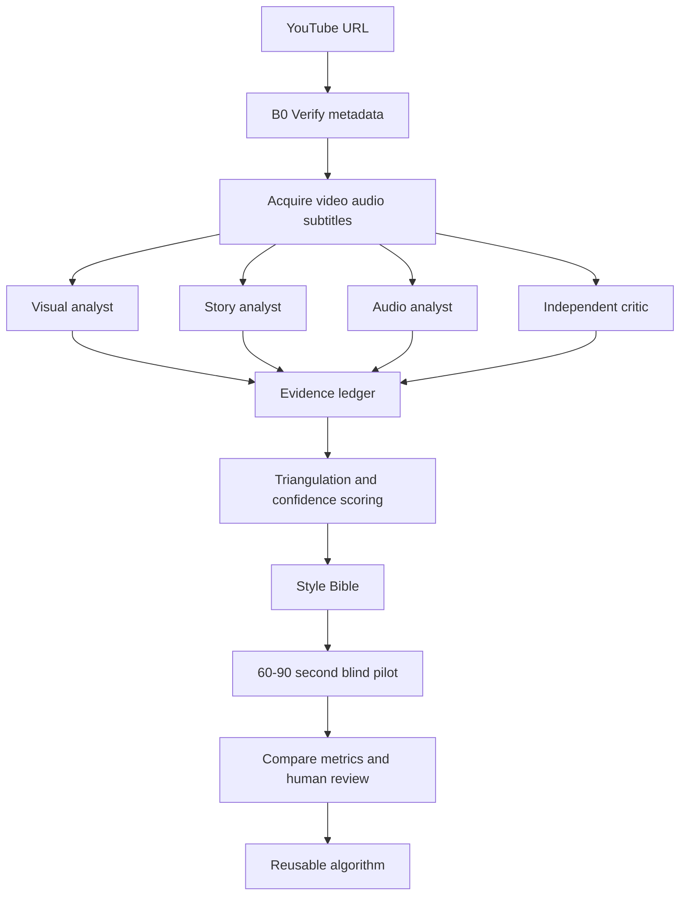

# PLAN — Reverse-engineer khách quan một video mẫu

## Mục tiêu

Xây dựng một **evidence pack** và **Style Bible** cho video mẫu `https://youtu.be/npoPedEq3hs`, để biết:

1. Video thực tế dùng kỹ thuật gì.
2. Yếu tố nào tạo retention và cảm giác cuốn hút.
3. Yếu tố nào chỉ là đặc điểm hình thức, không nên sao chép.
4. Có thể chuyển các nguyên lý đó thành quy trình tạo video mới hay không.
5. Bước nào cần sửa pipeline và bước nào chỉ cần sửa prompt/kịch bản.

**Không được kết luận từ tên kênh, tiêu đề hoặc trí nhớ. Mọi kết luận phải gắn với bằng chứng: timestamp, transcript, keyframe, audio measurement hoặc kết quả thử nghiệm.**

---

## Nguyên tắc chống thiên kiến

- Không giả định video thuộc kênh/phong cách nào trước khi xác minh metadata.
- Tách **quan sát** khỏi **diễn giải** và **khuyến nghị**.
- Không gọi một kỹ thuật là nguyên nhân giữ chân người xem nếu chưa có bằng chứng hoặc thử nghiệm.
- Phân tích độc lập bởi ít nhất 2 vai trò AI, sau đó dùng một vai trò tổng hợp để đối chiếu.
- Không hỏi AI: “Video này hay vì sao?” ngay từ đầu. Hỏi dữ liệu và mô tả trước, đánh giá sau.
- Không sử dụng các câu như “cứ 3–5 giây phải có SFX” nếu video mẫu chưa chứng minh điều đó.
- Phân biệt rõ:
  - **Style fingerprint:** dấu vân tay hình ảnh/âm thanh của video.
  - **Transferable principle:** nguyên lý có thể áp dụng cho chủ đề khác.
  - **Implementation detail:** cách triển khai trong repo.

---

## Kiến trúc phân tích tổng thể



---

# Giai đoạn 0 — Chuẩn bị và xác minh

## Bước 0.1 — Xác minh video

Agent phải lấy và lưu:

- URL chuẩn.
- Video ID.
- Tiêu đề chính xác.
- Tên kênh.
- Thời lượng.
- Ngày đăng.
- Ngôn ngữ.
- Phụ đề thủ công hay phụ đề tự động.
- Tình trạng video: public, age restriction, region restriction nếu có.

Có thể dùng [`download_subtitles_fast()`](../pipeline/youtube.py:279) để lấy phụ đề nhanh và [`probe_youtube_title()`](../pipeline/youtube.py:265) để kiểm tra tiêu đề. Nếu cần dữ liệu hình/âm thanh đầy đủ, dùng [`download_video()`](../pipeline/youtube.py:133).

### Output

```text
analysis/<video_id>/00_metadata.json
analysis/<video_id>/00_source_manifest.json
```

## Bước 0.2 — Kiểm tra chất lượng đầu vào

Không phân tích nếu:

- Đúng video nhưng tải thiếu audio.
- Transcript lệch quá nhiều so với audio.
- Video bị crop hoặc giảm chất lượng làm mất chi tiết hình.
- Chỉ có vài keyframe không đại diện.

---

# Giai đoạn 1 — Tạo evidence pack

## Bước 1.1 — Transcript có timestamp

Ưu tiên theo thứ tự:

1. Phụ đề thủ công.
2. Phụ đề tự động của YouTube.
3. Whisper từ audio nếu không có phụ đề.

Transcript phải lưu được:

```json
{
  "start": 0.0,
  "end": 2.4,
  "text": "...",
  "source": "manual|youtube_auto|whisper"
}
```

Dùng các module liên quan như [`transcribe.py`](../pipeline/transcribe.py:1) và kiểm tra chất lượng bằng [`transcript_quality.py`](../pipeline/transcript_quality.py:1).

## Bước 1.2 — Phân đoạn nội dung

Chia video thành các vùng có ý nghĩa, không chỉ chia đều theo thời lượng:

- Hook.
- Bối cảnh.
- Nhân vật/mục tiêu.
- Trở ngại đầu tiên.
- Leo thang.
- Khủng hoảng.
- Bước ngoặt.
- Kết quả.
- Kết luận/callback.

Mỗi vùng phải có start/end timestamp và lý do phân loại.

## Bước 1.3 — Shot và keyframe

Lấy:

- Một keyframe ở đầu shot.
- Một keyframe ở giữa shot.
- Một keyframe khi có thay đổi lớn.
- Một số frame trước/sau transition.

Không chỉ lấy frame theo khoảng thời gian cố định, vì sẽ bỏ qua các thay đổi hình ảnh nhanh.

Có thể dùng [`shot_analysis.py`](../pipeline/shot_analysis.py:1) và [`keyframes.py`](../pipeline/keyframes.py:1).

## Bước 1.4 — Audio evidence

Tách và lưu:

- Voice track nếu có thể.
- BGM track hoặc đoạn audio hỗn hợp.
- Các đoạn có SFX nổi bật.
- Waveform và spectrogram.
- Loudness/LUFS.
- Các điểm im lặng hoặc thay đổi năng lượng.

Dùng [`audio_analysis.py`](../pipeline/audio_analysis.py:1) và [`audio_mix.py`](../pipeline/audio_mix.py:1) để đối chiếu với khả năng hiện tại của pipeline.

### Output evidence pack

```text
analysis/<video_id>/
  00_metadata.json
  01_transcript.json
  02_segments.json
  03_shots.json
  04_keyframes/
  05_audio_metrics.json
  06_contact_sheet.jpg
  07_waveform.png
  08_evidence_index.md
```

`08_evidence_index.md` phải lập bảng:

| ID | Timestamp | Loại bằng chứng | Mô tả trung tính | File |
| :--- | :--- | :--- | :--- | :--- |
| E001 | 00:00–00:07 | Hook | `[mô tả không đánh giá]` | `...` |

---

# Giai đoạn 2 — Cho AI xem video theo 3 cấp độ

## Cấp độ A — Multimodal AI xem trực tiếp video

Nếu agent/model hỗ trợ input video:

1. Gửi video hoặc các đoạn ngắn 30–90 giây.
2. Gửi kèm transcript timestamped.
3. Yêu cầu model trả về timestamp, không nhận xét chung chung.
4. Yêu cầu phân tích từng đoạn riêng trước khi tổng hợp toàn video.

Prompt:

```text
Analyze this video as evidence, not as a review.
Do not infer the channel identity or style from the title.
For every claim, provide a timestamp and quote or describe the visible/audible evidence.
Separate the response into:
1. Direct observations.
2. Measurable hypotheses.
3. Transferable storytelling principles.
4. Video-specific style details that should not be copied.
5. Confidence: high, medium, or low.
Do not invent exact tools, models, frame rates, or audio plugins unless visible or measured.
Return JSON plus a timestamped evidence table.
```

## Cấp độ B — AI xem chuỗi keyframe + transcript + audio metrics

Dùng khi model không nhận video trực tiếp. Gửi theo từng phân đoạn:

- 6–10 keyframe có thứ tự.
- Transcript của phân đoạn.
- Timestamp mỗi frame.
- Audio metrics của phân đoạn.
- Contact sheet để model nhìn toàn cục.

Có thể dùng [`caption_single_keyframe()`](../pipeline/vlm_captioning.py:58) hoặc [`caption_shot()`](../pipeline/vlm_captioning.py:136) làm lớp caption nền, sau đó đưa các caption và ảnh vào VLM để phân tích Style DNA.

## Cấp độ C — AI chỉ xem dữ liệu cấu trúc

Dùng cho story analyst hoặc critic:

- Transcript.
- Shot list.
- Timestamp.
- Tóm tắt hình ảnh từ VLM.
- Audio metrics.

Cấp độ này không được dùng để kết luận chính xác về chất liệu nét vẽ, màu sắc hoặc kỹ thuật motion nếu không có ảnh/video.

---

# Giai đoạn 3 — Phân tích độc lập theo vai trò

## Vai trò A: Visual analyst

Nhiệm vụ:

- Chất liệu hình ảnh.
- Nét viền, độ rung, texture.
- Bảng màu định lượng.
- Tỉ lệ nhân vật.
- Background.
- Bố cục.
- Mật độ element.
- Chữ trên hình.
- Kiểu chuyển cảnh.
- Thay đổi hình ảnh theo timestamp.

Không được suy đoán công cụ sinh ảnh nếu không có bằng chứng.

## Vai trò B: Story analyst

Nhiệm vụ:

- Câu hook chính xác.
- Mục tiêu nhân vật.
- Trở ngại và mức độ leo thang.
- Open loop và thời điểm đóng loop.
- Ẩn dụ.
- Cách dùng hài hước.
- Nhịp reveal thông tin.
- Câu chuyển đoạn.
- Callback ở phần kết.

## Vai trò C: Audio analyst

Nhiệm vụ:

- Persona giọng kể.
- WPM.
- Nhịp câu.
- Khoảng lặng.
- BGM: thể loại, nhạc cụ, tempo ước lượng, mức tương đối.
- SFX và timestamp.
- Điểm đổi nhạc, ngắt nhạc, tăng năng lượng.

Không khẳng định giọng được tạo bởi ElevenLabs/xKiro/Edge-TTS nếu không có metadata nguồn.

## Vai trò D: Independent critic

Không được đọc kết luận của A/B/C trước khi hoàn thành bản phân tích riêng.

Nhiệm vụ:

- Chỉ ra điểm nào là bằng chứng yếu.
- Phân biệt tương quan và nguyên nhân.
- Kiểm tra các kết luận có thể áp dụng cho chủ đề khác hay không.
- Tìm những đoạn có thể buồn chán dù hình đẹp.
- Tìm những đoạn giữ người xem nhờ nội dung, không phải nhờ animation.

---

# Giai đoạn 4 — Định lượng sức hút

Tạo bảng metrics cho video gốc:

## Story metrics

- Hook duration.
- WPM.
- Độ dài câu trung bình.
- Số câu hỏi/phút.
- Số open loop/phút.
- Thời gian trung bình để đóng loop.
- Số ẩn dụ/phút.
- Số punchline/phút.
- Số lần căng thẳng tăng/giảm.
- Tỉ lệ transcript là thông tin mới so với nhắc lại.

## Visual metrics

- Shot duration mean/median/P90.
- Cut/phút.
- Visual change/phút.
- Tỉ lệ frame có chữ.
- Tỉ lệ cận cảnh/toàn cảnh.
- Số nhân vật hoặc vật thể trung bình/frame.
- Tần suất camera push/zoom/pan.

## Audio metrics

- Integrated loudness.
- Voice-to-BGM ratio.
- Pause count/phút.
- Silence duration ở các điểm quan trọng.
- SFX events/phút.
- BGM change count.

Mỗi metrics phải có:

```text
metric | value | method | timestamp/sample | confidence
```

---

# Giai đoạn 5 — Triangulation và chấm độ tin cậy

Dùng ba nhãn:

- **Observed:** thấy/nghe trực tiếp và có timestamp.
- **Measured:** được tính từ dữ liệu.
- **Inferred:** suy luận từ observed/measured.

Chấm confidence:

- **High:** ít nhất 2 loại bằng chứng độc lập hỗ trợ.
- **Medium:** một nguồn rõ ràng hoặc nhiều nguồn chưa hoàn toàn thống nhất.
- **Low:** chỉ là suy đoán hoặc đánh giá chủ quan.

Ví dụ:

| Kết luận | Loại | Bằng chứng | Confidence | Có đưa vào thuật toán không |
| :--- | :--- | :--- | :--- | :--- |
| Câu chuyện mở bằng nghịch lý | Observed | Transcript 00:00–00:08 | High | Có |
| Nhạc nền là pizzicato | Inferred | Nghe audio, chưa tách track | Medium | Chỉ ghi như lựa chọn mood |
| Dùng ElevenLabs | Speculation | Không có metadata | Low | Không |

---

# Giai đoạn 6 — Chuyển thành Style Bible

Style Bible cuối cùng phải tách thành 3 lớp:

## Lớp 1: Bắt buộc vì có bằng chứng

Ví dụ:

- Hook bắt đầu trong 5–10 giây.
- Có một mục tiêu rõ.
- Có trở ngại tăng dần.
- Có callback ở cuối.

## Lớp 2: Quy tắc có thể áp dụng

Ví dụ:

- Câu chuyện phải tạo open loop.
- Mỗi beat phải có thay đổi nhận thức hoặc hình ảnh.
- Thuật ngữ khó phải đi kèm ẩn dụ.
- Tách punchline thành cue riêng.

## Lớp 3: Tùy chọn thẩm mỹ

Ví dụ:

- Crayon texture.
- Off-white paper.
- Pizzicato.
- Màu primary.

Lớp 3 không được xem là nguyên nhân chắc chắn tạo retention.

Dùng template hiện có tại [`style_bible_template.md`](style_bible_template.md) làm khung, nhưng chỉ điền các giá trị đã có evidence.

---

# Giai đoạn 7 — Kiểm chứng bằng thử nghiệm mù

## Bước 7.1 — Viết ba phiên bản cùng một chủ đề

- **Version A:** chỉ áp dụng nguyên lý story.
- **Version B:** chỉ áp dụng visual/audio style.
- **Version C:** áp dụng cả story + visual/audio.

Giữ cố định:

- Chủ đề.
- Độ dài.
- Ngôn ngữ.
- Mức độ thông tin.
- Voice actor/TTS.

## Bước 7.2 — Không cho người đánh giá biết phiên bản nào là A/B/C

Yêu cầu đánh giá:

- Mức muốn xem tiếp sau 10 giây.
- Mức dễ hiểu.
- Mức nhớ được nội dung.
- Mức tự nhiên của giọng.
- Mức đồng nhất của hình.
- Mức muốn chia sẻ.

## Bước 7.3 — Tiêu chí kết luận

- Nếu version có story tốt hơn dù hình đơn giản hơn → story là yếu tố chính.
- Nếu visual/audio chỉ cải thiện điểm cảm xúc nhưng không cải thiện hiểu/nhớ → xem đó là lớp hỗ trợ.
- Nếu không khác biệt → không đưa kỹ thuật đó thành yêu cầu bắt buộc.

---

# Giai đoạn 8 — Đối chiếu với repo, chưa sửa code

Lập bảng:

| Nguyên lý | Repo đã có | Thiếu | Cách triển khai dự kiến | Ưu tiên |
| :--- | :--- | :--- | :--- | :--- |
| Transcript timestamp | [`transcribe.py`](../pipeline/transcribe.py:1) | `[điền]` | `[điền]` | P0/P1/P2 |
| VLM keyframe | [`vlm_captioning.py`](../pipeline/vlm_captioning.py:58) | `[điền]` | `[điền]` | P0/P1/P2 |
| TTS xKiro | [`tts.py`](../pipeline/tts.py:66) | `[điền]` | `[điền]` | P0/P1/P2 |
| BGM mix | [`documentary_assembler.py`](../pipeline/documentary_assembler.py:361) | `[điền]` | `[điền]` | P0/P1/P2 |
| SFX event map | `[kiểm tra]` | `[điền]` | `[điền]` | P0/P1/P2 |
| Character reference | `[kiểm tra]` | `[điền]` | `[điền]` | P0/P1/P2 |
| Sub-beat visual planning | [`script_auditor.py`](../services/script_auditor.py:27) | `[điền]` | `[điền]` | P0/P1/P2 |

**Giai đoạn này chỉ lập gap analysis, không sửa code.**

---

# Danh sách deliverables bắt buộc

```text
plans/video_reverse_engineering_plan.md
analysis/<video_id>/00_metadata.json
analysis/<video_id>/01_transcript.json
analysis/<video_id>/02_segments.json
analysis/<video_id>/03_shots.json
analysis/<video_id>/04_keyframes/
analysis/<video_id>/05_audio_metrics.json
analysis/<video_id>/06_contact_sheet.jpg
analysis/<video_id>/08_evidence_index.md
analysis/<video_id>/09_visual_analysis.json
analysis/<video_id>/10_story_analysis.json
analysis/<video_id>/11_audio_analysis.json
analysis/<video_id>/12_independent_critique.json
analysis/<video_id>/13_triangulation.md
plans/style_bible_<channel>.md
plans/pilot_comparison_<channel>.md
```

---

# Prompt tổng hợp cuối cùng cho agent

```text
You are the lead researcher synthesizing a video reverse-engineering report.
Use only the attached evidence pack and independent analyst reports.
Do not treat guesses as facts.
For every important conclusion include:
- timestamp or metric;
- evidence file;
- observed/measured/inferred label;
- confidence high/medium/low.

Produce five sections:
1. What the video demonstrably does.
2. What probably contributes to engagement, with supporting evidence.
3. What is only aesthetic and should not be mistaken for the cause.
4. A reusable production algorithm for a new topic.
5. A gap analysis against the current repository pipeline.

The reusable algorithm must describe principles, not copy exact sentences,
characters, artwork, music, or distinctive branding from the source video.
```

---

# Definition of Done

- [ ] Video identity verified.
- [ ] Transcript aligned with timestamps.
- [ ] Full evidence pack saved.
- [ ] AI has analyzed the video directly or received representative frames, transcript and audio data.
- [ ] Visual, story, audio and critic reports were produced independently.
- [ ] Every major claim has evidence and confidence.
- [ ] Style-specific details are separated from transferable principles.
- [ ] A blind pilot test was designed or completed.
- [ ] Style Bible contains measured ranges, not invented exact settings.
- [ ] Code changes have not started until the gap analysis is approved.
