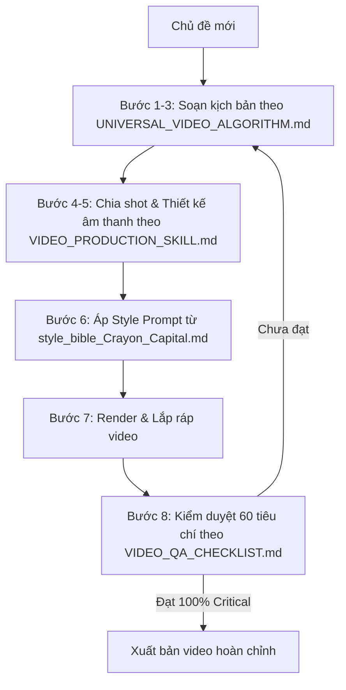

# VIDEO PRODUCTION EXPERT SKILL
## Kỹ năng sản xuất video AI cuốn hút cho BẤT KỲ chủ đề

> **Phiên bản:** `v1.0.0`  
> **Thư mục chuyên biệt:** `skills/video_production/`  
> **Nền tảng thực nghiệm:** Dựa trên bóc tách định lượng 100% video triệu view Crayon Capital (`npoPedEq3hs`).

---

## 📂 Danh mục tài liệu trong bộ Skill

| File | Vai trò | Nội dung chính |
| :--- | :--- | :--- |
| [`UNIVERSAL_VIDEO_ALGORITHM.md`](UNIVERSAL_VIDEO_ALGORITHM.md) | **Thuật toán cốt lõi** | 8 bước sản xuất, ngưỡng đo được, công thức hook toán học, open loops lồng nhau, nhịp kịch bản 54/46. |
| [`VIDEO_PRODUCTION_SKILL.md`](VIDEO_PRODUCTION_SKILL.md) | **Cẩm nang thực hành** | Hướng dẫn chi tiết, công cụ thực thi trong repo, ví dụ Bitcoin, 7 lỗi thường gặp và cách khắc phục. |
| [`VIDEO_QA_CHECKLIST.md`](VIDEO_QA_CHECKLIST.md) | **Kiểm định chất lượng (QA)** | 60 tiêu chí đánh giá (22 Critical + 14 High + 12 Medium + 12 Tech/Legal), nguyên tắc không xuất bản nếu Critical < 100%. |
| [`style_bible_template.md`](style_bible_template.md) | **Khung mẫu Style Bible** | Template trống có sẵn công thức đo đạc để reverse-engineer bất kỳ kênh YouTube mẫu nào khác. |
| [`style_bible_Crayon_Capital.md`](style_bible_Crayon_Capital.md) | **Style Bible tham chiếu** | Bộ thông số đo đạc thực tế từ kênh Crayon Capital (WPM 184.8, shot 5.0s, LUFS -18.3, nền đổi màu theo mood). |
| [`pilot_comparison_Crayon_Capital.md`](pilot_comparison_Crayon_Capital.md) | **Giao thức thử nghiệm mù** | Kịch bản pilot 75 giây chủ đề Nvidia/Jensen Huang và ma trận so sánh 3 phiên bản A/B/C. |

---

## 🎯 10 Nguyên tắc vàng (Tóm lược nhanh)

1. **Hook bằng nghịch lý/so sánh/câu hỏi** trong $\le$ 30 giây (không mở bài bằng giới thiệu chủ đề).
2. **Tạo 3–5 open loops lồng nhau** (mở vòng tò mò tiếp theo trước khi đóng vòng tò mò cũ).
3. **Quy tắc 54/46:** $\ge$ 50% câu kịch bản là câu ngắn ($\le$ 6 từ) để dập nhịp dứt khoát.
4. **Tốc độ nói (WPM):** 160 – 200 từ/phút (chuẩn đàm thoại tự nhiên, không đều đều).
5. **Khoảng lặng kịch tính:** $\ge$ 8 lần/phút (ngắt 600–700ms trước câu chốt hạ hoặc sự thật sốc).
6. **Ẩn dụ 3 tầng:** Khái niệm trừu tượng $\to$ Đồ vật đời thường $\to$ Hành động có xung đột.
7. **Thời lượng shot:** 4.0 – 7.0 giây (trung bình 5.0s), luôn có sub-beat visual change mỗi 2–3s.
8. **Nền chuyển động theo cảm xúc:** Sáng ngà khi bình thường, bảng đen chì khi khủng hoảng/biến cố.
9. **Âm thanh chuẩn phát thanh:** Loudness -18 đến -20 LUFS, BGM -18dB dưới voice, SFX 6–12 lần/phút.
10. **Callback bắt buộc:** Câu kết thúc video phải quay lại trả lời hoặc giải tỏa câu hỏi ở phần Hook mở đầu.

---

## 🚀 Cách sử dụng bộ Skill trong quy trình làm việc

