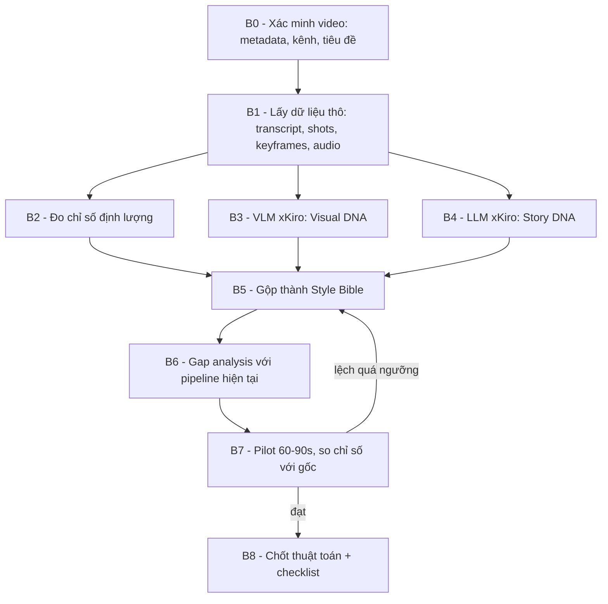

# STYLE BIBLE TEMPLATE — Thuật toán "Style DNA" tái tạo phong cách video hoạt họa kể chuyện

> **Mục đích:** Biến 1 video mẫu (YouTube) thành bộ quy tắc **đo được** để mọi video sau follow theo.
> **Nguyên tắc vàng:** Không đoán. Mọi giá trị trong file này phải đến từ **dữ liệu thật** (transcript, keyframe, audio) hoặc ghi rõ `[GIẢ ĐỊNH]`.
> **Trạng thái:** 📝 Template — chưa điền. Bản điền thật sẽ lưu thành `plans/style_bible_<ten_kenh>.md`.
> **Phạm vi:** Chỉ là plan/tài liệu, **không sửa code**.

---

## 0. TỔNG QUAN QUY TRÌNH



| Bước | Input | Công cụ có sẵn trong repo | Output |
| :--- | :--- | :--- | :--- |
| B0 | URL YouTube | [`pipeline/youtube.py`](../pipeline/youtube.py) | `meta.json` (kênh, tiêu đề, thời lượng, view, có sub không) |
| B1 | Video + sub | [`pipeline/transcribe.py`](../pipeline/transcribe.py), [`pipeline/shot_analysis.py`](../pipeline/shot_analysis.py), [`pipeline/keyframes.py`](../pipeline/keyframes.py) | `transcript.json` (có timestamp), `shots.json`, `keyframes/*.jpg` |
| B2 | Dữ liệu B1 | [`pipeline/audio_analysis.py`](../pipeline/audio_analysis.py), [`pipeline/transcript_quality.py`](../pipeline/transcript_quality.py) | Bảng **Metrics** (mục 2) |
| B3 | Keyframes | [`pipeline/vlm_captioning.py`](../pipeline/vlm_captioning.py) qua xKiro | `visual_dna.json` (mục 3) |
| B4 | Transcript | [`pipeline/llm_client.py`](../pipeline/llm_client.py) qua xKiro | `story_dna.json` (mục 4) |
| B5 | B2+B3+B4 | Thủ công + LLM tổng hợp | `style_bible_<kenh>.md` |
| B6 | Style Bible | Đọc code | Bảng Gap (mục 8) |
| B7 | Chủ đề mới | Pipeline Mode 2 | Video pilot + bảng so sánh chỉ số |
| B8 | Kết quả B7 | — | Checklist QA (mục 9) |

---

## 1. NHẬN DIỆN NGUỒN (B0)

| Trường | Giá trị |
| :--- | :--- |
| URL | `https://youtu.be/npoPedEq3hs` |
| Tên kênh | `[ĐIỀN]` |
| Tiêu đề | `[ĐIỀN]` |
| Thời lượng | `[ĐIỀN] s` |
| Ngôn ngữ | `[ĐIỀN]` |
| Có phụ đề gốc? | `[có / auto / không]` |
| Thể loại | `[tiểu sử / kinh doanh / lịch sử / giải thích khái niệm]` |
| Ngày phân tích | `[ĐIỀN]` |

> ⛔ **Cổng B0:** Nếu tên kênh/tiêu đề khác giả định ban đầu (Crayon Capital), **bỏ toàn bộ giả định** của bản phân tích cũ.

---

## 2. METRICS ĐỊNH LƯỢNG (B2) — "Nhịp" của video

Đây là phần quan trọng nhất: biến cảm giác "cuốn" thành con số để kiểm tra.

### 2.1 Nhịp lời (Narration pacing)
| Chỉ số | Cách đo | Giá trị gốc | Ngưỡng chấp nhận cho video sau |
| :--- | :--- | :--- | :--- |
| Words per minute (WPM) | tổng từ ÷ phút có lời | `[ĐIỀN]` | ±10% |
| Độ dài câu trung bình | từ/câu | `[ĐIỀN]` | ±20% |
| % câu ngắn (≤ 6 từ) | đếm | `[ĐIỀN]` | ≥ gốc − 5% |
| Khoảng lặng trung bình giữa câu | từ timestamp | `[ĐIỀN] ms` | ±100 ms |
| Số "dramatic pause" ≥ 600ms / phút | từ timestamp | `[ĐIỀN]` | ±1 |
| Tỉ lệ thời gian có lời / tổng | | `[ĐIỀN]%` | ±5% |

### 2.2 Nhịp hình (Visual pacing)
| Chỉ số | Cách đo | Giá trị gốc | Ngưỡng |
| :--- | :--- | :--- | :--- |
| Độ dài shot trung bình | `shots.json` | `[ĐIỀN] s` | ±20% |
| Độ dài shot trung vị / P90 | | `[ĐIỀN] / [ĐIỀN] s` | |
| Số cut / phút | | `[ĐIỀN]` | ±15% |
| Số "visual change" / phút (kể cả không cut: zoom, element mới hiện) | VLM so sánh keyframe liên tiếp | `[ĐIỀN]` | ±20% |
| Tỉ lệ shot có chữ trên hình | VLM | `[ĐIỀN]%` | |

### 2.3 Nhịp truyện (Story pacing)
| Chỉ số | Giá trị gốc | Ngưỡng |
| :--- | :--- | :--- |
| Độ dài hook (đến câu đầu tiên không còn là hook) | `[ĐIỀN] s` | ≤ gốc |
| Khoảng cách trung bình giữa 2 "open loop" (câu hỏi/bí ẩn treo) | `[ĐIỀN] s` | ≤ gốc + 15s |
| Số câu hỏi tu từ / phút | `[ĐIỀN]` | ±1 |
| Số joke/punchline / phút | `[ĐIỀN]` | ±1 |
| Số ẩn dụ đời thường / phút | `[ĐIỀN]` | ±1 |
| Số "twist / đảo chiều" toàn video | `[ĐIỀN]` | ≥ gốc |

### 2.4 Nhịp âm thanh (Audio pacing)
| Chỉ số | Cách đo | Giá trị gốc |
| :--- | :--- | :--- |
| Loudness tổng (LUFS) | `audio_analysis` / ffmpeg ebur128 | `[ĐIỀN]` |
| Chênh lệch voice vs BGM | ước lượng ở đoạn không lời | `[ĐIỀN] dB` |
| Số lần BGM đổi bài / tắt đột ngột | energy drop > X dB | `[ĐIỀN]` + timestamp |
| Mật độ SFX / phút (ước lượng) | onset detection ngoài vùng lời | `[ĐIỀN]` |

---

## 3. VISUAL DNA (B3)

### 3.1 Cách lấy mẫu keyframe
- Chia video thành **5 phân đoạn** (hook / setup / rising / climax / ending), mỗi đoạn lấy **6–10 keyframe**.
- Bắt buộc có: 3 cận mặt nhân vật chính, 3 toàn cảnh, 3 khung có biểu đồ/chữ/ẩn dụ, 2 khung chuyển cảnh (frame giữa transition).

### 3.2 Prompt gửi VLM (xKiro) — dùng nguyên văn
```text
You are an animation art director. Analyze these {N} keyframes from one video.
Return STRICT JSON with this schema, no prose:
{
  "medium": "e.g. wax crayon / colored pencil / vector flat / cutout paper",
  "line": {"weight": "", "wobble": "none|light|heavy", "color": "", "outline_on_characters": true},
  "texture": {"background": "", "grain": "none|light|heavy"},
  "palette_hex": ["#......", "..."],      // 5-8 dominant colors
  "saturation": "low|medium|high",
  "background_rule": "",                  // e.g. plain off-white paper, no scenery
  "character_rules": {
    "head_to_body_ratio": "",
    "eyes": "", "mouth": "", "hands": "",
    "caricature_level": "none|mild|strong",
    "recurring_characters": [{"name": "", "fixed_traits": ""}]
  },
  "composition": {"subject_position": "", "negative_space": "", "max_elements_per_frame": 0},
  "on_screen_text": {"present": true, "font_style": "", "usage": ""},
  "motion_inferred": ["ken_burns", "line_boil", "pop_in", "slide", "draw_on", "cutout_puppet"],
  "transitions": [""],
  "do_not": ["3D shading", "..."]
}
```

### 3.3 Kết quả điền vào
| Thuộc tính | Giá trị |
| :--- | :--- |
| Chất liệu | `[ĐIỀN]` |
| Bảng màu HEX | `[#..., #..., ...]` |
| Nền | `[ĐIỀN]` |
| Quy tắc nhân vật | `[ĐIỀN]` |
| Số element tối đa / khung | `[ĐIỀN]` |
| Chữ trên hình | `[ĐIỀN]` |
| Cấm | `[ĐIỀN]` |

### 3.4 Master Style Prompt (sinh từ 3.3)
```text
[SUBJECT + ACTION ẨN DỤ], {medium}, {line}, {texture},
palette limited to {palette_hex}, {background_rule},
{character_rules tóm tắt}, max {N} elements, generous negative space,
flat 2D, no gradients, no 3D shading, no photorealism --ar 16:9
```
- **Negative prompt cố định:** `3d render, realistic, photo, gradient shading, glossy, extra fingers, text artifacts`.

### 3.5 Character Sheet (bắt buộc cho nhân vật lặp lại)
Mỗi nhân vật chính có 1 block **cố định**, dán nguyên vào mọi prompt có nhân vật đó:
| Nhân vật | Fixed descriptor (copy-paste) | Ảnh tham chiếu |
| :--- | :--- | :--- |
| `[Tên]` | `[tóc, màu áo, phụ kiện, dáng người, biểu cảm mặc định]` | `assets/characters/<ten>_ref.png` |

> Quy tắc: sinh **1 ảnh reference trước**, duyệt, rồi mọi shot sau dùng image-reference nếu provider hỗ trợ. Không có reference = nhân vật sẽ đổi mặt giữa các cảnh.

---

## 4. STORY DNA (B4)

### 4.1 Prompt gửi LLM — dùng nguyên văn
```text
Below is a timestamped transcript of a highly engaging explainer video.
Reverse-engineer its storytelling. Return STRICT JSON:
{
  "hook": {"end_time": 0, "type": "paradox|shock_stat|question|cold_open_scene", "text": ""},
  "beats": [{"start": 0, "end": 0, "role": "setup|rising|crisis|breakthrough|payoff|moral",
             "tension_0_10": 0, "summary": ""}],
  "open_loops": [{"opened_at": 0, "closed_at": 0, "question": ""}],
  "metaphors": [{"t": 0, "concept": "", "metaphor": ""}],
  "humor": [{"t": 0, "technique": "understatement|rule_of_three|callback|absurd_comparison|self_aware", "line": ""}],
  "transitions": [{"t": 0, "phrase": ""}],
  "narrator_persona": {"tone": "", "pov": "1st|2nd|3rd", "addresses_viewer": true, "signature_phrases": []},
  "ending": {"type": "moral|callback|cliffhanger|cta", "text": ""}
}
```

### 4.2 Biểu đồ căng thẳng (vẽ từ `beats[].tension_0_10`)
- Ghi lại **hình dạng đường cong** (ví dụ: W-shape, staircase, rollercoaster). Đây là "khuôn" cho video sau.

### 4.3 Script Template (điền sau B4)
Áp cho video dài **L phút**; số vòng lặp = `ceil(L / chu_ky_open_loop)`.

| Khối | Thời lượng (% tổng) | Mục tiêu | Công thức câu mẫu |
| :--- | :--- | :--- | :--- |
| Hook | `[ĐIỀN]%` | Nghịch lý / câu hỏi | `[ĐIỀN từ hook thật]` |
| Setup + ẩn dụ gốc | `[ĐIỀN]%` | Ai, muốn gì, ẩn dụ chủ đạo | |
| Vòng lặp × N | `[ĐIỀN]%` | Mở loop → leo thang → đóng loop + mở loop mới | |
| Crisis | `[ĐIỀN]%` | Đáy thấp nhất | |
| Breakthrough | `[ĐIỀN]%` | Giải tỏa nhanh | |
| Payoff + moral | `[ĐIỀN]%` | Callback về hook | |

### 4.4 Quy tắc viết (rút từ dữ liệu, không phải ý kiến)
- [ ] Mỗi thuật ngữ khó → 1 ẩn dụ đời thường trong ≤ 2 câu.
- [ ] Không để quá `[ĐIỀN]s` mà không có open loop đang treo.
- [ ] Câu ngắn chiếm ≥ `[ĐIỀN]%`.
- [ ] Signature phrases của narrator: `[ĐIỀN]` (chỉ học **cấu trúc**, không chép nguyên câu).
- [ ] Kết bằng callback về hook.

---

## 5. VOICE SPEC

| Thuộc tính | Gốc (đo/nghe) | Áp dụng cho repo |
| :--- | :--- | :--- |
| Giới tính / tuổi cảm nhận | `[ĐIỀN]` | Chọn trong `XKIRO_VOICES_METADATA` / Edge-TTS |
| WPM | từ mục 2.1 | Chỉnh `rate` TTS để khớp ±10% |
| Persona | từ `narrator_persona` | Thể hiện qua **văn bản**, không qua tham số |
| Pause style | từ 2.1 | Chèn `...` / xuống dòng / tách cue riêng |

**Kỹ thuật "ép cảm xúc" khi TTS không có tham số stability** (áp cho xKiro / Edge-TTS):
1. Tách câu punchline thành **cue riêng**, chèn 300–600ms silence trước nó.
2. Câu hỏi tu từ kết thúc bằng `?` để TTS lên giọng.
3. Nhấn mạnh bằng câu cực ngắn đứng riêng: "Bùm." / "Hết tiền."
4. Không dùng ký tự đặc biệt mà [`clean_narration_for_tts()`](../services/prompt_sanitizer.py) sẽ xóa mất.
5. Nghe thử 3 giọng với cùng đoạn hook ([`scripts/test_all_vi_voices.py`](../scripts/test_all_vi_voices.py)) rồi chốt.

---

## 6. AUDIO SPEC (BGM + SFX)

### 6.1 BGM
| Thuộc tính | Giá trị |
| :--- | :--- |
| Thể loại / nhạc cụ | `[ĐIỀN]` |
| Tempo ước lượng | `[ĐIỀN] BPM` |
| Mức dưới voice | `[ĐIỀN] dB` (repo hiện: `volume=0.12` ≈ −18.4 dB) |
| Điểm đổi nhạc | gắn theo `beats[].role` — ví dụ crisis → đổi mood / im lặng 0.5s |
| Nguồn nhạc | **chỉ nhạc có license** (YouTube Audio Library, Pixabay, Epidemic…) |

### 6.2 SFX map (gắn theo sự kiện, không theo thời gian cố định)
| Sự kiện trong kịch bản/hình | SFX |
| :--- | :--- |
| Element mới xuất hiện | pop / plop |
| Chuyển cảnh | whoosh / paper slide |
| Tiền / lợi nhuận | ka-ching |
| Thất bại | buzzer / sad trombone |
| Punchline | record scratch / silence |
| Vẽ nét | crayon scribble (nếu style vẽ tay) |

Mật độ mục tiêu: theo chỉ số 2.4 của video gốc.

---

## 7. MOTION SPEC

| Kỹ thuật | Tham số chuẩn | Ghi chú |
| :--- | :--- | :--- |
| Ken Burns | zoom 1.00 → 1.06–1.10 trong 1 shot | Đã có: [`image_kenburns_provider.py`](../services/image_kenburns_provider.py) |
| Line boil (rung nét) | 3 biến thể ảnh, lặp ở **8–12 fps** (không phải 2–3 fps) | Có thể giả lập bằng displacement nhẹ ở ffmpeg |
| Pop-in element | scale 0 → 1.1 → 1.0 trong 150–250ms | Cần layer tách nền |
| Chuyển cảnh | `[ĐIỀN từ VLM]` | |
| Độ dài 1 "visual change" | từ 2.2 | Nếu nhỏ hơn 10s → 1 shot 10s cần nhiều ảnh con |

> **Khuyến nghị:** với phong cách vẽ tay 2D, ưu tiên **ảnh tĩnh + motion 2D** hơn Veo, vì Veo hay kéo hình về 3D/realistic. Veo chỉ dùng cho vài cảnh then chốt nếu style cho phép.

---

## 8. GAP ANALYSIS VỚI PIPELINE HIỆN TẠI (B6)

| Yêu cầu Style Bible | Hiện trạng repo | Gap | Mức |
| :--- | :--- | :--- | :--- |
| Shot ngắn theo chỉ số 2.2 | [`script_auditor.py`](../services/script_auditor.py) cố định shot 10s, 6–28 từ | Cần "sub-shot": 1 cue voice → nhiều ảnh | 🔴 |
| Style đồng nhất | Prompt Veo/Imagen tự do, chưa có Master Style suffix | Cần inject Master Style + Character descriptor | 🔴 |
| Nhân vật đồng nhất | Chưa có reference image | Cần Character Sheet + ref | 🔴 |
| Line boil / pop-in | Chỉ có Ken Burns | Cần motion 2D mới | 🟡 |
| SFX theo sự kiện | Chưa có lớp SFX | Cần SFX library + mapper | 🟡 |
| BGM đổi theo beat | BGM 1 bài, volume cố định | Cần BGM theo `beats[].role` | 🟡 |
| Auto ducking sidechain | Đang "phát triển" ([`07_export.py`](../pages/07_export.py)) | | 🟢 |
| Voice cảm xúc | xKiro / Edge-TTS không có stability | Điều khiển qua văn bản + tách cue | 🟢 |
| Phân tích video mẫu | Có đủ module nhưng chưa có flow "style extraction" | Script/flow mới | 🟡 |

---

## 9. CHECKLIST QA CHO MỌI VIDEO SAU (B8)

**Kịch bản**
- [ ] Hook ≤ `[ĐIỀN]s`, dạng nghịch lý/câu hỏi.
- [ ] Open loop không bao giờ trống quá `[ĐIỀN]s`.
- [ ] WPM trong ngưỡng 2.1.
- [ ] ≥ `[ĐIỀN]` ẩn dụ / phút; ≥ `[ĐIỀN]` joke / phút.
- [ ] Kết có callback về hook.

**Hình**
- [ ] 100% prompt chứa Master Style suffix + negative prompt.
- [ ] Nhân vật chính dùng đúng Character descriptor.
- [ ] Visual change / phút trong ngưỡng 2.2.
- [ ] Không vi phạm danh sách "do_not".

**Âm thanh**
- [ ] Loudness tổng trong khoảng `[ĐIỀN]` LUFS.
- [ ] BGM thấp hơn voice `[ĐIỀN]` dB, đổi mood ở crisis.
- [ ] SFX đúng map 6.2.

**Pháp lý / nền tảng**
- [ ] Chỉ học **cấu trúc & kỹ thuật**, không chép câu/hình/nhân vật đặc trưng của kênh gốc.
- [ ] Nhạc & SFX có license.
- [ ] Nội dung có giá trị biên tập riêng (tránh "mass-produced content").

---

## 10. QUY TẮC CẬP NHẬT
- Mỗi lần pilot (B7) ghi bảng: `chỉ số | gốc | pilot | lệch % | hành động`.
- Lệch > ngưỡng ở ≥ 2 chỉ số → quay lại B5 chỉnh Style Bible, **không** chỉnh từng video lẻ.
- Khi có ≥ 2 kênh mẫu khác nhau → tách phần chung thành `style_bible_core.md`, phần riêng giữ theo kênh.
