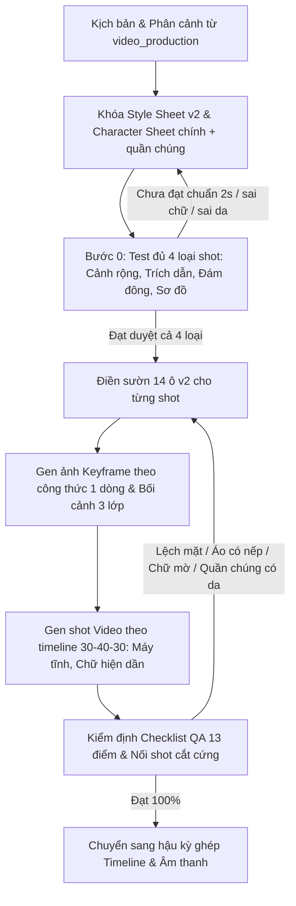

# SHOT GENERATION EXPERT SKILL (v2)
## Kỹ năng thiết kế Prompt, Keyframe & Shot Video Explainer 2D Chuẩn Crayon Capital

> **Phiên bản:** `v2.0.0` *(Cập nhật 2026-11-03 theo 4 ảnh mẫu thực tế từ clip triệu view Crayon Capital `npoPedEq3hs`)*  
> **Thư mục chuyên biệt:** `skills/shot_generation/`  
> **Kỹ năng liên đới:** Kết nối trực tiếp với [`video_production`](../video_production/SKILL.md) (kịch bản, giọng đọc, âm thanh).  
> **Đột phá v2:** Khắc phục triệt để 5 điểm yếu của v1: (1) Nhân vật người que: chính da đào vs quần chúng mặt trắng; (2) Khung 3 lớp có tiền cảnh cắt viền; (3) Shot trích dẫn câu đầy đủ làm punchline; (4) Shot sơ đồ vật lớn số đỏ; (5) Một mảng bóng xám phẳng đặc trưng.

---

## 📂 Danh mục tài liệu trong bộ Skill

| File | Vai trò | Nội dung chính |
| :--- | :--- | :--- |
| [`UNIVERSAL_SHOT_FRAMEWORK.md`](UNIVERSAL_SHOT_FRAMEWORK.md) | **Khung sườn vạn năng v2 (Master Framework)** | Bản đầy đủ 845 dòng: Sườn 14 ô v2, 4 loại shot, 4 ảnh mẫu phân tích, công thức prompt 1 dòng, quy tắc Khóa/Biến, timeline 30-40-30 cho từng loại shot, checklist QA 13 điểm, bảng sửa lỗi và chuỗi 4 shot mẫu đủ loại. *(Gốc: `suon-chung-gen-anh-shot-video (1).md`)* |
| [`CRAYON_EXPLAINER_MOLD.md`](CRAYON_EXPLAINER_MOLD.md) | **Khuôn mẫu Crayon Capital v2 (Style Mold)** | Khối Style Lock v2 nguyên văn, Character Sheet chính & quần chúng, quy tắc trực quan hóa khung hình, quy tắc gen ảnh/video, các biến thể bị loại bỏ và giới hạn đã xác minh. |

---

## 🎯 Khi nào kích hoạt Skill này (When to Use)

- Khi người dùng hoặc agent cần **viết prompt tạo ảnh keyframe** hoặc **prompt gen shot video** dạng hoạt họa 2D / explainer / phân tích kinh doanh.
- Khi chia shot cho kịch bản và cần chọn đúng **1 trong 4 loại shot** (Cảnh rộng, Trích dẫn, Đám đông, Sơ đồ).
- Khi trong shot có **đông người** và cần giữ đúng nhân vật chính nổi bật, không để quần chúng có cùng độ chi tiết.
- Khi cần tạo **shot trích dẫn có punchline** (chữ viết tay / bong bóng mây trắng) hoặc **shot sơ đồ số liệu** có một màu nhấn đỏ.
- Khi cần đảm bảo **nối shot mượt mà (continuity)** bằng cắt cứng (hard cut), không giật mặt, không đổi áo, không crop sai tỉ lệ.

---

## 🧭 Bản đồ nhìn 1 phát — Lời thoại đi vào, Video đi ra

```text
Lời thoại + timecode
  -> CHỌN LOẠI SHOT: cảnh rộng / trích dẫn / đám đông / sơ đồ (xem bảng 0.1)
  -> KHÓA: Style Lock + Character Sheet chính + Character Sheet quần chúng + tỉ lệ 16:9
     (cửa 1: chưa duyệt thì chưa gen; chưa test đủ 4 loại shot thì chưa gen hàng loạt)
  -> HÌNH DUNG: mắt nhìn đâu đầu tiên, rồi nhìn đâu thứ hai,
     khung có 3 lớp nào, trong khung KHÔNG có gì, nhân vật chính là ai, ai là quần chúng
  -> ĐIỀN 5 Ô BẮT BUỘC: chủ thể + hành động + tiêu điểm + bối cảnh 3 lớp + cấm
  -> GEN ẢNH KEYFRAME: 1 shot = 1 ý = 1 tiêu điểm
  -> GEN VIDEO: tối đa 1 chuyển động nhỏ, chậm; shot trích dẫn thì chuyển động là chữ/bong bóng hiện dần
  -> NỐI SHOT: cắt cứng sang ý mới, không dùng pan/zoom để giả vờ đổi ý
  -> KIỂM TRA: mặt, áo, chính/phụ, chữ, tỉ lệ có giống shot trước không (cửa 2: sai thì gen lại)
```

---

## 🎭 0.1. Bốn loại shot — Phải chọn loại trước khi điền ô

| Loại shot | Khi nào dùng? | Tiêu điểm là gì? | Chuyển động video là gì? |
|---|---|---|---|
| **1. Cảnh rộng / cảnh kể** | Giới thiệu bối cảnh, tương phản kích thước, nhân vật làm việc | Một vật lớn hoặc một nhân vật (người nhỏ bên tên lửa lớn) | Chớp mắt, sáng dần, vật phụ chuyển động nhẹ |
| **2. Trích dẫn / đối thoại** | Lời thoại là câu nói trực tiếp, câu đùa, lời thú nhận, suy nghĩ | Câu chữ viết tay hoặc bong bóng suy nghĩ, mặt người nói là thứ hai | Chữ/bong bóng hiện dần, miệng người nói mở ra, đám đông giữ nguyên mặt |
| **3. Đám đông / phòng họp** | Nhiều người cùng họp, làm việc, xem, chờ đợi | Nhân vật chính là mặt da đào duy nhất có chi tiết; đám đông là nền | Nhân vật chính đổi biểu cảm nhẹ, đám đông gần như đứng yên |
| **4. Sơ đồ / infographic** | Số liệu, thời gian, chi phí, so sánh, quy trình, tăng trưởng | Vật lớn + số lớn, đọc từ trái qua phải, từ trên xuống dưới | Đường biểu đồ đi lên, cột mọc lên, con dấu đóng xuống, số hiện lên |

---

## 🔒 11 Nguyên tắc vàng của Khuôn v2 (Tóm lược nhanh)

1. **Khóa trước, gen sau:** Dán nguyên văn khối `Style Lock` và `Character Sheet` vào mọi prompt. Test trước đủ 4 loại shot ở Bước 0.
2. **Người que — Chính da đào, Quần chúng mặt trắng:** Nhân vật chính mặt da đào, tóc có hình, vest tối, tương phản cao. Quần chúng mặt trắng trơn, một mảng bóng xám phẳng, thân oval lặp lại y hệt nhau.
3. **Khung hình có 3 lớp & Tiền cảnh cắt viền:** Tiền cảnh có vật hoặc người lớn bị cắt mép khung, trung cảnh là nhân vật chính, hậu cảnh là dãy vật lặp lại (màn hình, tủ server) mờ nhạt. Không để nhân vật cô độc ở giữa nền trống.
4. **Một màu nhấn đỏ mỗi shot:** Chỉ dành cho vật tiêu điểm, con số punch, hoặc con dấu đỏ. Mọi thứ khác giữ bảng màu muted để màu đỏ đấm thẳng vào mắt người xem.
5. **Chữ trích dẫn là Punchline — Giữ nguyên câu đầy đủ:** Không rút cụt chữ trích dẫn thành 1-3 từ. Viết câu ngắn hoàn chỉnh bằng chữ viết tay hoặc đặt trong bong bóng mây trắng viền đen.
6. **Vẽ vật lớn — Silhouette trước, chỉ 3-4 chi tiết trong:** Vật biểu trưng chiếm $\ge$ 1/3 khung hình. Nhận diện bằng đường viền ngoài trước, bên trong chỉ 3-4 chi tiết (xe: kính, bánh, gương, nóc).
7. **Luật tỉ lệ khung hình — Tuyệt đối không crop để cứu:** Ngang là 16:9, dọc là 9:16. Trả sai tỉ lệ thì gen lại, crop sẽ cắt mất đầu/vai nhân vật.
8. **Timeline video 30-40-30 & Máy đứng yên:** Mở 30% $\to$ Diễn 40% (duy nhất 1 chuyển động chậm) $\to$ Kết 30% (giữ yên khung hình để đọc kịp chữ/số). Máy quay mặc định `static camera`.
9. **Nối shot bằng cắt cứng (Hard Cut):** Đổi ý là cắt sang cỡ cảnh mới (Toàn $\to$ Cận $\to$ Thẻ chữ). Không dùng pan/zoom để giả vờ đổi ý.
10. **Biến hóa chỉ đổi 1 nhóm ô:** Đổi chủ đề (Chủ thể + Bối cảnh); Đổi cảm xúc (Biểu cảm + Hành động); Đổi định dạng (Tỉ lệ + Cỡ cảnh). Không bao giờ đổi mặt/áo nhân vật chính hay vai chính/phụ.
11. **Ảnh tham khảo làm mỏ neo sáng tạo (Visual Idea Anchor & Stylization Mandate):**
    - **Nguồn ảnh:** Mỗi TODO trả về 10-20 ảnh tư liệu thực tế (`reference_images`) xuyên suốt kịch bản, và mỗi shot có thể có `reference_image_url`.
    - **Lấy ý tưởng từ ảnh thực tế:** Khi shot có ảnh tham khảo, agent BẮT BUỘC quan sát chi tiết đặc thù của vật thể/bối cảnh/công nghệ/nhân vật trong ảnh tham khảo (ví dụ: dáng xe Yangwang U9 nhảy múa, cụm thanh cell pin Blade Battery mỏng dài, kiến trúc trụ sở, màn hình hệ thống Aladdin) để lấy làm ý tưởng sáng tạo trọng tâm cho cảnh quay — giúp video sinh động, chân thực, bám sát đời thật.
    - **Chuyển hóa phong cách (Stylization Fusion):** TUYỆT ĐỐI KHÔNG dán ảnh chụp thực tế vào video. Toàn bộ chi tiết từ ảnh tham khảo phải được **chuyển hóa (vectorize / stylize)** sang đúng chuẩn khuôn Crayon Capital: nét mực đen đậm, người que chính da đào / quần chúng mặt trắng, 1 màu đỏ nhấn (muted red) đặt đúng vào chi tiết tiêu điểm, bố cục 3 lớp cắt viền.

---

## 📋 Khối Style Lock chuẩn v2 — Dán nguyên văn vào mọi Prompt

```text
STYLE LOCKED:
Simple flat 2D cartoon explainer, clean sharp professional line art.
Crisp, smooth, bold black outlines, clean vector edges.
Flat colours, minimal shading: exactly one flat grey side shadow
on the shaded side of a head or body, no gradient, no detailed shading.
Characters are stick figures: oversized round heads, very small dot eyes,
simple curved eyebrows, wide toothy grins OR shocked open mouths,
a small oval or tube body, thin single-line stick arms and legs,
hands as small plain blobs, no fingers, no detailed clothing folds.
Main character: peach skin face, detailed hair, dark or coloured outfit,
sharp and high contrast. Crowd characters: plain white faces,
no skin tone, one flat grey side shadow, simple flat hair,
repeated identical oval bodies, lower contrast than the main character.
Muted-but-clear palette, slightly desaturated: dusty blue, muted navy,
muted red, off-white, slate grey, warm earth tones.
One accent colour per shot, muted red, reserved for the focal object,
number, or stamp. Everything else stays muted so the accent punches.
Bright, simple backgrounds, one clear scene, no clutter, still bright and readable.
Aspect ratio: 16:9, unless the format requires 9:16.
Negative: NO crayon texture, NO grain, NO paper texture,
NO rough sketchy wobbly lines, NO childish doodle texture,
NO overly vivid candy colours, NO dark grey muddy look,
no photorealism, no 3D render, no detailed shading, no gradient,
no blurry, no extra limbs, no distorted hands,
no crowded background, no tiny unreadable text, no garbled text,
no realistic torso, shirt, or jacket with folds and buttons,
no crowd character with the same skin tone and detail as the main character.
```

---

## ⚡ Mẫu Copy Nhanh Cho 4 Loại Shot (Quick-Start Prompts)

### 1. Shot Cảnh Rộng / Cảnh Kể (Scene Shot)
```text
[STYLE LOCKED], [CHARACTER chính: peach skin face, stick figure, black suit],
[CROWD nếu có: white faces, grey side shadow, repeated oval bodies],
[CHỦ THỂ] is [HÀNH ĐỘNG 1 ĐỘNG TỪ], [BIỂU CẢM],
foreground: [VẬT/NGƯỜI BỊ CẮT VIỀN Ở MÉP KHUNG],
in [BỐI CẢNH, DÃY VẬT LẶP LẠI PHÍA SAU], [THỜI GIAN / KHÔNG KHÍ],
[CỠ CẢNH], [GÓC MÁY], [BỐ CỤC: MẮT NHÌN ĐÂU TRƯỚC, ĐÂU SAU],
[ÁNH SÁNG], [MÀU SẮC, MÀU NHẤN ĐỎ LÀ GÌ], [2–3 CHI TIẾT PHỤ].
Sharp, clean lines, one clear focal point, no clutter.
Negative: photorealistic, 3D render, blurry, realistic hands, detailed shirt with folds,
crowd with peach skin tone, changed hairstyle, tiny unreadable text, crowded background.
```

### 2. Shot Trích Dẫn / Bong Bóng Suy Nghĩ (Quote / Thought Bubble)
```text
[STYLE LOCKED], [CHARACTER chính: peach skin face], [CROWD: white faces, flat worried],
[NGƯỜI NÓI] is [HÀNH ĐỘNG], [BIỂU CẢM KHỚP CÂU NÓI],
[TIỀN CẢNH CẮT VIỀN], in [BỐI CẢNH], [CỠ CẢNH], [GÓC MÁY],
[CHỮ TRÍCH DẪN: caption chữ viết tay ở trên đầu HOẶC large white cloud thought bubble with thick black outline in centre foreground, with black handwritten text inside: "QUOTE EXACT WORDS"].
The quote is the focal point, the speaker's face is the second focal point.
Crowd keeps a flat worried expression, unchanged. Sharp, clean lines.
Negative: garbled text, misspelled text, small text, text covering speaker's face,
crowd with peach skin tone, realistic hands.
```

### 3. Shot Sơ Đồ / Infographic (Diagram Shot)
```text
[STYLE LOCKED],
two flat bands split by a thick black horizontal line,
top band pale blue, bottom band beige, reading order left to right, top to bottom.
Top band, left: [VẬT LỚN, 3-4 CHI TIẾT], black handwritten label: "LABEL 1".
Top band, right: [VẬT/CON DẤU ĐỎ NGHIÊNG]: "STAMP".
Bottom band, left: [VẬT BIỂU TRƯNG], middle: [CỘT TĂNG DẦN / ZIGZAG ĐỎ],
Bottom band, right: large red handwritten number: "$50 MILLION".
No character, no room, no crowd. Sharp, clean lines, one idea.
Negative: small objects, small numbers, technical detail, gradient, garbled text.
```

### 4. Shot Video — Timeline 30-40-30
```text
[STYLE LOCKED], [CHARACTER chính], [CROWD nếu có],
[CHỦ THỂ] [HÀNH ĐỘNG MỞ ĐẦU (0-30%)],
then [HÀNH ĐỘNG CHÍNH HOẶC CHỮ/BONG BÓNG HIỆN DẦN (30-70%)],
finally [TRẠNG THÁI KẾT THÚC GIỮ YÊN ĐỂ ĐỌC KỊP CHỮ/SỐ (70-100%)].
Setting: [BỐI CẢNH 3 LỚP], [THỜI GIAN].
Camera: [CỠ CẢNH], [GÓC MÁY], static camera, character/graphic moves only.
Lighting: [ÁNH SÁNG]. Mood: [CẢM XÚC].
Duration: [10s]. Aspect ratio: [16:9].
Smooth slow motion, stable final frame, one clear focal point.
Negative: fast shaky camera, morphing face, changing crowd skin tone,
extra limbs, realistic hands, unreadable text, garbled text.
```

---

## 🔄 Quy trình làm việc phối hợp v2 (Workflow Integration)



---

## 📑 Chi tiết tra cứu thêm

- Xem sườn 14 ô đầy đủ v2, 4 ảnh mẫu phân tích chi tiết, từ vựng máy quay, 13 điểm checklist QA và chuỗi 4 shot mẫu hoàn chỉnh:  
  👉 Đọc chi tiết tại [`UNIVERSAL_SHOT_FRAMEWORK.md`](UNIVERSAL_SHOT_FRAMEWORK.md).
- Xem quy chuẩn khuôn mẫu tiếng Anh, ranh giới và bằng chứng kiểm tra Crayon Capital:  
  👉 Đọc chi tiết tại [`CRAYON_EXPLAINER_MOLD.md`](CRAYON_EXPLAINER_MOLD.md).
- Kết nối với quy trình sản xuất video tổng thể:  
  👉 Tham khảo [`skills/video_production/SKILL.md`](../video_production/SKILL.md).
